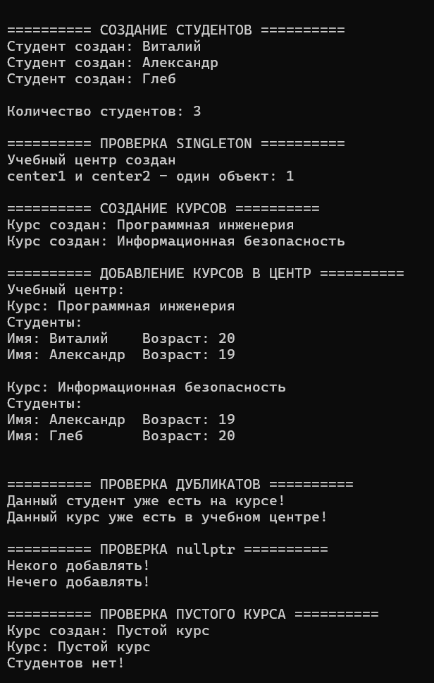
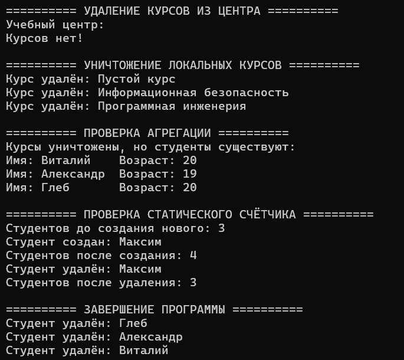

# Отчёт по лабораторной работе №1

**Дисциплина:** Алгоритмы и структуры данных  
**Тема:** Композиция и агрегация классов. Статические члены  
**Уровень:** Продвинутый  
**Вариант:** 5  
**Студент:** Власенко Александр Андреевич  
**Группа:** ПИЖ-б-о-25-1  
**Год:** 2026

---

## 1. Цель работы

Изучить способы организации отношений между классами C++, научиться различать композицию и агрегацию по времени жизни объектов. Получить практические навыки использования указателей, статических полей и методов, а также паттерна проектирования «Одиночка» (Singleton). Реализовать систему управления учебными курсами с безопасным добавлением и исключением объектов из списков.

## 2. Теоретическая часть

### 2.1. Отношения между классами

В объектно-ориентированном программировании классы могут взаимодействовать через ассоциацию, агрегацию и композицию.

**Ассоциация** – общее отношение, при котором один объект знает о другом или использует его. Например, преподаватель проводит занятие со студентом.

**Агрегация** – отношение «часть–целое», в котором часть может существовать независимо от целого. Объект-контейнер не отвечает за уничтожение объектов, на которые ссылается. В C++ агрегацию можно реализовать через указатели или ссылки. В программе учебный центр хранит указатели на курсы, а каждый курс – указатели на студентов.

**Композиция** – отношение «часть–целое», в котором целое владеет частями и контролирует время их жизни. Например, объект `House` может содержать поля-объекты `Room`. Когда дом уничтожается, его комнаты автоматически уничтожаются. Для композиции применяются поля-объекты и владеющие умные указатели, например `std::unique_ptr`.

| Признак | Агрегация | Композиция |
|---|---|---|
| Владение частью | Не предполагается | Предполагается |
| Время жизни части | Независимо от целого | Контролируется целым |
| Типичная реализация | Указатели и ссылки | Поля-объекты, `unique_ptr` |
| Пример | Курс и студент | Дом и комната |

### 2.2. Конструкторы, деструкторы и память

Конструктор вызывается при создании объекта и инициализирует его поля. Деструктор вызывается при уничтожении объекта и служит для освобождения ресурсов, если они используются. Локальные объекты с автоматическим временем хранения уничтожаются после выхода из области видимости в обратном порядке создания.

При агрегации удаление указателя из контейнера `std::vector<Course*>` методом `erase()` не уничтожает сам объект `Course`. Это позволяет независимо управлять временем жизни учебного центра и курсов. Для предотвращения обращения к уничтоженным объектам курс удаляется из списка учебного центра до завершения его времени жизни.

### 2.3. Статические члены класса

**Статическое поле** – переменная, принадлежащая классу в целом, а не отдельному экземпляру. Все объекты используют одно общее значение. В классе `Student` поле `static int count` хранит количество существующих студентов: конструктор увеличивает счётчик, а деструктор уменьшает.

**Статический метод** можно вызвать через имя класса без создания объекта, например `Student::getCount()`. Он не имеет указателя `this` и поэтому не обращается напрямую к нестатическим полям без указания конкретного объекта.

### 2.4. Паттерн «Одиночка» (Singleton)

Singleton – паттерн, обеспечивающий наличие единственного экземпляра класса и предоставляющий к нему общую точку доступа. В `TrainingCenter` конструктор закрыт, а копирование запрещено. Статический метод `getInstance()` возвращает ссылку на локальный статический объект, который создаётся при первом вызове и повторно используется далее.

## 3. Постановка задачи

**Продвинутый уровень, вариант 5:** «Система управления курсами: TrainingCenter (одиночка) + Course (агрегация) + Student (агрегация в Course)».

Согласно общим требованиям продвинутого уровня необходимо:

1. Реализовать отношения между классами в соответствии с вариантом.
2. Добавить статическое поле для подсчёта объектов одного из классов.
3. Реализовать паттерн Singleton для одного из классов.
4. Продемонстрировать работу всех реализованных возможностей.

Программа должна создавать студентов и курсы, записывать студентов на курсы, добавлять и исключать курсы из учебного центра, выводить данные, проверять единственность `TrainingCenter`, считать существующие объекты `Student` и обрабатывать некорректные либо повторные добавления.

## 4. Листинг программы

Ниже приведён исходный код итогового решения на C++ с комментариями.

```cpp
#include <iostream>
#include <string>
#include <vector>

class Student {
public:
    Student(std::string name, unsigned age) : name{name}, age{age} {
        std::cout << "Студент создан: " << name << std::endl;
        count++;
    }

    ~Student() {
        std::cout << "Студент удалён: " << name << std::endl;
        count--;
    }

    Student(const Student&) = delete;
    Student& operator=(const Student&) = delete;

    void printInfo() const {
        std::cout << "Имя: " << name << "\tВозраст: " << age << std::endl;
    }

    static int getCount() {
        return count;
    }

private:
    std::string name;
    unsigned age;
    static int count; // Общий счётчик студентов
};

int Student::count = 0;

class Course {
public:
    Course(std::string title) : title{title} {
        std::cout << "Курс создан: " << title << std::endl;
    }

    ~Course() {
        std::cout << "Курс удалён: " << title << std::endl;
    }

    void addStudent(Student* student) {
        if (student == nullptr) {
            std::cout << "Некого добавлять!" << std::endl;
            return;
        }

        for (Student* c_student : students) {
            if (c_student == student) {
                std::cout << "Данный студент уже есть на курсе!" << std::endl;
                return;
            }
        }

        students.push_back(student);
    }

    void printInfo() const {
        std::cout << "Курс: " << title << std::endl;

        if (students.empty()) {
            std::cout << "Студентов нет!" << std::endl;
            return;
        }

        std::cout << "Студенты:" << std::endl;

        for (Student* student : students) {
            student->printInfo();
        }
    }

private:
    std::string title;
    std::vector<Student*> students; // Агрегация: студенты существуют отдельно от курса
};

class TrainingCenter {
public:
    TrainingCenter(const TrainingCenter&) = delete;
    TrainingCenter& operator=(const TrainingCenter&) = delete;

    static TrainingCenter& getInstance() {
        static TrainingCenter instance;
        return instance;
    }

    void addCourse(Course* course) {
        if (course == nullptr) {
            std::cout << "Нечего добавлять!" << std::endl;
            return;
        }

        for (Course* c_course : courses) {
            if (c_course == course) {
                std::cout << "Данный курс уже есть в учебном центре!" << std::endl;
                return;
            }
        }

        courses.push_back(course);
    }

    void removeCourse(Course* course) {
        for (auto it = courses.begin(); it != courses.end(); ++it) {
            if (*it == course) {
                courses.erase(it); // Удаляем указатель, а не сам курс
                return;
            }
        }
    }

    void printInfo() const {
        std::cout << "Учебный центр:" << std::endl;

        if (courses.empty()) {
            std::cout << "Курсов нет!" << std::endl;
            return;
        }

        for (Course* course : courses) {
            course->printInfo();
            std::cout << std::endl;
        }
    }

private:
    TrainingCenter() {
        std::cout << "Учебный центр создан" << std::endl;
    }

    std::vector<Course*> courses; // Агрегация курсов
};

int main() {
    setlocale(LC_ALL, "Ru");

    std::cout << "\n========== СОЗДАНИЕ СТУДЕНТОВ ==========\n";

    Student s1{"Виталий", 20};
    Student s2{"Александр", 19};
    Student s3{"Глеб", 20};

    std::cout << "\nКоличество студентов: " << Student::getCount() << std::endl;

    std::cout << "\n========== ПРОВЕРКА SINGLETON ==========\n";

    TrainingCenter& center1 = TrainingCenter::getInstance();
    TrainingCenter& center2 = TrainingCenter::getInstance();

    std::cout << "center1 и center2 - один объект: "
              << (&center1 == &center2) << std::endl; // 1 - один экземпляр

    {
        std::cout << "\n========== СОЗДАНИЕ КУРСОВ ==========\n";

        Course c1{"Программная инженерия"};
        c1.addStudent(&s1);
        c1.addStudent(&s2);

        Course c2{"Информационная безопасность"};
        c2.addStudent(&s2);
        c2.addStudent(&s3);

        std::cout << "\n========== ДОБАВЛЕНИЕ КУРСОВ В ЦЕНТР ==========\n";

        center1.addCourse(&c1);
        center1.addCourse(&c2);

        center1.printInfo();

        std::cout << "\n========== ПРОВЕРКА ДУБЛИКАТОВ ==========\n";

        c1.addStudent(&s2);
        center1.addCourse(&c2);

        std::cout << "\n========== ПРОВЕРКА nullptr ==========\n";

        c1.addStudent(nullptr);
        center1.addCourse(nullptr);

        std::cout << "\n========== ПРОВЕРКА ПУСТОГО КУРСА ==========\n";

        Course emptyCourse{"Пустой курс"};
        emptyCourse.printInfo();

        std::cout << "\n========== УДАЛЕНИЕ КУРСОВ ИЗ ЦЕНТРА ==========\n";

        center1.removeCourse(&c1);
        center1.removeCourse(&c2);

        // Повторное удаление несуществующего в центре курса
        center1.removeCourse(&c1);

        center1.printInfo();

        std::cout << "\n========== УНИЧТОЖЕНИЕ ЛОКАЛЬНЫХ КУРСОВ ==========\n";
    }

    std::cout << "\n========== ПРОВЕРКА АГРЕГАЦИИ ==========\n";

    std::cout << "Курсы уничтожены, но студенты существуют:\n";
    s1.printInfo();
    s2.printInfo();
    s3.printInfo();

    std::cout << "\n========== ПРОВЕРКА СТАТИЧЕСКОГО СЧЁТЧИКА ==========\n";

    std::cout << "Студентов до создания нового: "
              << Student::getCount() << std::endl;

    {
        Student s4{"Максим", 21};

        std::cout << "Студентов после создания: "
                  << Student::getCount() << std::endl;
    }

    std::cout << "Студентов после удаления: "
              << Student::getCount() << std::endl;

    std::cout << "\n========== ЗАВЕРШЕНИЕ ПРОГРАММЫ ==========\n";

    return 0;
}
```

## 5. Результаты работы

Ниже приведён вывод проверенного запуска.

```text

========== СОЗДАНИЕ СТУДЕНТОВ ==========
Студент создан: Виталий
Студент создан: Александр
Студент создан: Глеб

Количество студентов: 3

========== ПРОВЕРКА SINGLETON ==========
Учебный центр создан
center1 и center2 - один объект: 1

========== СОЗДАНИЕ КУРСОВ ==========
Курс создан: Программная инженерия
Курс создан: Информационная безопасность

========== ДОБАВЛЕНИЕ КУРСОВ В ЦЕНТР ==========
Учебный центр:
Курс: Программная инженерия
Студенты:
Имя: Виталий	Возраст: 20
Имя: Александр	Возраст: 19

Курс: Информационная безопасность
Студенты:
Имя: Александр	Возраст: 19
Имя: Глеб	Возраст: 20


========== ПРОВЕРКА ДУБЛИКАТОВ ==========
Данный студент уже есть на курсе!
Данный курс уже есть в учебном центре!

========== ПРОВЕРКА nullptr ==========
Некого добавлять!
Нечего добавлять!

========== ПРОВЕРКА ПУСТОГО КУРСА ==========
Курс создан: Пустой курс
Курс: Пустой курс
Студентов нет!

========== УДАЛЕНИЕ КУРСОВ ИЗ ЦЕНТРА ==========
Учебный центр:
Курсов нет!

========== УНИЧТОЖЕНИЕ ЛОКАЛЬНЫХ КУРСОВ ==========
Курс удалён: Пустой курс
Курс удалён: Информационная безопасность
Курс удалён: Программная инженерия

========== ПРОВЕРКА АГРЕГАЦИИ ==========
Курсы уничтожены, но студенты существуют:
Имя: Виталий	Возраст: 20
Имя: Александр	Возраст: 19
Имя: Глеб	Возраст: 20

========== ПРОВЕРКА СТАТИЧЕСКОГО СЧЁТЧИКА ==========
Студентов до создания нового: 3
Студент создан: Максим
Студентов после создания: 4
Студент удалён: Максим
Студентов после удаления: 3

========== ЗАВЕРШЕНИЕ ПРОГРАММЫ ==========
Студент удалён: Глеб
Студент удалён: Александр
Студент удалён: Виталий
```

Скриншоты:





**Анализ результатов.** Получение двух ссылок `center1` и `center2` возвращает один объект (`1` при сравнении адресов). Учебный центр содержит два основных курса. Повторное добавление студента и курса обнаруживается, передача `nullptr` отклоняется, пустой курс выводит соответствующее сообщение. После исключения курсов из учебного центра и завершения их области видимости студенты остаются доступны. Статический счётчик последовательно принимает значения `3`, `4`, `3` при создании и уничтожении временного студента Максима. Дополнительно создаётся тестовый пустой курс, который не добавляется в учебный центр.

## 6. Ответы на контрольные вопросы

**1. Что такое композиция? Приведите пример. –** Композиция – отношение между классами «часть–целое», при котором целый объект владеет составными частями и контролирует их время жизни. Например, класс `House` содержит поля-объекты `Room`. При уничтожении дома принадлежащие ему комнаты уничтожаются автоматически.

**2. Что такое агрегация? Чем она отличается от композиции? –** Агрегация – отношение «часть–целое», при котором объекты-части могут существовать отдельно от целого. Например, студенты не перестают существовать после закрытия курса. В отличие от композиции, агрегирующий объект не управляет уничтожением частей.

**3. Как реализовать композицию в C++? Приведите пример кода. –** Простой способ – объявить объект части полем класса целого: `class Room {}; class House { Room room; };`. Поле `room` создаётся вместе с `House` и автоматически уничтожается вместе с ним. Также для владеющей динамической части можно использовать `std::unique_ptr`.

**4. Как реализовать агрегацию в C++? Приведите пример кода. –** Агрегация реализуется через указатели или ссылки на независимо созданные объекты. Например:
```cpp
class Student {
public:
    void printInfo() const {
        std::cout << "Информация о студенте" << std::endl;
    }
};

class Course {
private:
    std::vector<Student*> students;

public:
    void addStudent(Student* student) {
        if (student != nullptr) {
            students.push_back(student);
        }
    }
};

int main() {
    Student s1;

    {
        Course course;
        course.addStudent(&s1);
    }

    s1.printInfo();

    return 0;
}
```
 Уничтожение объекта `Course` уничтожит вектор указателей, но не сами объекты `Student`.

**5. В чём разница между временем жизни частей при композиции и агрегации? –** При композиции время жизни составных частей контролируется целым: при уничтожении владельца уничтожаются и принадлежащие ему части. При агрегации объекты живут независимо и могут продолжить существовать после уничтожения агрегирующего объекта.

**6. Что такое статическое поле класса? Чем оно отличается от обычного поля? –** Статическое поле – общая переменная класса, существующая в одном экземпляре для всех объектов. Обычное поле хранится отдельно у каждого экземпляра. Например, `Student::count` – общий счётчик студентов, а `name` – личное имя конкретного студента.

**7. Как объявить и определить статическое поле? Где оно хранится? –** Внутри класса записывают объявление `static int count;`, а вне класса – определение `int Student::count = 0;`. Статическое поле имеет статическую продолжительность хранения и не является отдельной частью памяти каждого объекта. Обычно оно размещается в области данных программы, а не внутри объектов класса.

**8. Что такое статический метод? Можно ли из него обратиться к нестатическим полям? –** Статический метод принадлежит классу и вызывается без конкретного экземпляра, например `Student::getCount()`. У него нет `this`, поэтому напрямую обратиться к нестатическому полю он не может. Для этого нужно явно получить ссылку или указатель на конкретный объект.

**9. Для чего используются статические счётчики объектов? –** Они помогают учитывать количество созданных или одновременно существующих объектов определённого класса. Для учёта живых объектов счётчик увеличивают при создании и уменьшают при уничтожении. В программе это позволяет вывести текущее количество студентов. Дополнительно запрещено копирование `Student`, чтобы копии не нарушали счётчик.

**10. Что такое паттерн «Одиночка» (Singleton)? Для чего он нужен? –** Singleton – паттерн проектирования, ограничивающий класс одним экземпляром и обеспечивающий общую точку доступа к нему. Он нужен, когда в приложении должен быть один управляющий объект. В работе таким объектом является `TrainingCenter`, доступный через `getInstance()`.

**11. Как запретить создание копий объекта (конструктор копирования)? –** Конструктор копирования можно удалить объявлением `ClassName(const ClassName&) = delete;`. Для запрета копирующего присваивания добавляют `ClassName& operator=(const ClassName&) = delete;`. Такой подход используется в `TrainingCenter` и `Student`.

**12. В каком порядке вызываются конструкторы и деструкторы при композиции? –** При создании целого сначала инициализируются его базовые классы и поля-объекты, затем выполняется тело конструктора целого. Поля создаются в порядке их объявления в классе. При уничтожении сначала выполняется тело деструктора целого, после чего поля уничтожаются в обратном порядке их создания.

**13. Можно ли изменить статическое поле из обычного метода? –** Да. Обычный метод имеет доступ к статическим полям класса с учётом правил доступа `public` и `private`. Например, конструктор `Student` изменяет общее поле `count` через операцию `count++`.

**14. Почему статические поля нужно определять вне класса? –** В традиционной записи C++ объявление `static int count;` внутри класса не является определением переменной с выделением хранения. Для такого поля требуется отдельное определение, например `int Student::count = 0;`, чтобы программа имела единственный экземпляр переменной. Начиная с C++17 существует исключение: `inline static` можно определить прямо внутри класса.

**15. В каких случаях стоит использовать композицию, а в каких – агрегацию? –** Композицию применяют, когда часть принадлежит целому и её время жизни должно контролироваться владельцем, например комната в модели дома. Агрегация подходит, когда объекты независимы и могут использоваться несколькими другими объектами, например студент может быть записан одновременно на несколько курсов.

## 7. Выводы

В ходе лабораторной работы были изучены различия композиции и агрегации, а также правила управления временем жизни объектов C++. Была разработана система управления курсами с тремя основными классами: `TrainingCenter`, `Course` и `Student`. В программе реализованы две связи агрегации, Singleton для учебного центра и статический счётчик студентов. Проверены добавление, поиск дубликатов, обработка `nullptr`, работа с пустыми списками и независимость времени жизни студентов и курсов. Получены навыки использования `std::vector`, указателей, конструкторов, деструкторов и статических членов классов.

## 8. Ссылка на Git-репозиторий

https://github.com/lostmoth/student-dsa-course
