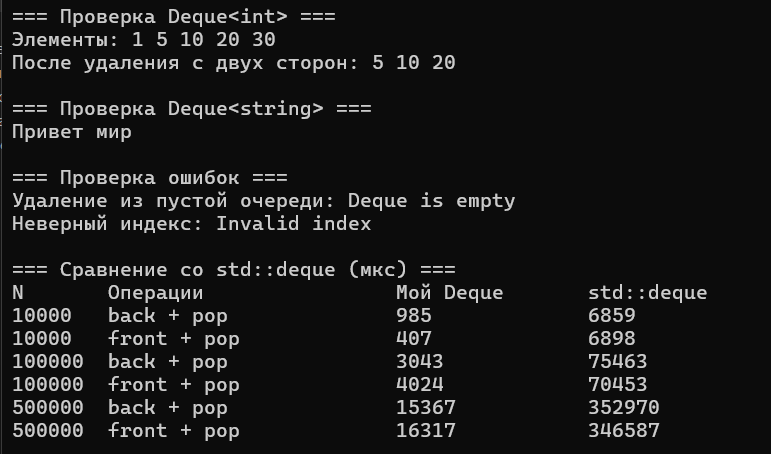

# Лабораторная работа №2

## Титульный лист

**Дисциплина:** Алгоритмы и структуры данных  
**Тема:** Анализ сложности алгоритмов. Шаблоны классов  
**Уровень:** Продвинутый  
**Вариант:** 5  
**Студент:** Власенко Александр Андреевич
**Группа:** ПИЖ-б-о-25-1 
**Год:** 2026

---

## 1. Цель работы

Изучить способы оценки временной и пространственной сложности алгоритмов с помощью О-нотации, освоить разработку шаблонных классов в C++, реализовать собственный двусторонний контейнер `Deque<T>`, исследовать сложность его операций и сравнить скорость работы со стандартным контейнером `std::deque`.

## 2. Теоретическая часть

### 2.1. Анализ сложности алгоритмов и О-нотация

Анализ сложности позволяет определить, как изменяются затраты времени и памяти с ростом размера входных данных `n`. Временная сложность характеризует рост числа выполняемых действий, а пространственная – объём используемой памяти. О-нотация (Big O) задаёт асимптотическую верхнюю границу роста: `f(n) = O(g(n))`, если существуют положительные константы `c` и `n₀`, для которых `0 ≤ f(n) ≤ c·g(n)` при всех `n ≥ n₀`. При оценке обычно опускают постоянные множители и слагаемые меньшего порядка: например, `5n + 3` имеет сложность `O(n)`.

### 2.2. Основные классы сложности

| Класс | Название | Пример |
|---|---|---|
| `O(1)` | Константная | Доступ к элементу массива по индексу |
| `O(log n)` | Логарифмическая | Бинарный поиск в отсортированном массиве |
| `O(n)` | Линейная | Последовательный поиск |
| `O(n log n)` | Линейно-логарифмическая | Сортировка слиянием |
| `O(n²)` | Квадратичная | Пузырьковая сортировка в худшем случае |
| `O(2ⁿ)` | Экспоненциальная | Наивное рекурсивное вычисление Фибоначчи (верхняя оценка) |
| `O(n!)` | Факториальная | Перебор всех перестановок |

Два последовательных цикла длины `n` обычно имеют сложность `O(n)`, а два вложенных цикла той же длины – `O(n²)`. Цикл с делением размера задачи пополам обычно имеет сложность `O(log n)`.

### 2.3. Шаблоны функций и классов

Шаблоны C++ позволяют описывать алгоритмы и структуры данных независимо от конкретного типа элементов. Конструкция `template <typename T>` объявляет параметр типа. Например, из одного шаблона класса можно создать `Deque<int>` и `Deque<std::string>`. Типы должны поддерживать операции, используемые внутри шаблона.

### 2.4. Двусторонняя очередь и кольцевой массив

Deque (double-ended queue) – контейнер, допускающий добавление и удаление элементов с обоих концов. В данной работе он реализован как кольцевой динамический массив. Поле `first` задаёт физический индекс начала, `count` – число логических элементов, `capacity` – вместимость, `data` – выделенный массив. Индекс элемента с логическим номером `i` вычисляется как `(first + i) % capacity`.

При достижении конца выделенного массива индексы переходят к его началу. Поэтому удаление первого элемента не требует сдвига всего массива. При заполнении вместимость удваивается, а элементы переносятся в новый массив в логическом порядке.

### 2.5. Амортизированная сложность

Отдельное добавление при заполненном массиве вызывает перенос `n` элементов за `O(n)`. Однако вместимость увеличивается вдвое, поэтому дорогие расширения происходят редко. В длинной последовательности добавлений средняя стоимость одного добавления по амортизированному анализу составляет `O(1)` для элементов с постоянной стоимостью копирования или перемещения.

### 2.6. Экспериментальное измерение времени

Для измерения используются `std::chrono::steady_clock`, отметки времени до и после последовательности операций и перевод разности в микросекунды. Сравнение проводится для одинаковых размеров входных данных. Результаты зависят от компьютера, компилятора, оптимизаций и фоновой нагрузки; одиночный запуск позволяет получить лишь ориентировочную оценку.

## 3. Постановка задачи

**Продвинутый уровень, вариант 5:** разработать шаблонный контейнер `Deque<T>` с операциями `push_front`, `push_back`, `pop_front`, `pop_back`, `operator[]`. Определить асимптотическую сложность каждой операции. Провести экспериментальное сравнение производительности собственного контейнера с аналогом стандартной библиотеки C++ (`std::deque`).

Для демонстрации реализовать тесты разных типов данных, расширения вместимости и обработки ошибочных операций.

## 4. Листинг программы

Ниже приведён итоговый согласованный исходный код на C++ без изменений.

```cpp
#include <iostream>
#include <deque>
#include <chrono>
#include <stdexcept>
#include <string>
using namespace std;

template <typename T>
class Deque {
private:
    T* data;
    int capacity;
    int count;
    int first;

    void resize() {
        int newCapacity = capacity * 2;
        T* newData = new T[newCapacity];
        for (int i = 0; i < count; i++) {
            newData[i] = data[(first + i) % capacity];
        }
        delete[] data;
        data = newData;
        capacity = newCapacity;
        first = 0;
    }

public:
    Deque() : capacity(4), count(0), first(0) {
        data = new T[capacity];
    }

    ~Deque() {
        delete[] data;
    }

    Deque(const Deque&) = delete;
    Deque& operator=(const Deque&) = delete;

    void push_back(const T& value) {
        if (count == capacity) resize();
        data[(first + count) % capacity] = value;
        count++;
    }

    void push_front(const T& value) {
        if (count == capacity) resize();
        first = (first - 1 + capacity) % capacity;
        data[first] = value;
        count++;
    }

    void pop_back() {
        if (count == 0) throw out_of_range("Deque is empty");
        count--;
        if (count == 0) first = 0;
    }

    void pop_front() {
        if (count == 0) throw out_of_range("Deque is empty");
        first = (first + 1) % capacity;
        count--;
        if (count == 0) first = 0;
    }

    T& operator[](int index) {
        if (index < 0 || index >= count) throw out_of_range("Invalid index");
        return data[(first + index) % capacity];
    }

    const T& operator[](int index) const {
        if (index < 0 || index >= count) throw out_of_range("Invalid index");
        return data[(first + index) % capacity];
    }

    int size() const { return count; }
    bool empty() const { return count == 0; }
};

template <typename Func>
long long measureTime(Func func) {
    auto start = chrono::steady_clock::now();
    func();
    auto end = chrono::steady_clock::now();
    return chrono::duration_cast<chrono::microseconds>(end - start).count();
}

int main() {
    setlocale(LC_ALL, "");

    cout << "=== Проверка Deque<int> ===\n";
    Deque<int> d;
    d.push_back(10);
    d.push_back(20);
    d.push_front(5);
    d.push_front(1);
    d.push_back(30); // Вызывает расширение массива

    cout << "Элементы: ";
    for (int i = 0; i < d.size(); i++) cout << d[i] << " ";
    cout << "\n";

    d.pop_front();
    d.pop_back();
    cout << "После удаления с двух сторон: ";
    for (int i = 0; i < d.size(); i++) cout << d[i] << " ";
    cout << "\n";

    cout << "\n=== Проверка Deque<string> ===\n";
    Deque<string> words;
    words.push_back("мир");
    words.push_front("Привет");
    cout << words[0] << " " << words[1] << "\n";

    cout << "\n=== Проверка ошибок ===\n";
    try {
        Deque<int> emptyDeque;
        emptyDeque.pop_front();
    } catch (const out_of_range& e) {
        cout << "Удаление из пустой очереди: " << e.what() << "\n";
    }
    try {
        cout << d[100] << "\n";
    } catch (const out_of_range& e) {
        cout << "Неверный индекс: " << e.what() << "\n";
    }

    cout << "\n=== Сравнение со std::deque (мкс) ===\n";
    cout << "N\tОперации\t\tМой Deque\tstd::deque\n";
    for (int n : {10000, 100000, 500000}) {
        long long myBack = measureTime([&]() {
            Deque<int> q;
            for (int i = 0; i < n; i++) q.push_back(i);
            for (int i = 0; i < n; i++) q.pop_back();
        });
        long long stlBack = measureTime([&]() {
            std::deque<int> q;
            for (int i = 0; i < n; i++) q.push_back(i);
            for (int i = 0; i < n; i++) q.pop_back();
        });
        long long myFront = measureTime([&]() {
            Deque<int> q;
            for (int i = 0; i < n; i++) q.push_front(i);
            for (int i = 0; i < n; i++) q.pop_front();
        });
        long long stlFront = measureTime([&]() {
            std::deque<int> q;
            for (int i = 0; i < n; i++) q.push_front(i);
            for (int i = 0; i < n; i++) q.pop_front();
        });
        cout << n << "\tback + pop\t\t" << myBack << "\t\t" << stlBack << "\n";
        cout << n << "\tfront + pop\t\t" << myFront << "\t\t" << stlFront << "\n";
    }
    return 0;
}
```

## 5. Результаты работы

### 5.1. Проверка функциональности

При контрольном запуске получено следующее:

Таким образом, проверены добавление и удаление с обеих сторон, сохранение порядка при расширении, работа шаблона с `int` и `string`, исключения при удалении из пустой очереди и при неверном индексе.

**Скриншот 1:** 


Таким образом, проверены добавление и удаление с обеих сторон, сохранение порядка при расширении, работа шаблона с `int` и `string`, исключения при удалении из пустой очереди и при неверном индексе.

### 5.2. Экспериментальное сравнение с STL


| N | Операции | Собственный `Deque<T>`, мкс | `std::deque`, мкс |
|---:|---|---:|---:|
| 10 000 | `push_back` + `pop_back` | 985 | 6859 |
| 10 000 | `push_front` + `pop_front` | 407 | 6898 |
| 100 000 | `push_back` + `pop_back` | 3043 | 75463 |
| 100 000 | `push_front` + `pop_front` | 4024 | 70453 |
| 500 000 | `push_back` + `pop_back` | 15357 | 352970 |
| 500 000 | `push_front` + `pop_front` | 16317 | 346587 |

Данная таблица взята из того же вывода программы, изображённого на скриншоте 1.

В контрольном запуске стандартный `std::deque` показал большее время во всех тестах. Таблица не доказывает постоянное превосходство одной реализации на любых платформах: для надёжного сравнения нужны повторные запуски и обработка результатов (например, медиана). Тесты включают не только операции добавления и удаления, но и создание и уничтожение локальных контейнеров; обе реализации измеряются по одинаковому сценарию.

## 6. Анализ сложности операций

| Операция | Временная сложность | Обоснование |
|---|---|---|
| Конструктор | `O(1)` при фиксированной начальной вместимости | Выделяются четыре ячейки |
| `push_back` | `O(1)` амортизированно; `O(n)` при расширении | Одна запись либо перенос всех элементов |
| `push_front` | `O(1)` амортизированно; `O(n)` при расширении | Пересчёт `first`, запись либо перенос |
| `pop_back` | `O(1)` | Уменьшение `count` |
| `pop_front` | `O(1)` | Обновление `first` и `count` |
| `operator[]` | `O(1)` | Проверка границ и вычисление индекса |
| `size` | `O(1)` | Чтение `count` |
| `empty` | `O(1)` | Проверка `count == 0` |
| `resize` | `O(n)` | Копирование `count` элементов |
| Деструктор | В общем случае `O(capacity)` | `delete[]` уничтожает выделенные объекты типа `T` |

Оценки для массового переноса предполагают постоянную стоимость присваивания элемента. За счёт геометрического расширения объём занятой контейнером памяти составляет `O(n)` относительно числа элементов при больших `n`. В момент расширения дополнительно требуется `O(n)` памяти.

**Особенность учебной реализации:** `new T[capacity]` сразу создаёт объекты во всех ячейках массива, а методы `pop_*` только уменьшают логический размер. Поэтому контейнер в данной форме рассчитан на типы с конструктором по умолчанию и операцией присваивания, а освобождение ресурсов удалённого элемента может откладываться до перезаписи ячейки или уничтожения массива. Для `int` и `std::string` в рамках текущих проверок это допустимое упрощение. Копирование самого `Deque` запрещено, чтобы избежать двойного освобождения выделенного массива.

## 7. Ответы на контрольные вопросы

**1. Что такое О-нотация (Big O) и зачем она нужна? –** О-нотация описывает верхнюю асимптотическую границу роста затрат алгоритма при увеличении размера входных данных. Она нужна для оценки масштабируемости алгоритмов и сравнения подходов независимо от конкретной скорости компьютера. Например, линейный поиск имеет худшую временную сложность `O(n)`.

**2. Какая сложность у доступа к элементу массива по индексу? Почему? –** `O(1)`, поскольку адрес элемента вычисляется по начальному адресу массива, размеру элемента и индексу. Для этого не требуется последовательно просматривать предыдущие элементы.

**3. Какая сложность у бинарного поиска? Почему? –** `O(log n)` в худшем случае, поскольку после каждой проверки в отсортированном массиве область поиска уменьшается приблизительно в два раза. Удвоение исходного количества элементов добавляет примерно одну проверку.

**4. Что означает сложность O(n log n)? Приведите пример алгоритма. –** Это означает, что затраты растут пропорционально произведению размера входа `n` и его логарифма. Пример – сортировка слиянием: массив рекурсивно делится на части за `O(log n)` уровней, а объединение на каждом уровне требует `O(n)` операций.

**5. Что такое амортизированный анализ? Приведите пример. –** Амортизированный анализ оценивает среднюю стоимость операции в последовательности действий с учётом редких дорогостоящих операций. Например, добавление в динамический массив обычно выполняется за `O(1)`, но иногда требует расширения и переноса `n` элементов за `O(n)`. При увеличении вместимости вдвое амортизированная стоимость добавления остаётся `O(1)`.

**6. Какая сложность у двух вложенных циклов по n итераций каждый? –** `O(n²)`, если тело внутреннего цикла выполняет постоянное количество действий. Внешний цикл делает `n` итераций, а на каждую из них приходится ещё `n` внутренних итераций, всего около `n²` действий.

**7. Какая сложность у рекурсивного вычисления чисел Фибоначчи? –** Наивная рекурсивная функция без запоминания промежуточных результатов имеет экспоненциальную временную сложность. Её часто оценивают верхней границей `O(2ⁿ)`; более точный порядок роста – `Θ(φⁿ)`, где `φ ≈ 1,618`. Это происходит из-за повторных вычислений одних и тех же значений.

**8. Что такое шаблоны функций? Как их объявить и использовать? –** Шаблон функции позволяет записать общий алгоритм для разных типов данных. Он объявляется с помощью `template <typename T>`, после чего тип `T` используется в параметрах и возвращаемом значении. Например:

```cpp
template <typename T>
T getMax(T a, T b) {
    return a > b ? a : b;
}

int a = getMax(3, 7);
double b = getMax(2.5, 4.1);
```

**9. Что такое шаблоны классов? Как их объявить и использовать? –** Шаблон класса определяет структуру и методы, которые могут работать с несколькими типами данных без дублирования кода. Например:

```cpp
template <typename T>
class Box {
    T value;
public:
    Box(T v) : value(v) {}
    T get() const { return value; }
};

Box<int> number(10);
Box<std::string> word("Hello");
```

**10. В чём преимущество шаблонов перед перегрузкой функций? –** Шаблоны сокращают повторение одинаковой логики для разных типов. Вместо нескольких перегрузок с практически одинаковыми телами достаточно одного шаблона. Перегрузка, в свою очередь, удобнее, когда для конкретных типов требуется различное поведение.

**11. Как указать, что шаблонный параметр – тип? –** Нужно записать `template <typename T>` или `template <class T>`. В данном контексте ключевые слова `typename` и `class` равнозначны.

**12. Можно ли создать шаблон с несколькими параметрами типов? –** Да. Например, `template <typename T1, typename T2> class Pair { ... };`. Такой класс может одновременно хранить значения разных типов, например `Pair<int, std::string>`.

**13. Как провести экспериментальное измерение времени выполнения? –** Можно использовать библиотеку `<chrono>`: получить время до исследуемой операции через `std::chrono::steady_clock::now()`, выполнить операцию, получить время после неё и вычислить разность. Результат при необходимости переводится в микросекунды с помощью `duration_cast`. Для сравнения алгоритмов важно использовать одинаковые условия и входные данные.

**14. Почему при измерении времени нужно выполнять операцию многократно? –** Одиночная быстрая операция может занимать слишком мало времени для достоверного измерения. Повторения увеличивают длительность измеряемого участка и уменьшают относительное влияние точности часов и случайных колебаний. Также желательно проводить несколько независимых серий измерений.

**15. Что важнее: сложность алгоритма или константа? –** Это зависит от размера данных и практических условий. Для больших `n` обычно решающую роль играет асимптотический рост, поэтому алгоритм с лучшей сложностью может значительно выигрывать. Для небольших данных константы, расходы на память и особенности реализации иногда важнее, поэтому полезно сочетать теоретический анализ с реальными измерениями.

## 8. Выводы

В ходе лабораторной работы изучены способы оценки временной и пространственной сложности алгоритмов, рассмотрены основные классы сложности и шаблоны C++. Реализован шаблонный контейнер `Deque<T>` на основе динамического кольцевого массива. Проверена работа операций добавления, удаления и обращения к элементу по индексу, а также обработка ошибок. Определена сложность операций; установлено, что добавление с обоих концов выполняется за `O(1)` амортизированно, а обращение по индексу и удаления – за `O(1)` при принятых предположениях. Экспериментальное сравнение со `std::deque` показало преимущество стандартной реализации в проведённом контрольном запуске. Получены навыки анализа сложности, работы с шаблонами, динамической памятью и измерением производительности.

## 9. Ссылка на Git-репозиторий

https://github.com/lostmoth/student-dsa-course
