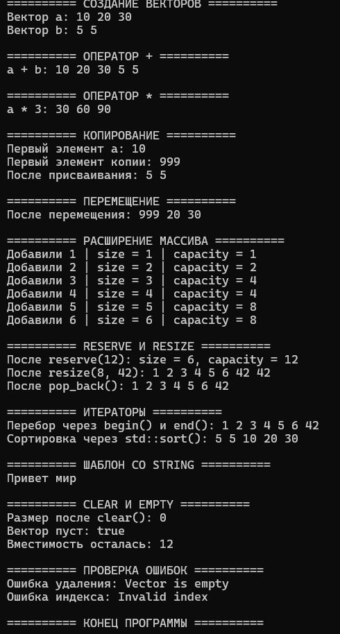

# Лабораторная работа №3

## Титульный лист

**Дисциплина:** Алгоритмы и структуры данных  
**Тема:** Реализация динамического массива (аналог vector). Итераторы  
**Уровень:** Продвинутый  
**Вариант:** 5  
**Студент:** Власенко Александр Андреевич 
**Группа:** ПИЖ-б-о-25-1
**Год:** 2026

---

## 1. Цель работы

Изучить устройство динамического массива и способы управления динамической памятью в C++. Создать шаблонный класс `Vector<T>` с конструкторами, деструктором, операциями копирования и перемещения по «правилу пяти», итераторами и основными методами работы с элементами. Реализовать операторы `+` для объединения векторов и `*` для умножения элементов на число, проанализировать сложность операций и проверить программу на практических примерах.

## 2. Теоретическая часть

### 2.1. Динамический массив

Динамический массив – структура данных, элементы которой располагаются в непрерывной области памяти, а вместимость может изменяться во время работы программы. В отличие от обычного массива фиксированного размера, динамический массив позволяет добавлять новые элементы, при необходимости выделяя дополнительную память.

В учебной реализации используется шаблон `template <typename T>`, благодаря которому можно создавать, например, `Vector<int>` и `Vector<std::string>`.

Основные поля класса:

- `T* data` – указатель на выделенный массив;
- `int sz` – количество логических элементов (`size`);
- `int cap` – вместимость выделенного массива (`capacity`).

Например, если `sz = 3`, а `cap = 8`, вектор содержит три элемента, но в выделенной памяти есть место ещё для пяти без расширения. Увеличение `capacity` не означает автоматического увеличения `size`.

### 2.2. Управление динамической памятью

Память под массив выделяется с помощью `new T[n]` и освобождается через `delete[]`. При заполнении массива создаётся новый массив большей вместимости, в него копируются элементы, после чего старая память освобождается. Для обычных операций добавления используется удвоение вместимости: `1 → 2 → 4 → 8 → 16`.

В нашей реализации метод `reserve(newCap)` увеличивает вместимость без изменения числа элементов. Метод `resize(newSize, value)` меняет количество элементов, при необходимости увеличивая вместимость и заполняя новые позиции заданным значением.

### 2.3. Правило трёх и правило пяти

**Правило трёх** применяется к классам, самостоятельно управляющим ресурсами, например динамической памятью. Если такой класс определяет деструктор, обычно необходимы также конструктор копирования и оператор копирующего присваивания. В противном случае копирование указателя может привести к двум объектам, пытающимся освободить одну и ту же память.

**Правило пяти** дополняет эти три метода конструктором перемещения и оператором перемещающего присваивания. При перемещении новый объект получает ресурсы исходного без поэлементного копирования; исходный объект переводится в безопасное пустое состояние. Конструктор и оператор перемещения в программе помечены `noexcept`.

Конструктор копирования создаёт новый объект, например `Vector<int> b(a)`, а оператор присваивания копирует данные в уже существующий объект, например `b = a`. Для копирующего присваивания применяется подход `copy-and-swap`: сначала создаётся временная копия, затем внутренние поля обмениваются. Условие `this != &other` защищает от самоприсваивания.

### 2.4. Глубокое копирование, перемещение и RAII

При поверхностном копировании указателя два объекта начинают использовать одну и ту же память. При глубоком копировании создаётся отдельный массив с теми же значениями. Поэтому изменение копии не должно менять исходный вектор.

Перемещение позволяет передать указатель на динамический массив другому объекту и избежать дорогостоящего копирования элементов. `std::move` позволяет выбрать перегрузку перемещения, а фактическую передачу ресурсов выполняет конструктор или оператор перемещения.

RAII (Resource Acquisition Is Initialization) – принцип, согласно которому объект управляет принадлежащим ему ресурсом: конструктор получает ресурс, а деструктор освобождает его. В нашем классе деструктор вызывает `delete[] data`. После перемещения исходный указатель становится `nullptr`, и повторного освобождения той же памяти не происходит.

### 2.5. Итераторы

Итератор – объект, позволяющий последовательно обращаться к элементам контейнера. Поскольку элементы `Vector<T>` расположены последовательно в памяти, в учебной реализации итераторами выступают указатели типа `T*`.

`begin()` возвращает указатель на первый элемент, а `end()` – указатель на позицию после последнего элемента. Эти методы обеспечивают работу цикла `for (int x : v)` и алгоритмов стандартной библиотеки, например `std::sort(v.begin(), v.end())`.

Для константного объекта реализованы перегрузки, возвращающие `const T*`. Если при расширении массива память перемещается по новому адресу, ранее полученные итераторы могут стать недействительными.

### 2.6. Амортизированный анализ `push_back`

Когда есть свободная вместимость, добавление в конец выполняется за `O(1)`. Если массив заполнен, требуется выделить память большего размера и перенести все существующие элементы, поэтому отдельная операция может занять `O(n)`.

При удвоении вместимости расширения происходят сравнительно редко. За последовательность из `n` добавлений суммарное количество перенесённых элементов ограничено величиной порядка `n`, поэтому **амортизированная сложность** одной операции `push_back` равна `O(1)`, если копирование отдельного элемента считается операцией постоянной стоимости.

### 2.7. Дополнительные операторы варианта 5

Оператор `+` выполняет **конкатенацию**: создаёт новый вектор, содержащий сначала элементы левого, затем правого операнда. Например, `[10, 20] + [30, 40]` даёт `[10, 20, 30, 40]`. Он не изменяет исходные векторы.

Оператор `*` создаёт новый вектор, в котором каждый элемент умножен на число: `[10, 20, 30] * 3` даёт `[30, 60, 90]`. Этот оператор используется для типов, поддерживающих умножение, например `int` и `double`.

## 3. Постановка задачи

**Продвинутый уровень, вариант 5:** реализовать шаблонный класс `Vector` с поддержкой «правила пяти», итераторами и дополнительной функциональностью – операторами `+` (конкатенация) и `*` (умножение на число).

Для выполнения задания также реализованы базовые операции динамического массива: конструкторы, деструктор, `push_back`, `pop_back`, `operator[]`, `size`, `capacity`, `empty`, `reserve`, `resize`, `clear`, методы `begin` и `end`. Необходимо продемонстрировать копирование и перемещение объектов, работу итераторов, расширение вместимости, обработку ошибочных ситуаций и определить сложность реализованных операций.

## 4. Листинг программы

Ниже приведён итоговый код на C++

```cpp
#include <iostream>
#include <string>
#include <stdexcept>
#include <utility>
#include <algorithm>

using namespace std;

template <typename T>
class Vector {
private:
    T* data;
    int sz;
    int cap;

    // Обмен содержимым двух векторов
    void swap(Vector& other) noexcept {
        std::swap(data, other.data);
        std::swap(sz, other.sz);
        std::swap(cap, other.cap);
    }

public:
    // Конструктор по умолчанию
    Vector() : data(nullptr), sz(0), cap(0) {}

    // Конструктор с заданным размером
    explicit Vector(int n) : data(nullptr), sz(0), cap(0) {
        if (n < 0)
            throw invalid_argument("Negative size");

        if (n > 0) {
            data = new T[n]{};
            sz = n;
            cap = n;
        }
    }

    // Конструктор с размером и значением
    Vector(int n, const T& value) : Vector(n) {
        for (int i = 0; i < sz; i++)
            data[i] = value;
    }

    // Конструктор копирования
    Vector(const Vector& other) : Vector(other.sz) {
        for (int i = 0; i < sz; i++)
            data[i] = other.data[i];
    }

    // Конструктор перемещения
    Vector(Vector&& other) noexcept
        : data(other.data), sz(other.sz), cap(other.cap) {
        other.data = nullptr;
        other.sz = 0;
        other.cap = 0;
    }

    // Деструктор
    ~Vector() {
        delete[] data;
    }

    // Присваивание копированием
    Vector& operator=(const Vector& other) {
        if (this != &other) {
            Vector temp(other);
            swap(temp);
        }
        return *this;
    }

    // Присваивание перемещением
    Vector& operator=(Vector&& other) noexcept {
        if (this != &other) {
            delete[] data;

            data = other.data;
            sz = other.sz;
            cap = other.cap;

            other.data = nullptr;
            other.sz = 0;
            other.cap = 0;
        }
        return *this;
    }

    int size() const {
        return sz;
    }

    int capacity() const {
        return cap;
    }

    bool empty() const {
        return sz == 0;
    }

    // Выделение памяти большей вместимости
    void reserve(int newCap) {
        if (newCap <= cap)
            return;

        T* newData = new T[newCap];

        try {
            for (int i = 0; i < sz; i++)
                newData[i] = data[i];
        }
        catch (...) {
            delete[] newData;
            throw;
        }

        delete[] data;
        data = newData;
        cap = newCap;
    }

    // Добавление в конец
    void push_back(const T& value) {
        if (sz == cap) {
            T saved = value;
            reserve(cap == 0 ? 1 : cap * 2);
            data[sz] = saved;
        }
        else {
            data[sz] = value;
        }

        sz++;
    }

    // Удаление последнего элемента
    void pop_back() {
        if (empty())
            throw out_of_range("Vector is empty");

        sz--;
    }

    // Изменение размера
    void resize(int newSize, const T& value = T()) {
        if (newSize < 0)
            throw invalid_argument("Negative size");

        if (newSize > sz) {
            T saved = value;

            if (newSize > cap)
                reserve(newSize);

            for (int i = sz; i < newSize; i++)
                data[i] = saved;
        }

        sz = newSize;
    }

    // Очистка вектора
    void clear() {
        sz = 0;
    }

    // Доступ по индексу
    T& operator[](int index) {
        if (index < 0 || index >= sz)
            throw out_of_range("Invalid index");

        return data[index];
    }

    const T& operator[](int index) const {
        if (index < 0 || index >= sz)
            throw out_of_range("Invalid index");

        return data[index];
    }

    // Итераторы
    T* begin() {
        return data;
    }

    T* end() {
        return data == nullptr ? nullptr : data + sz;
    }

    const T* begin() const {
        return data;
    }

    const T* end() const {
        return data == nullptr ? nullptr : data + sz;
    }

    // Конкатенация двух векторов
    Vector operator+(const Vector& other) const {
        Vector result(sz + other.sz);

        for (int i = 0; i < sz; i++)
            result.data[i] = data[i];

        for (int i = 0; i < other.sz; i++)
            result.data[sz + i] = other.data[i];

        return result;
    }

    // Умножение элементов на число
    Vector operator*(const T& number) const {
        Vector result(sz);

        for (int i = 0; i < sz; i++)
            result.data[i] = data[i] * number;

        return result;
    }
};

int main() {
    setlocale(LC_ALL, "");

    cout << "========== СОЗДАНИЕ ВЕКТОРОВ ==========\n";

    Vector<int> a(3);
    a[0] = 10;
    a[1] = 20;
    a[2] = 30;

    Vector<int> b(2, 5);

    cout << "Вектор a: ";
    for (int x : a)
        cout << x << " ";

    cout << "\nВектор b: ";
    for (int x : b)
        cout << x << " ";

    cout << "\n\n========== ОПЕРАТОР + ==========\n";

    Vector<int> c = a + b;

    cout << "a + b: ";
    for (int x : c)
        cout << x << " ";

    cout << "\n\n========== ОПЕРАТОР * ==========\n";

    Vector<int> d = a * 3;

    cout << "a * 3: ";
    for (int x : d)
        cout << x << " ";

    cout << "\n\n========== КОПИРОВАНИЕ ==========\n";

    Vector<int> copy(a);
    copy[0] = 999;

    cout << "Первый элемент a: " << a[0] << "\n";
    cout << "Первый элемент копии: " << copy[0] << "\n";

    Vector<int> assigned;
    assigned = b;
    assigned = assigned; // Проверка самоприсваивания

    cout << "После присваивания: ";
    for (int x : assigned)
        cout << x << " ";

    cout << "\n\n========== ПЕРЕМЕЩЕНИЕ ==========\n";

    Vector<int> moved(std::move(copy));

    Vector<int> movedAgain;
    movedAgain = std::move(moved);

    cout << "После перемещения: ";
    for (int x : movedAgain)
        cout << x << " ";

    cout << "\n\n========== РАСШИРЕНИЕ МАССИВА ==========\n";

    Vector<int> v;

    for (int i = 1; i <= 6; i++) {
        v.push_back(i);

        cout << "Добавили " << i
             << " | size = " << v.size()
             << " | capacity = " << v.capacity() << "\n";
    }

    cout << "\n========== RESERVE И RESIZE ==========\n";

    v.reserve(12);

    cout << "После reserve(12): size = " << v.size()
         << ", capacity = " << v.capacity() << "\n";

    v.resize(8, 42);

    cout << "После resize(8, 42): ";
    for (int x : v)
        cout << x << " ";

    v.pop_back();

    cout << "\nПосле pop_back(): ";
    for (int x : v)
        cout << x << " ";

    cout << "\n\n========== ИТЕРАТОРЫ ==========\n";

    cout << "Перебор через begin() и end(): ";

    for (auto it = v.begin(); it != v.end(); ++it)
        cout << *it << " ";

    cout << "\nСортировка через std::sort(): ";

    std::sort(c.begin(), c.end());

    for (int x : c)
        cout << x << " ";

    cout << "\n\n========== ШАБЛОН СО STRING ==========\n";

    Vector<string> words;
    words.push_back("Привет");
    words.push_back("мир");

    for (const string& word : words)
        cout << word << " ";

    cout << "\n\n========== CLEAR И EMPTY ==========\n";

    v.clear();

    cout << "Размер после clear(): " << v.size() << "\n";
    cout << "Вектор пуст: " << boolalpha << v.empty() << "\n";
    cout << "Вместимость осталась: " << v.capacity() << "\n";

    cout << "\n========== ПРОВЕРКА ОШИБОК ==========\n";

    try {
        v.pop_back();
    }
    catch (const out_of_range& e) {
        cout << "Ошибка удаления: " << e.what() << "\n";
    }

    try {
        cout << a[100];
    }
    catch (const out_of_range& e) {
        cout << "Ошибка индекса: " << e.what() << "\n";
    }

    cout << "\n========== КОНЕЦ ПРОГРАММЫ ==========\n";

    return 0;
}
```

## 5. Результаты работы

### Проверка функций программы

При контрольной сборке в режиме C++17 программа скомпилировалась и была запущена. Получен следующий вывод:



**Анализ полученных результатов:**

1. Векторы `a = [10, 20, 30]` и `b = [5, 5]` успешно созданы с помощью разных конструкторов.
2. Оператор `+` сформировал новый вектор `[10, 20, 30, 5, 5]`.
3. Оператор `*` создал результат `[30, 60, 90]` при умножении на 3.
4. При копировании изменение первого элемента копии на `999` не изменило исходное значение `10`. Это подтверждает независимость массивов.
5. Присваивание и самоприсваивание завершились корректно. При перемещении сохранились данные `[999, 20, 30]`.
6. При добавлении шести чисел вместимость менялась по последовательности `1, 2, 4, 4, 8, 8`, что демонстрирует стратегию удвоения.
7. `reserve(12)` увеличил вместимость до 12 при прежнем размере 6. `resize(8, 42)` добавил два элемента со значением 42.
8. `pop_back()` уменьшил размер на один. Перебор через итераторы и `range-based for` дал ожидаемые значения.
9. `std::sort` отсортировал вектор с помощью наших итераторов. Шаблон также сработал с типом `std::string`.
10. `clear()` установил размер 0 без изменения вместимости 12, а попытки удалить элемент из пустого вектора и прочитать индекс 100 вызвали обработанные исключения.

## 6. Анализ сложности реализованных операций

Пусть `n` – текущий размер вектора, `m` – размер второго вектора при конкатенации. Оценки ниже предполагают, что копирование, присваивание и арифметические операции для одного элемента выполняются за `O(1)`.

| Операция | Временная сложность | Обоснование |
|---|---|---|
| Конструктор по умолчанию | `O(1)` | Только инициализация трёх полей |
| Конструктор размера `n` | `O(n)` | Создание массива из `n` элементов |
| Конструктор размера `n` со значением | `O(n)` | Инициализация `n` элементов заданным значением |
| Конструктор копирования | `O(n)` | Создание нового массива и копирование `n` элементов |
| Конструктор перемещения | `O(1)` | Передача указателя и значений полей |
| Копирующее присваивание | `O(n + cap_старого)` в общем случае | Копирование `n` элементов и последующее освобождение старого массива; для простых типов обычно оценивают как `O(n)` |
| Перемещающее присваивание | `O(cap_старого)` в общем случае | Освобождение старого массива, затем передача указателя за `O(1)` |
| Деструктор | `O(cap)` в общем случае | `delete[]` освобождает массив и уничтожает выделенные объекты типа `T` |
| `size()` | `O(1)` | Возврат поля `sz` |
| `capacity()` | `O(1)` | Возврат поля `cap` |
| `empty()` | `O(1)` | Проверка `sz == 0` |
| `reserve(newCap)` | `O(n)` при расширении, иначе `O(1)` | Копирование имеющихся элементов в новый массив |
| `push_back()` | `O(1)` амортизированно, `O(n)` при расширении | Обычно одна запись, иногда перенос элементов |
| `pop_back()` | `O(1)` | Уменьшение логического размера |
| `resize(newSize)` | `O(newSize)` при увеличении; `O(1)` при уменьшении логического размера | Заполнение новых позиций, иногда расширение памяти |
| `clear()` | `O(1)` | Установка `sz = 0` |
| `operator[]` | `O(1)` | Вычисление адреса элемента по индексу |
| `begin()`, `end()` | `O(1)` | Возврат указателя |
| `operator+` | `O(n + m)` | Копирование элементов двух векторов в новый |
| `operator*` | `O(n)` | Умножение каждого элемента на число |

Для этой упрощённой реализации память, выделенная под элементы, имеет порядок `O(cap)`. При расширении дополнительно создаётся массив, также занимающий `O(newCap)` памяти. Увеличение вместимости вдвое обеспечивает амортизированную сложность `push_back` порядка `O(1)`.

**Особенность учебной реализации:** `new T[cap]` создаёт все элементы выделенного массива, в том числе пока не входящие в логический размер `sz`. Поэтому методы `pop_back`, `clear` и уменьшение `resize` изменяют только логический размер, не уничтожая сразу убранные объекты. Это упрощение соответствует использованному в методичке подходу и подходит для рассматриваемых типов, но не делает класс полной заменой `std::vector` для произвольных пользовательских типов. Исключения при копировании в конструкторах и при выполнении пользовательского присваивания требуют более развитого управления ресурсами для полной гарантии безопасности.

## 7. Ответы на контрольные вопросы

**1. Почему динамический массив называется «динамическим»? –** Потому что его вместимость можно изменять во время выполнения программы. Если текущая память заполнена, контейнер выделяет новый массив большей вместимости и переносит туда элементы. Поэтому количество хранимых элементов не ограничивается исходным фиксированным размером.

**2. Что такое ёмкость (capacity) и чем она отличается от размера (size)? –** `size` – фактическое число логических элементов вектора. `capacity` – количество элементов, для которых уже выделена память. Например, при `size = 5` и `capacity = 8` хранятся пять элементов, а ещё три можно добавить без повторного выделения памяти. При `reserve()` вместимость может увеличиваться, хотя размер остаётся прежним.

**3. Почему при расширении массива ёмкость удваивается, а не увеличивается на фиксированное число? –** Удвоение уменьшает частоту дорогостоящих расширений. При росте по схеме `1, 2, 4, 8, 16` каждое новое выделение происходит только после заполнения всё более крупного массива, а суммарное количество переносов при `n` добавлениях остаётся `O(n)`. Если каждый раз увеличивать ёмкость на фиксированное число, переносы будут происходить гораздо чаще и при последовательном добавлении большого числа элементов могут потребовать суммарно `O(n²)` операций.

**4. Какова амортизированная сложность операции push_back? Почему? –** Амортизированная сложность `push_back` составляет `O(1)`. Пока в массиве есть свободное место, запись нового элемента выполняется за постоянное время. Когда память заполнена, требуется расширение и копирование элементов за `O(n)`, но при удвоении вместимости такие случаи редки. Суммарная стоимость `n` последовательных добавлений составляет `O(n)`, поэтому на одно добавление в амортизированном анализе приходится `O(1)`.

**5. Что такое «правило трёх»? Когда оно применяется? –** Правило трёх гласит, что класс, самостоятельно владеющий ресурсом и определяющий деструктор, обычно должен также определять конструктор копирования и оператор копирующего присваивания. Оно применяется, например, при управлении динамическим массивом через указатель. Без правильного копирования два объекта могут ссылаться на одну область памяти и пытаться освободить её дважды.

**6. Что такое «правило пяти»? Чем оно отличается от «правила трёх»? –** Правило пяти включает пять специальных методов: деструктор, конструктор копирования, оператор копирующего присваивания, конструктор перемещения и оператор перемещающего присваивания. В отличие от правила трёх, оно учитывает семантику перемещения, появившуюся в C++11. Перемещение позволяет эффективно передавать ресурсы новому объекту без копирования всех элементов.

**7. В чём разница между конструктором копирования и оператором присваивания? –** Конструктор копирования создаёт новый объект на основе существующего: `Vector<int> b(a);`. Оператор присваивания заменяет содержимое объекта, который уже был создан: `b = a;`. При присваивании также необходимо правильно освободить прежние ресурсы и предусмотреть самоприсваивание.

**8. Зачем нужна проверка if (this != &other) в операторе присваивания? –** Она проверяет, не присваивается ли объект самому себе, например `a = a`. Если сначала удалить старую память без такой проверки, данные могут оказаться уничтожены до их копирования. В нашей реализации эта проверка также позволяет избежать ненужного создания временной копии при самоприсваивании.

**9. Что такое итератор? Как он связан с указателем? –** Итератор – средство последовательного доступа к элементам контейнера. Указатель может выступать итератором для элементов, расположенных непрерывно в памяти: `*it` получает элемент, а `++it` переходит к следующему. В нашем `Vector<T>` итераторы `begin()` и `end()` реализованы как обычные указатели `T*` или `const T*`.

**10. Зачем нужны методы begin() и end()? –** `begin()` возвращает итератор на первый элемент, а `end()` – итератор на позицию после последнего элемента. Они задают диапазон `[begin(), end())`, который можно использовать в циклах и алгоритмах стандартной библиотеки, например `std::sort`. При переборе элементы обрабатываются, пока текущий итератор не станет равным `end()`.

**11. Как реализовать range-based for для своего контейнера? –** Необходимо предоставить методы `begin()` и `end()`, возвращающие итераторы, поддерживающие сравнение, разыменование и переход к следующему элементу. Для динамического массива достаточно указателей: `T* begin() { return data; }` и `T* end() { return data == nullptr ? nullptr : data + sz; }`. После этого можно использовать цикл `for (int x : v)`, если `v` содержит элементы типа `int`.

**12. Что такое «глубокое копирование»? Чем оно отличается от «поверхностного»? –** При поверхностном копировании копируются значения полей, включая адрес динамического массива. Поэтому два объекта могут ссылаться на одну память. При глубоком копировании для нового объекта выделяется собственная память, в которую копируются значения элементов. В результате изменение копии не влияет на исходный объект, а их память можно безопасно освободить независимо.

**13. Что такое семантика перемещения и зачем она нужна? –** Семантика перемещения – способ передачи ресурсов из одного объекта в другой без дорогостоящего полного копирования. Например, вектор может передать новому объекту указатель на выделенный массив, а сам перейти в пустое состояние. Это особенно полезно при работе с временными объектами и большими контейнерами. Для выбора операции перемещения часто используется `std::move`.

**14. Почему конструктор перемещения помечается noexcept? –** `noexcept` указывает, что конструктор не выбрасывает исключений. Передача указателя и простых полей в нашей реализации не требует выделения памяти, поэтому может быть выполнена без исключений. Такая гарантия также позволяет стандартным контейнерам выбирать перемещение вместо копирования при некоторых операциях перераспределения памяти.

**15. Как правильно освобождать память в деструкторе? –** Если массив выделен через `new T[n]`, его необходимо освободить вызовом `delete[] data;`, а не обычным `delete`. Освобождение должно происходить один раз для каждой принадлежащей объекту области памяти. При глубоком копировании каждый объект владеет своим массивом, а после перемещения указатель исходного объекта обнуляется. Вызов `delete[] nullptr` безопасен, поэтому такой деструктор корректно работает и для пустого вектора.

## 8. Выводы

В ходе лабораторной работы изучен принцип работы динамического массива и реализован шаблонный класс `Vector<T>` с возможностью изменения размера и вместимости. Освоены выделение и освобождение динамической памяти, создание глубоких копий и передача ресурсов с помощью перемещения.

Реализовано «правило пяти», включая защиту от самоприсваивания, а также итераторы `begin()` и `end()`, позволяющие применять `range-based for` и алгоритм `std::sort`. Для индивидуального варианта 5 разработаны операторы `+` для объединения двух векторов и `*` для умножения каждого элемента на число.

Проведён анализ сложности основных методов. Установлено, что доступ по индексу имеет сложность `O(1)`, копирование и конкатенация требуют линейного времени, а добавление в конец при стратегии удвоения вместимости имеет амортизированную сложность `O(1)`. Проверены обработка ошибок, изменение вместимости, работа с числами и строками. Поставленные задачи лабораторной работы выполнены в рамках учебной модели контейнера.

## 9. Ссылка на Git-репозиторий

https://github.com/lostmoth/student-dsa-course
