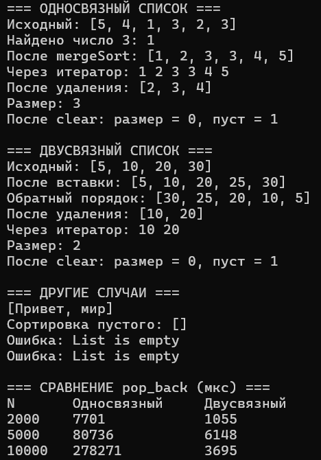

# Лабораторная работа №4

## Титульный лист

**Дисциплина:** Алгоритмы и структуры данных  
**Тема:** Односвязный и двусвязный списки    
**Уровень:** Продвинутый  
**Вариант:** 5  
**Студент:** Власенко Александр Андреевич 
**Группа:** ПИЖ-б-о-25-1
**Год:** 2026

---

## 1. Цель работы

Изучить устройство односвязного и двусвязного списков, реализовать их как шаблонные классы C++, научиться добавлять, удалять, искать и перебирать узлы с правильным управлением динамической памятью. Реализовать сортировку слиянием `mergeSort()` для односвязного списка, исследовать её принцип работы и сложность, сравнить производительность удаления элементов с конца для двух видов списков.

## 2. Теоретическая часть

### 2.1. Понятие связного списка

**Связный список** – структура данных, состоящая из отдельных узлов, связанных указателями. Узлы не обязаны располагаться подряд в памяти. Каждый узел содержит значение и адрес следующего узла, а в двусвязном списке также адрес предыдущего.

В отличие от динамического массива, в связном списке нельзя получить произвольный элемент напрямую по индексу. Чтобы найти узел с заданным порядковым номером, обычно требуется пройти от начала списка, поэтому сложность такого доступа – `O(n)`. Зато добавление узла в начало требует изменения фиксированного количества указателей и занимает `O(1)`.

### 2.2. Узел, head, tail и размер

Для односвязного списка применяется узел с полями `data` и `next`, для двусвязного – с полями `data`, `next` и `prev`.

- `head` – указатель на первый узел.
- `tail` – указатель на последний узел.
- `count` – количество узлов в списке.
- `nullptr` – отсутствие узла. В пустом списке и `head`, и `tail` равны `nullptr`.

При наличии `tail` вставка в конец любого из списков занимает `O(1)`. В односвязном списке удаление с конца всё равно требует поиска предпоследнего узла, поскольку указателя назад нет.

### 2.3. Основные действия с указателями

При `push_front()` создаётся новый узел, его `next` связывается со старым `head`, после чего `head` обновляется. Если список был пустым, `tail` также указывает на новый узел. При `push_back()` новый узел присоединяется через `tail->next`, затем обновляется `tail`.

При удалении необходимо сначала сохранить адрес удаляемого узла, изменить связи между оставшимися узлами и только после этого выполнить `delete`. Так мы не теряем доступ к остальной цепочке и не оставляем ссылки на освобождённую память. После удаления единственного узла оба указателя должны стать `nullptr`.

В двусвязном списке при вставке и удалении поддерживаются **обе** связи – `next` и `prev`. Благодаря `prev` удаление последнего узла выполняется за `O(1)` без обхода списка.

### 2.4. Динамическая память и деструктор

Каждый узел создаётся оператором `new Node(value)` и удаляется оператором `delete`. Метод `clear()` последовательно проходит по узлам, сохраняет адрес очередного узла до удаления текущего и освобождает память всех узлов. Деструктор вызывает `clear()`, реализуя принцип RAII – ресурс освобождается при уничтожении владеющего им объекта.

Обычное копирование указателей `head` и `tail` опасно: два объекта стали бы владеть одними узлами, что может привести к двойному `delete`. Поскольку копирование не требуется вариантом задания, оно явно запрещено через `= delete` для конструктора копирования и оператора присваивания.

### 2.5. Итераторы

Итератор хранит указатель на текущий узел, позволяет получать значение через `operator*`, переходить к следующему узлу через `operator++` и сравнивать текущую позицию с концом через `operator!=`.

Методы `begin()` и `end()` возвращают итераторы на первый узел и на позицию после последнего (`nullptr`). Благодаря им возможен цикл `for (int x : list)`. В программе реализован минимальный итератор для прямого обхода, а не полный набор итераторов стандартной библиотеки.

### 2.6. Сортировка слиянием (Merge Sort)

**Merge Sort** – рекурсивный алгоритм «разделяй и властвуй». Он делит список на две примерно равные части, сортирует каждую и объединяет отсортированные части.

Для поиска границы используется метод двух указателей: `slow` движется по одному узлу, а `fast` – по два. После нахождения середины связь `slow->next` обрывается, и получаются две независимые цепочки. Рекурсия останавливается, когда цепочка пуста или состоит из одного узла.

Функция `merge(a, b)` сравнивает значения голов двух отсортированных цепочек и каждый раз присоединяет узел с меньшим значением к результату. Указатели переставляются без выделения новых узлов. Если одна из цепочек закончилась, остаток второй присоединяется сразу. Проверка `last == nullptr` предотвращает обращение к нулевому указателю, когда одна из исходных цепочек была пустой.

На каждом уровне слияние требует `O(n)`, а число уровней разделения равно `O(log n)`. **Временная сложность – `O(n log n)`**, дополнительная память – `O(log n)` для стека рекурсии, поскольку слияние в программе выполняется итеративно. Сравнение через `<=` делает сортировку стабильной: равные элементы из левой половины остаются раньше равных элементов из правой.

После сортировки метод `mergeSort()` обновляет `head` и заново находит `tail`, чтобы последующие добавления в конец работали корректно.

### 2.7. Сравнение односвязного и двусвязного списков

| Характеристика | Односвязный список | Двусвязный список |
|---|---|---|
| Направление обхода | Вперёд | Вперёд и назад |
| Ссылки в каждом узле | `next` | `next` и `prev` |
| Вставка в начало | `O(1)` | `O(1)` |
| Вставка в конец при наличии `tail` | `O(1)` | `O(1)` |
| Удаление из начала | `O(1)` | `O(1)` |
| Удаление с конца | `O(n)` | `O(1)` |
| Поиск значения | `O(n)` | `O(n)` |
| Доступ по индексу | `O(n)` | `O(n)` |
| Дополнительная память на узел | Один указатель | Два указателя |

## 3. Постановка задачи

**Продвинутый уровень:** реализовать оба шаблонных класса `SinglyLinkedList<T>` и `DoublyLinkedList<T>` с полной базовой функциональностью. Дополнительно реализовать метод `mergeSort()` для односвязного списка.

Необходимо продемонстрировать вставку, удаление, поиск, вывод, очистку и проверку размера списков; реализовать итераторы для перебора элементов; обеспечить корректное управление памятью и обработку пустого списка; провести анализ временной сложности основных операций и сравнение производительности двух видов списков.

## 4. Листинг программы

Ниже приведён итоговый исходный код

```cpp
#include <iostream>
#include <string>
#include <stdexcept>
#include <chrono>

using namespace std;

// ОДНОСВЯЗНЫЙ СПИСОК
template <typename T>
class SinglyLinkedList {
private:
    struct Node {
        T data;
        Node* next;

        Node(const T& value) : data(value), next(nullptr) {}
    };

    Node* head;
    Node* tail;
    int count;

    // Слияние двух отсортированных цепочек
    static Node* merge(Node* a, Node* b) {
        Node* result = nullptr;
        Node* last = nullptr;

        while (a != nullptr && b != nullptr) {
            Node* chosen;

            if (a->data <= b->data) {
                chosen = a;
                a = a->next;
            }
            else {
                chosen = b;
                b = b->next;
            }

            if (result == nullptr)
                result = chosen;
            else
                last->next = chosen;

            last = chosen;
        }

        if (last == nullptr)
            return a != nullptr ? a : b;

        last->next = a != nullptr ? a : b;
        return result;
    }

    // Рекурсивная сортировка цепочки узлов
    static Node* sortNodes(Node* start) {
        if (start == nullptr || start->next == nullptr)
            return start;

        Node* slow = start;
        Node* fast = start->next;

        while (fast != nullptr && fast->next != nullptr) {
            slow = slow->next;
            fast = fast->next->next;
        }

        Node* second = slow->next;
        slow->next = nullptr; // Разделяем список на две части

        Node* left = sortNodes(start);
        Node* right = sortNodes(second);

        return merge(left, right);
    }

public:
    // Итератор для обхода списка
    class Iterator {
    private:
        Node* ptr;

    public:
        Iterator(Node* p) : ptr(p) {}

        T& operator*() const {
            return ptr->data;
        }

        Iterator& operator++() {
            ptr = ptr->next;
            return *this;
        }

        bool operator!=(const Iterator& other) const {
            return ptr != other.ptr;
        }
    };

    SinglyLinkedList() : head(nullptr), tail(nullptr), count(0) {}

    ~SinglyLinkedList() {
        clear();
    }

    // Запрещаем копирование, чтобы не удалить узлы дважды
    SinglyLinkedList(const SinglyLinkedList&) = delete;
    SinglyLinkedList& operator=(const SinglyLinkedList&) = delete;

    void push_front(const T& value) {
        Node* node = new Node(value);

        node->next = head;
        head = node;

        if (tail == nullptr)
            tail = node;

        count++;
    }

    void push_back(const T& value) {
        Node* node = new Node(value);

        if (tail == nullptr) {
            head = tail = node;
        }
        else {
            tail->next = node;
            tail = node;
        }

        count++;
    }

    void pop_front() {
        if (empty())
            throw underflow_error("List is empty");

        Node* old = head;
        head = head->next;

        delete old;

        if (head == nullptr)
            tail = nullptr;

        count--;
    }

    void pop_back() {
        if (empty())
            throw underflow_error("List is empty");

        if (head == tail) {
            delete head;
            head = tail = nullptr;
        }
        else {
            Node* current = head;

            while (current->next != tail)
                current = current->next;

            delete tail;
            tail = current;
            tail->next = nullptr;
        }

        count--;
    }

    Node* find(const T& value) const {
        Node* current = head;

        while (current != nullptr) {
            if (current->data == value)
                return current;

            current = current->next;
        }

        return nullptr;
    }

    bool remove(const T& value) {
        if (empty())
            return false;

        if (head->data == value) {
            pop_front();
            return true;
        }

        Node* current = head;

        while (current->next != nullptr &&
               current->next->data != value) {
            current = current->next;
        }

        if (current->next == nullptr)
            return false;

        Node* old = current->next;
        current->next = old->next;

        if (old == tail)
            tail = current;

        delete old;
        count--;

        return true;
    }

    // Сортировка слиянием
    void mergeSort() {
        head = sortNodes(head);

        // После сортировки обновляем tail
        tail = head;

        while (tail != nullptr && tail->next != nullptr)
            tail = tail->next;
    }

    void clear() {
        while (head != nullptr) {
            Node* old = head;
            head = head->next;
            delete old;
        }

        tail = nullptr;
        count = 0;
    }

    void print() const {
        cout << "[";

        Node* current = head;

        while (current != nullptr) {
            cout << current->data;

            if (current->next != nullptr)
                cout << ", ";

            current = current->next;
        }

        cout << "]\n";
    }

    int size() const {
        return count;
    }

    bool empty() const {
        return count == 0;
    }

    Iterator begin() {
        return Iterator(head);
    }

    Iterator end() {
        return Iterator(nullptr);
    }
};

// ДВУСВЯЗНЫЙ СПИСОК
template <typename T>
class DoublyLinkedList {
private:
    struct Node {
        T data;
        Node* prev;
        Node* next;

        Node(const T& value)
            : data(value), prev(nullptr), next(nullptr) {}
    };

    Node* head;
    Node* tail;
    int count;

public:
    // Итератор для обхода списка
    class Iterator {
    private:
        Node* ptr;

    public:
        Iterator(Node* p) : ptr(p) {}

        T& operator*() const {
            return ptr->data;
        }

        Iterator& operator++() {
            ptr = ptr->next;
            return *this;
        }

        bool operator!=(const Iterator& other) const {
            return ptr != other.ptr;
        }
    };

    DoublyLinkedList() : head(nullptr), tail(nullptr), count(0) {}

    ~DoublyLinkedList() {
        clear();
    }

    DoublyLinkedList(const DoublyLinkedList&) = delete;
    DoublyLinkedList& operator=(const DoublyLinkedList&) = delete;

    void push_front(const T& value) {
        Node* node = new Node(value);

        if (head == nullptr) {
            head = tail = node;
        }
        else {
            node->next = head;
            head->prev = node;
            head = node;
        }

        count++;
    }

    void push_back(const T& value) {
        Node* node = new Node(value);

        if (tail == nullptr) {
            head = tail = node;
        }
        else {
            tail->next = node;
            node->prev = tail;
            tail = node;
        }

        count++;
    }

    void pop_front() {
        if (empty())
            throw underflow_error("List is empty");

        Node* old = head;
        head = head->next;

        if (head != nullptr)
            head->prev = nullptr;
        else
            tail = nullptr;

        delete old;
        count--;
    }

    void pop_back() {
        if (empty())
            throw underflow_error("List is empty");

        Node* old = tail;
        tail = tail->prev;

        if (tail != nullptr)
            tail->next = nullptr;
        else
            head = nullptr;

        delete old;
        count--;
    }

    Node* find(const T& value) const {
        Node* current = head;

        while (current != nullptr) {
            if (current->data == value)
                return current;

            current = current->next;
        }

        return nullptr;
    }

    // Вставка после найденного узла
    void insert_after(Node* place, const T& value) {
        if (place == nullptr) {
            push_front(value);
            return;
        }

        if (place == tail) {
            push_back(value);
            return;
        }

        Node* node = new Node(value);

        node->next = place->next;
        node->prev = place;

        place->next->prev = node;
        place->next = node;

        count++;
    }

    // Удаление указанного узла
    void erase(Node* place) {
        if (place == nullptr)
            return;

        if (place == head) {
            pop_front();
            return;
        }

        if (place == tail) {
            pop_back();
            return;
        }

        place->prev->next = place->next;
        place->next->prev = place->prev;

        delete place;
        count--;
    }

    void print() const {
        cout << "[";

        Node* current = head;

        while (current != nullptr) {
            cout << current->data;

            if (current->next != nullptr)
                cout << ", ";

            current = current->next;
        }

        cout << "]\n";
    }

    void printReverse() const {
        cout << "[";

        Node* current = tail;

        while (current != nullptr) {
            cout << current->data;

            if (current->prev != nullptr)
                cout << ", ";

            current = current->prev;
        }

        cout << "]\n";
    }

    void clear() {
        while (head != nullptr) {
            Node* old = head;
            head = head->next;
            delete old;
        }

        tail = nullptr;
        count = 0;
    }

    int size() const {
        return count;
    }

    bool empty() const {
        return count == 0;
    }

    Iterator begin() {
        return Iterator(head);
    }

    Iterator end() {
        return Iterator(nullptr);
    }
};

int main() {
    setlocale(LC_ALL, "");

    cout << "=== ОДНОСВЯЗНЫЙ СПИСОК ===\n";

    SinglyLinkedList<int> singly;

    singly.push_back(4);
    singly.push_back(1);
    singly.push_back(3);
    singly.push_front(5);
    singly.push_back(2);
    singly.push_back(3);

    cout << "Исходный: ";
    singly.print();

    cout << "Найдено число 3: "
         << (singly.find(3) != nullptr) << "\n";

    singly.mergeSort();

    cout << "После mergeSort: ";
    singly.print();

    cout << "Через итератор: ";
    for (int x : singly)
        cout << x << " ";
    cout << "\n";

    singly.remove(3);
    singly.pop_front();
    singly.pop_back();

    cout << "После удаления: ";
    singly.print();

    cout << "Размер: " << singly.size() << "\n";

    singly.clear();

    cout << "После clear: размер = " << singly.size()
         << ", пуст = " << singly.empty() << "\n";

    cout << "\n=== ДВУСВЯЗНЫЙ СПИСОК ===\n";

    DoublyLinkedList<int> doubly;

    doubly.push_back(10);
    doubly.push_back(20);
    doubly.push_front(5);
    doubly.push_back(30);

    cout << "Исходный: ";
    doubly.print();

    doubly.insert_after(doubly.find(20), 25);

    cout << "После вставки: ";
    doubly.print();

    cout << "Обратный порядок: ";
    doubly.printReverse();

    doubly.erase(doubly.find(25));
    doubly.pop_front();
    doubly.pop_back();

    cout << "После удаления: ";
    doubly.print();

    cout << "Через итератор: ";
    for (int x : doubly)
        cout << x << " ";

    cout << "\nРазмер: " << doubly.size() << "\n";

    doubly.clear();

    cout << "После clear: размер = " << doubly.size()
         << ", пуст = " << doubly.empty() << "\n";

    cout << "\n=== ДРУГИЕ СЛУЧАИ ===\n";

    SinglyLinkedList<string> words;
    words.push_back("Привет");
    words.push_back("мир");
    words.print();

    SinglyLinkedList<int> emptyList;
    emptyList.mergeSort();

    cout << "Сортировка пустого: ";
    emptyList.print();

    try {
        emptyList.pop_front();
    }
    catch (const underflow_error& e) {
        cout << "Ошибка: " << e.what() << "\n";
    }

    try {
        DoublyLinkedList<int> emptyDoubly;
        emptyDoubly.pop_back();
    }
    catch (const underflow_error& e) {
        cout << "Ошибка: " << e.what() << "\n";
    }

    cout << "\n=== СРАВНЕНИЕ pop_back (мкс) ===\n";
    cout << "N\tОдносвязный\tДвусвязный\n";

    for (int n : {2000, 5000, 10000}) {
        SinglyLinkedList<int> a;
        DoublyLinkedList<int> b;

        for (int i = 0; i < n; i++) {
            a.push_back(i);
            b.push_back(i);
        }

        auto start = chrono::steady_clock::now();

        for (int i = 0; i < n; i++)
            a.pop_back();

        auto end = chrono::steady_clock::now();

        auto t1 = chrono::duration_cast<chrono::microseconds>(
            end - start).count();

        start = chrono::steady_clock::now();

        for (int i = 0; i < n; i++)
            b.pop_back();

        end = chrono::steady_clock::now();

        auto t2 = chrono::duration_cast<chrono::microseconds>(
            end - start).count();

        cout << n << "\t" << t1 << "\t\t" << t2 << "\n";
    }

    return 0;
}

```

## 5. Результаты работы

Скриншот вывода программы:



### 5.2. Проверенные возможности

По результатам контрольного запуска:

- Односвязный список до сортировки имел вид `[5, 4, 1, 3, 2, 3]`, после `mergeSort()` – `[1, 2, 3, 3, 4, 5]`.
- Метод `find()` обнаружил существующее значение; `remove()`, `pop_front()` и `pop_back()` корректно изменили список.
- Двусвязный список поддержал вставку после найденного узла, удаление, прямой и обратный вывод.
- Итераторы позволили перебрать узлы с помощью `range-based for`.
- `clear()` обнулил размер, пустой список сохранил корректное состояние после сортировки, а удаление из пустого списка выдало обрабатываемое исключение.
- Шаблон был использован с типами `int` и `std::string`.

### 5.3. Экспериментальное сравнение `pop_back()`

Измерялось время последовательного удаления **всех** `N` элементов из предварительно заполненных односвязного и двусвязного списков. Создание и заполнение списков происходили вне измеряемого интервала. В таблице показаны результаты **одного контрольного запуска**.

| Размер N | Односвязный список, мкс | Двусвязный список, мкс |
|---:|---:|---:|
| 2 000 | 7 701 | 1 055 |
| 5 000 | 80 736 | 6 148 |
| 10 000 | 278 271 | 3 695 |

В эксперименте двусвязный список оказался существенно быстрее, так как он удаляет последний узел через `tail->prev` без поиска. Для односвязного списка каждый `pop_back()` может требовать прохода до предпоследнего узла. В последовательности из `N` удалений суммарные сложности составляют `O(N²)` и `O(N)` соответственно. Для статистически более надёжного сравнения желательно провести несколько запусков и использовать медианные времена.

## 6. Анализ сложности операций

Оценки предполагают, что сравнение, копирование, вывод и уничтожение одного значения `T` имеют постоянную стоимость.

| Операция | `SinglyLinkedList<T>` | `DoublyLinkedList<T>` | Причина |
|---|---|---|---|
| Конструктор | `O(1)` | `O(1)` | Инициализация трёх полей |
| `push_front()` | `O(1)` | `O(1)` | Создание узла, изменение нескольких указателей |
| `push_back()` | `O(1)` | `O(1)` | Используется `tail` |
| `pop_front()` | `O(1)` | `O(1)` | Удаляется первый узел |
| `pop_back()` | `O(n)` | `O(1)` | В односвязном списке нужен поиск предпоследнего узла |
| `find()` | `O(n)` | `O(n)` | Последовательный поиск |
| `remove(value)` | `O(n)` | Не реализован отдельно | Поиск по значению и удаление узла |
| `insert_after(place, value)` | Не реализован отдельно | `O(1)` | При наличии корректного указателя на узел |
| `erase(place)` | Не реализован отдельно | `O(1)` | При наличии корректного указателя на узел |
| `print()` | `O(n)` | `O(n)` | Обход всех узлов |
| `printReverse()` | Нет | `O(n)` | Проход по `prev` |
| `clear()` | `O(n)` | `O(n)` | Освобождение памяти каждого узла |
| `size()` | `O(1)` | `O(1)` | Возврат `count` |
| `empty()` | `O(1)` | `O(1)` | Сравнение `count` с нулём |
| `begin()`, `end()` | `O(1)` | `O(1)` | Создание итератора из указателя |
| `mergeSort()` | `O(n log n)` | Не требуется | Рекурсивное деление и линейные слияния |

Для `mergeSort()` дополнительная память равна `O(log n)` из-за рекурсии. Операции `find()` + `insert_after()` и `find()` + `erase()` в двусвязном списке суммарно могут занимать `O(n)`, потому что поиск линейный, хотя само изменение ссылок постоянно по времени.

При хранении `n` узлов оба списка занимают `O(n)` памяти, но двусвязный список требует дополнительный указатель `prev` в каждом узле.

## 7. Ответы на контрольные вопросы

**1. Чем связный список отличается от динамического массива? –** В динамическом массиве элементы располагаются непрерывно в памяти, поэтому доступ по индексу выполняется за `O(1)`. В связном списке элементы находятся в отдельных узлах, соединённых указателями. Чтобы получить элемент по порядковому номеру, обычно требуется проход по узлам за `O(n)`. При этом вставка и удаление в начале списка занимают `O(1)`, поскольку не нужно сдвигать все элементы.

**2. Какие операции в односвязном списке выполняются за O(1)? –** При хранении указателей `head` и `tail` за постоянное время выполняются `push_front()`, `push_back()`, `pop_front()`, `size()`, `empty()` и получение итераторов `begin()` и `end()`. Также за `O(1)` можно вставить узел после уже известного узла. Поиск его по значению в эту оценку не входит.

**3. Почему удаление из конца односвязного списка требует O(n) времени? –** Последний узел известен по `tail`, но он не хранит адрес предыдущего. Чтобы после удаления правильно установить новый `tail`, необходимо найти предпоследний узел, начиная с `head`. В худшем случае проход охватывает почти весь список, поэтому `pop_back()` занимает `O(n)`.

**4. Какие преимущества даёт хранение указателя tail в односвязном списке? –** `tail` позволяет сразу обращаться к последнему узлу и добавлять новый элемент в конец за `O(1)`, не проходя весь список. Также удобно определять и обновлять конец цепочки. При этом удаление с конца всё равно имеет сложность `O(n)`, потому что узнать предыдущий узел по `tail` нельзя.

**5. Чем двусвязный список отличается от односвязного? –** Односвязный список хранит в каждом узле указатель `next` на следующий узел. Двусвязный список дополнительно хранит `prev` на предыдущий узел. Поэтому по двусвязному списку можно перемещаться в обе стороны и быстро удалять последний узел. Недостаток – увеличенный расход памяти и необходимость обновлять обе связи.

**6. Какие операции в двусвязном списке выполняются быстрее, чем в односвязном? –** Наиболее заметное преимущество – удаление последнего узла: `O(1)` против `O(n)` при хранении `tail`. Кроме того, при наличии указателя на удаляемый внутренний узел двусвязный список может убрать его за `O(1)` благодаря полю `prev`. В односвязном списке обычно нужен доступ к предыдущему узлу. Поиск по значению остаётся `O(n)` в обоих списках.

**7. Что такое «голова» (head) и «хвост» (tail) списка? –** `head` – указатель на первый узел, с которого начинается обход списка. `tail` – указатель на последний узел, позволяющий быстро вставлять элементы в конец. В пустом списке оба равны `nullptr`. Если в списке один узел, оба указывают на него. У последнего узла обычного некольцевого списка `next == nullptr`.

**8. Как удалить узел из середины односвязного списка? –** Нужно найти предыдущий узел `previous`, сохранить адрес удаляемого узла `toDelete`, направить `previous->next` на узел после удаляемого, затем выполнить `delete toDelete` и уменьшить счётчик. Например:

```cpp
Node* toDelete = previous->next;
previous->next = toDelete->next;
delete toDelete;
```

Если удаляется последний узел, необходимо дополнительно обновить `tail`. Если узел найден только по значению, поиск предыдущего занимает `O(n)`; само переподключение ссылок выполняется за `O(1)`.

**9. Как удалить узел из середины двусвязного списка? Почему это проще? –** При наличии указателя `node` на внутренний узел достаточно изменить связи его соседей и удалить узел:

```cpp
node->prev->next = node->next;
node->next->prev = node->prev;
delete node;
```

Это проще, потому что адрес предыдущего узла уже хранится в `prev` и его не нужно искать. Если удаляется первый или последний узел, необходимо отдельно обновить `head` либо `tail`. При известном указателе удаление занимает `O(1)`.

**10. Что произойдёт, если забыть обновить tail при удалении? –** `tail` может остаться указывать на уже освобождённый узел. Такое состояние называют висячим указателем. Последующие операции `push_back()` или `pop_back()` способны обратиться к недействительной памяти, повредить список или вызвать аварийное завершение программы. После удаления последнего узла `tail` должен указывать на новый конец, а если список стал пустым – быть равен `nullptr`.

**11. Как реализовать реверс односвязного списка? –** Нужно последовательно менять направление связей `next`. Для этого используют три указателя: `prev`, `current` и `next`. Перед изменением `current->next` сохраняют адрес следующего узла, затем направляют `current->next` на `prev` и сдвигают оба указателя. После завершения старый `head` становится `tail`, а новый `head` равен последнему обработанному узлу. Временная сложность – `O(n)`, дополнительная память – `O(1)`.

**12. Как обнаружить цикл в связном списке? –** Можно использовать алгоритм Флойда с двумя указателями: `slow` движется по одному узлу, а `fast` – по два. Если список содержит цикл, указатели рано или поздно встретятся. Если `fast` достигнет `nullptr`, цикла нет. Алгоритм работает за `O(n)` времени и `O(1)` дополнительной памяти.

**13. В каких случаях стоит использовать список вместо массива? –** Связный список полезен, когда часто требуется добавлять или удалять элементы в начале, а также вставлять или удалять узлы при наличии указателя на нужную позицию. Двусвязный список удобен для двустороннего обхода и быстрых удалений с конца. Массив обычно лучше для частого доступа по индексу, меньших расходов памяти на элемент и эффективного последовательного чтения благодаря близкому размещению данных.

**14. Какая дополнительная память требуется для каждого узла списка? –** В односвязном списке каждый узел хранит указатель `next` помимо данных. В двусвязном – два указателя: `next` и `prev`. Также возможны служебные расходы выделения памяти и выравнивания. Таким образом, дополнительная память на узел постоянна, а суммарная память на `n` узлов растёт как `O(n)`.

**15. Почему доступ по индексу в списке имеет сложность O(n)? –** Узлы списка могут находиться в разных местах памяти, поэтому нельзя вычислить адрес элемента по формуле, как в массиве. Для получения элемента с индексом `i` нужно последовательно пройти по `next` от `head` (либо использовать `prev` от `tail` для части позиций в двусвязном списке). В худшем случае число переходов пропорционально размеру списка – `O(n)`.

## 8. Выводы

В ходе лабораторной работы реализованы шаблонные односвязный и двусвязный списки на C++. Закреплены навыки создания узлов через `new`, изменения указателей `head`, `tail`, `next`, `prev`, удаления узлов через `delete` и освобождения памяти в деструкторе. Реализованы основные операции со списками и минимальные итераторы для обхода.

Для односвязного списка реализована сортировка слиянием `mergeSort()`, которая разбивает цепочку на части, рекурсивно сортирует их и соединяет с помощью указателей. Временная сложность сортировки составляет `O(n log n)`.

Проведённое сравнение подтвердило асимптотическое преимущество двусвязного списка при удалении элементов с конца: `O(1)` для одного `pop_back()` против `O(n)` у односвязного списка. При этом двусвязный список расходует больше памяти, поскольку каждый узел хранит дополнительный указатель `prev`.

## 9. Ссылка на Git-репозиторий

https://github.com/lostmoth/student-dsa-course
