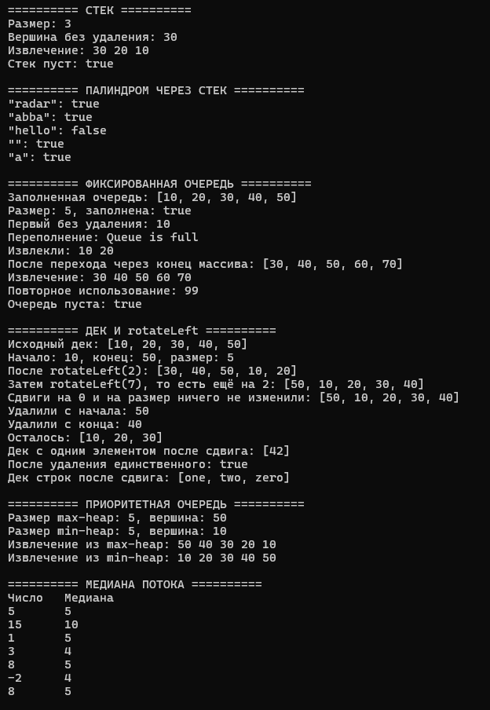
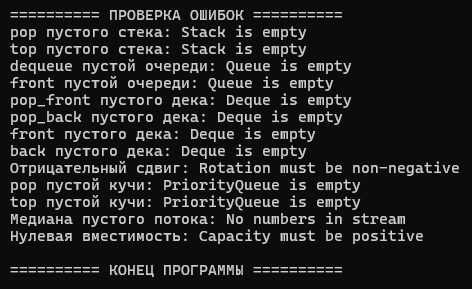

# Лабораторная работа №5

## Титульный лист

**Дисциплина:** Алгоритмы и структуры данных  
**Тема:** Стек, очередь, дек, приоритетная очередь  
**Вариант:** 5  
**Студент:** Власенко Александр Андреевич  
**Группа:** ПИЖ-б-о-25-1  
**Год:** 2026

---

## 1. Цель работы

Изучить принципы работы стека, очереди, дека и приоритетной очереди. Реализовать собственные шаблонные классы на основе динамического массива, кольцевого буфера и двусвязного списка с правильным управлением памятью. Применить стек для проверки палиндрома, реализовать фиксированную циклическую очередь и левый циклический сдвиг дека, найти медиану потока чисел с помощью двух двоичных куч. Проанализировать сложность операций и проверить обработку граничных случаев.

## 2. Теоретическая часть

### 2.1. Стек и принцип LIFO

**Стек** – структура данных, работающая по принципу LIFO (Last In, First Out): последним добавленный элемент извлекается первым. Все изменения выполняются с одного конца, называемого вершиной. Метод `push(value)` добавляет элемент, `pop()` удаляет и возвращает вершину, а `top()` читает её без удаления. Методы `isEmpty()` и `size()` проверяют пустоту и возвращают размер.

В реализации на динамическом массиве поле `data` хранит адрес массива, `topIndex` – индекс вершины, `capacity` – вместимость. Пустому стеку соответствует `topIndex == -1`, число элементов равно `topIndex + 1`. При заполнении выделяется массив вдвое большей вместимости, значения переносятся, а старый массив освобождается. Поэтому отдельный `push()` с расширением имеет сложность `O(n)`, но его амортизированная сложность равна `O(1)`.

### 2.2. Проверка палиндрома через стек

**Палиндром** – строка, одинаково читающаяся в прямом и обратном направлении. Для проверки символы последовательно помещают в стек, затем исходную строку обходят снова и сравнивают каждый символ с извлекаемой вершиной. Стек возвращает символы в обратном порядке. При первом различии возвращается `false`, при совпадении всех символов – `true`.

Например, строка `abba` совпадает с последовательностью извлечения `a`, `b`, `b`, `a`, а у `hello` уже первая пара `h` и `o` различается. Пустая строка и строка из одного символа считаются палиндромами. Алгоритм требует `O(n)` времени и `O(n)` дополнительной памяти.

В программе выполняется точное сравнение значений `char`: регистр, пробелы и знаки препинания учитываются. Демонстрационные строки состоят из латинских символов. Для обработки русских букв в многобайтовой кодировке UTF-8 потребовалось бы отдельное декодирование символов.

### 2.3. Очередь и принцип FIFO

**Очередь** работает по принципу FIFO (First In, First Out): первым извлекается наиболее рано добавленный элемент. Метод `enqueue(value)` добавляет значение в конец, `dequeue()` удаляет и возвращает первое значение, `front()` читает начало без удаления.

При последовательности добавлений `10`, `20`, `30` элементы должны извлекаться в порядке `10`, `20`, `30`. Чтобы не сдвигать массив после каждого извлечения, используют кольцевой буфер.

### 2.4. Кольцевой буфер фиксированной вместимости

**Кольцевой буфер** – массив, в котором после последнего индекса снова используется нулевой. Переход к следующей позиции вычисляется по формуле `(index + 1) % capacity`.

В очереди используются поля:

- `data` – массив элементов;
- `frontIndex` – индекс первого элемента;
- `rearIndex` – индекс позиции следующего добавления;
- `count` – текущее количество элементов;
- `capacity` – фиксированная вместимость.

Условия `count == 0` и `count == capacity` различают пустую и полную очередь, даже если её индексы совпадают. Логический элемент с номером `i` находится по физическому индексу `(frontIndex + i) % capacity`.

Например, после заполнения очереди вместимостью 5 числами `[10, 20, 30, 40, 50]`, извлечения `10` и `20` и добавления `60`, `70` массив содержит `[60, 70, 30, 40, 50]`. При этом логический порядок очереди – `[30, 40, 50, 60, 70]`.

В соответствии с вариантом массив не расширяется. При заполнении добавление отклоняется с исключением `overflow_error`, а существующие элементы сохраняются. Основные операции выполняются за `O(1)`.

### 2.5. Дек на двусвязном списке

**Дек** (double-ended queue) позволяет добавлять и извлекать элементы с обоих концов. В отличие от обычной очереди он поддерживает `push_front()`, `push_back()`, `pop_front()` и `pop_back()`. Методы `front()` и `back()` читают крайние значения.

В программе дек реализован двусвязным списком. Узел хранит значение `data` и указатели `prev`, `next`. Поля `head` и `tail` указывают на первый и последний узлы, `count` хранит размер. В пустом деке оба крайних указателя равны `nullptr`. При удалении единственного узла необходимо обнулить и `head`, и `tail`.

Добавление и удаление с любой стороны требуют изменения фиксированного количества связей, поэтому имеют сложность `O(1)`. Каждый узел создаётся через `new` и освобождается через `delete`; деструктор последовательно удаляет оставшиеся узлы.

### 2.6. Левый циклический сдвиг дека

Операция `rotateLeft(k)` переносит первые `k` элементов в конец с сохранением их относительного порядка:

```text
[10, 20, 30, 40, 50]
rotateLeft(2)
[30, 40, 50, 10, 20]
```

Перед выполнением сдвига проверяется аргумент: отрицательное `k` вызывает `invalid_argument`. При количестве элементов меньше двух метод завершается сразу. Для остальных случаев достаточно `k % count` переносов, поскольку сдвиг на полный размер возвращает исходный порядок.

Один перенос сохраняет старый первый узел, обновляет `head`, обнуляет обратную связь нового начала, присоединяет сохранённый узел после `tail` и делает его новым концом. Поле `next` нового последнего узла становится равным `nullptr`. Новые узлы не создаются, память не освобождается, размер не изменяется.

Если `r = k % n`, сложность составляет `O(1 + r)`, в худшем случае `O(n)`. Дополнительная память – `O(1)`.

### 2.7. Приоритетная очередь и двоичная куча

**Приоритетная очередь** извлекает элемент согласно его приоритету. В max-heap первым доступен максимум, в min-heap – минимум. В программе один шаблонный класс `PriorityQueue<T>` поддерживает оба режима через поле `minHeap` и метод `higherPriority()`.

**Двоичная куча** – почти полное двоичное дерево, последний уровень которого заполняется слева направо. Для max-heap родитель не меньше детей, для min-heap – не больше. Куча не является полностью отсортированным массивом, однако её корень всегда имеет наибольший приоритет.

Дерево хранится в массиве без отдельных узлов. Для элемента с индексом `i` индексы детей равны `2 * i + 1` и `2 * i + 2`, а индекс родителя при `i > 0` равен `(i - 1) / 2`.

При добавлении значение записывается в конец, затем `heapifyUp()` поднимает его через обмены с родителем. При извлечении сохраняется корень, на его место переносится последнее значение, размер уменьшается, а `heapifyDown()` опускает элемент к более приоритетному ребёнку. Индексы детей проверяются перед обращением к массиву.

Высота кучи равна `O(log n)`, поэтому просеивание занимает `O(log n)`. Чтение корня выполняется за `O(1)`. Из-за возможного расширения массива отдельное добавление может потребовать `O(n)`, но амортизированная сложность `push()` остаётся `O(log n)`.

### 2.8. Медиана потока и две кучи

**Медиана** – центральное значение упорядоченной последовательности. При чётном количестве элементов это среднее двух центральных значений. Например, для `[1, 3, 5]` медиана равна 3, для `[1, 3, 5, 15]` – 4.

Для поступающих по одному чисел используются две кучи:

- `lower` – max-heap, содержащая меньшую половину значений;
- `upper` – min-heap, содержащая большую половину.

Поддерживаются два условия: все значения нижней половины не больше значений верхней; в `lower` столько же элементов, сколько в `upper`, либо на один больше. Новое число сравнивается с максимумом `lower` и помещается в соответствующую половину. При нарушении баланса размеров вершина большей кучи переносится в другую.

Если размеры одинаковы, медиана равна среднему `lower.top()` и `upper.top()`. Иначе медиана равна `lower.top()`. Преобразование первого слагаемого в `double` до сложения предотвращает переполнение суммы двух `int` и позволяет получить дробный результат.

Обработка одного числа имеет амортизированную сложность `O(log n)`, чтение медианы – `O(1)`, общая память – `O(n)`. До поступления первого числа медиана не определена, поэтому `getMedian()` выбрасывает исключение.

### 2.9. Владение памятью и обработка ошибок

Массивы освобождаются через `delete[]`, отдельные узлы – через `delete`. Копирование владеющих контейнеров запрещено, чтобы два объекта не получили один и тот же адрес и не освободили память дважды. При исключении во время переноса в новый массив временная память освобождается, после чего исключение передаётся дальше.

Операции чтения и извлечения проверяют пустоту структуры. Вместимость массива должна быть положительной. Переполнение фиксированной очереди и отрицательный сдвиг обрабатываются отдельно.

Учебные контейнеры на массиве используют `new T[capacity]`: объекты создаются сразу во всех ячейках. Логическое удаление из стека, очереди или кучи не уничтожает немедленно объект в освободившейся ячейке. Его ресурсы освобождаются при перезаписи или уничтожении массива. Для используемых типов это допустимое упрощение; требуется поддержка создания элемента без аргументов и присваивания.

## 3. Постановка задачи

**Вариант 5:**

| Структура | Индивидуальное задание |
|---|---|
| Стек | Проверить, является ли строка палиндромом (с использованием стека) |
| Очередь | Реализовать циклическую очередь фиксированного размера |
| Дек | Реализовать дек с операцией `rotateLeft(k)` |
| Приоритетная очередь | Найти медиану потока чисел (две кучи) |

Необходимо самостоятельно реализовать шаблонные классы `Stack<T>`, `Queue<T>`, `Deque<T>` и `PriorityQueue<T>` с основными операциями и деструкторами. Для медианы использовать две собственные приоритетные очереди. Продемонстрировать работу методов в `main()`, проверить граничные случаи, предусмотреть исключения при ошибочных операциях и проанализировать сложность. Готовые контейнеры STL вместо собственных реализаций не используются.

Вся программа размещена в одном файле `main.cpp`. Стандарт языка – C++20, среда разработки – Microsoft Visual Studio.

## 4. Листинг программы

Ниже приведён полный итоговый код файла `main.cpp`.

```cpp
#include <iostream>
#include <string>
#include <stdexcept>
#include <utility>
#include <clocale>

using namespace std;

// СТЕК НА ДИНАМИЧЕСКОМ МАССИВЕ
template <typename T>
class Stack {
private:
    T* data;
    int topIndex;
    int capacity;

    void resize() {
        int newCapacity = capacity * 2;
        T* newData = new T[newCapacity];

        try {
            for (int i = 0; i <= topIndex; i++)
                newData[i] = data[i];
        }
        catch (...) {
            delete[] newData;
            throw;
        }

        delete[] data;
        data = newData;
        capacity = newCapacity;
    }

public:
    explicit Stack(int initialCapacity = 4)
        : data(nullptr), topIndex(-1), capacity(initialCapacity) {
        if (capacity <= 0)
            throw invalid_argument("Capacity must be positive");

        data = new T[capacity];
    }

    ~Stack() {
        delete[] data;
    }

    Stack(const Stack&) = delete;
    Stack& operator=(const Stack&) = delete;

    void push(const T& value) {
        if (size() == capacity)
            resize();

        data[topIndex + 1] = value;
        topIndex++;
    }

    T pop() {
        if (isEmpty())
            throw underflow_error("Stack is empty");

        T value = data[topIndex];
        topIndex--;
        return value;
    }

    T top() const {
        if (isEmpty())
            throw underflow_error("Stack is empty");

        return data[topIndex];
    }

    bool isEmpty() const {
        return topIndex == -1;
    }

    int size() const {
        return topIndex + 1;
    }
};

bool isPalindrome(const string& str) {
    Stack<char> stack;

    for (char ch : str)
        stack.push(ch);

    for (char ch : str) {
        if (ch != stack.pop())
            return false;
    }

    return true;
}

// ЦИКЛИЧЕСКАЯ ОЧЕРЕДЬ ФИКСИРОВАННОГО РАЗМЕРА
template <typename T>
class Queue {
private:
    T* data;
    int frontIndex;
    int rearIndex;
    int count;
    int capacity;

public:
    explicit Queue(int fixedCapacity)
        : data(nullptr), frontIndex(0), rearIndex(0),
        count(0), capacity(fixedCapacity) {
        if (capacity <= 0)
            throw invalid_argument("Capacity must be positive");

        data = new T[capacity];
    }

    ~Queue() {
        delete[] data;
    }

    Queue(const Queue&) = delete;
    Queue& operator=(const Queue&) = delete;

    void enqueue(const T& value) {
        if (isFull())
            throw overflow_error("Queue is full");

        data[rearIndex] = value;
        rearIndex = (rearIndex + 1) % capacity;
        count++;
    }

    T dequeue() {
        if (isEmpty())
            throw underflow_error("Queue is empty");

        T value = data[frontIndex];
        frontIndex = (frontIndex + 1) % capacity;
        count--;
        return value;
    }

    T front() const {
        if (isEmpty())
            throw underflow_error("Queue is empty");

        return data[frontIndex];
    }

    bool isEmpty() const {
        return count == 0;
    }

    bool isFull() const {
        return count == capacity;
    }

    int size() const {
        return count;
    }

    void print() const {
        cout << "[";

        for (int i = 0; i < count; i++) {
            if (i > 0)
                cout << ", ";

            cout << data[(frontIndex + i) % capacity];
        }

        cout << "]\n";
    }
};

// ДЕК НА ДВУСВЯЗНОМ СПИСКЕ
template <typename T>
class Deque {
private:
    struct Node {
        T data;
        Node* prev;
        Node* next;

        Node(const T& value)
            : data(value), prev(nullptr), next(nullptr) {}
    };

    Node* head;
    Node* tail;
    int count;

public:
    Deque() : head(nullptr), tail(nullptr), count(0) {}

    ~Deque() {
        while (head != nullptr) {
            Node* old = head;
            head = head->next;
            delete old;
        }
    }

    Deque(const Deque&) = delete;
    Deque& operator=(const Deque&) = delete;

    void push_front(const T& value) {
        Node* node = new Node(value);
        node->next = head;

        if (head != nullptr)
            head->prev = node;
        else
            tail = node;

        head = node;
        count++;
    }

    void push_back(const T& value) {
        Node* node = new Node(value);
        node->prev = tail;

        if (tail != nullptr)
            tail->next = node;
        else
            head = node;

        tail = node;
        count++;
    }

    T pop_front() {
        if (isEmpty())
            throw underflow_error("Deque is empty");

        Node* old = head;
        T value = old->data;
        head = head->next;

        if (head != nullptr)
            head->prev = nullptr;
        else
            tail = nullptr;

        delete old;
        count--;
        return value;
    }

    T pop_back() {
        if (isEmpty())
            throw underflow_error("Deque is empty");

        Node* old = tail;
        T value = old->data;
        tail = tail->prev;

        if (tail != nullptr)
            tail->next = nullptr;
        else
            head = nullptr;

        delete old;
        count--;
        return value;
    }

    T front() const {
        if (isEmpty())
            throw underflow_error("Deque is empty");

        return head->data;
    }

    T back() const {
        if (isEmpty())
            throw underflow_error("Deque is empty");

        return tail->data;
    }

    // Переносим первые k узлов в конец без выделения памяти
    void rotateLeft(int k) {
        if (k < 0)
            throw invalid_argument("Rotation must be non-negative");

        if (count < 2)
            return;

        k %= count;

        for (int i = 0; i < k; i++) {
            Node* first = head;
            head = head->next;
            head->prev = nullptr;

            tail->next = first;
            first->prev = tail;
            first->next = nullptr;
            tail = first;
        }
    }

    bool isEmpty() const {
        return count == 0;
    }

    int size() const {
        return count;
    }

    void print() const {
        cout << "[";

        for (Node* current = head; current != nullptr;
            current = current->next) {
            if (current != head)
                cout << ", ";

            cout << current->data;
        }

        cout << "]\n";
    }
};

// ПРИОРИТЕТНАЯ ОЧЕРЕДЬ НА ДВОИЧНОЙ КУЧЕ
template <typename T>
class PriorityQueue {
private:
    T* heap;
    int count;
    int capacity;
    bool minHeap;

    bool higherPriority(const T& a, const T& b) const {
        if (minHeap)
            return a < b;

        return a > b;
    }

    void resize() {
        int newCapacity = capacity * 2;
        T* newHeap = new T[newCapacity];

        try {
            for (int i = 0; i < count; i++)
                newHeap[i] = heap[i];
        }
        catch (...) {
            delete[] newHeap;
            throw;
        }

        delete[] heap;
        heap = newHeap;
        capacity = newCapacity;
    }

    // Поднимаем элемент, пока он важнее родителя
    void heapifyUp(int index) {
        while (index > 0) {
            int parent = (index - 1) / 2;

            if (!higherPriority(heap[index], heap[parent]))
                break;

            swap(heap[index], heap[parent]);
            index = parent;
        }
    }

    // Опускаем элемент к ребёнку с большим приоритетом
    void heapifyDown(int index) {
        while (true) {
            int left = 2 * index + 1;
            int right = 2 * index + 2;
            int best = index;

            if (left < count && higherPriority(heap[left], heap[best]))
                best = left;

            if (right < count && higherPriority(heap[right], heap[best]))
                best = right;

            if (best == index)
                break;

            swap(heap[index], heap[best]);
            index = best;
        }
    }

public:
    explicit PriorityQueue(bool useMinHeap = false, int initialCapacity = 4)
        : heap(nullptr), count(0), capacity(initialCapacity),
        minHeap(useMinHeap) {
        if (capacity <= 0)
            throw invalid_argument("Capacity must be positive");

        heap = new T[capacity];
    }

    ~PriorityQueue() {
        delete[] heap;
    }

    PriorityQueue(const PriorityQueue&) = delete;
    PriorityQueue& operator=(const PriorityQueue&) = delete;

    void push(const T& value) {
        if (count == capacity)
            resize();

        heap[count] = value;
        count++;
        heapifyUp(count - 1);
    }

    T pop() {
        if (isEmpty())
            throw underflow_error("PriorityQueue is empty");

        T value = heap[0];

        if (count > 1)
            heap[0] = heap[count - 1];

        count--;

        if (!isEmpty())
            heapifyDown(0);

        return value;
    }

    T top() const {
        if (isEmpty())
            throw underflow_error("PriorityQueue is empty");

        return heap[0];
    }

    bool isEmpty() const {
        return count == 0;
    }

    int size() const {
        return count;
    }
};

// МЕДИАНА ПОТОКА: НИЖНЯЯ И ВЕРХНЯЯ ПОЛОВИНЫ ЧИСЕЛ
class MedianFinder {
private:
    PriorityQueue<int> lower;
    PriorityQueue<int> upper;

public:
    MedianFinder() : lower(false), upper(true) {}

    void add(int value) {
        if (lower.isEmpty() || value <= lower.top())
            lower.push(value);
        else
            upper.push(value);

        // В нижней половине столько же элементов или на один больше
        if (lower.size() > upper.size() + 1)
            upper.push(lower.pop());
        else if (upper.size() > lower.size())
            lower.push(upper.pop());
    }

    double getMedian() const {
        if (lower.isEmpty())
            throw underflow_error("No numbers in stream");

        if (lower.size() == upper.size())
            return (static_cast<double>(lower.top()) + upper.top()) / 2.0;

        return lower.top();
    }
};

int main() {
    setlocale(LC_ALL, "");
    cout << boolalpha;

    cout << "========== СТЕК ==========\n";

    Stack<int> stack(2);
    stack.push(10);
    stack.push(20);
    stack.push(30); // Проверка расширения массива

    cout << "Размер: " << stack.size() << "\n";
    cout << "Вершина без удаления: " << stack.top() << "\n";
    cout << "Извлечение: ";

    while (!stack.isEmpty())
        cout << stack.pop() << " ";

    cout << "\nСтек пуст: " << stack.isEmpty() << "\n";

    cout << "\n========== ПАЛИНДРОМ ЧЕРЕЗ СТЕК ==========\n";

    for (const string& word : {string("radar"), string("abba"),
        string("hello"), string(""), string("a")}) {
        cout << "\"" << word << "\": " << isPalindrome(word) << "\n";
    }

    cout << "\n========== ФИКСИРОВАННАЯ ОЧЕРЕДЬ ==========\n";

    Queue<int> queue(5);

    for (int value : {10, 20, 30, 40, 50})
        queue.enqueue(value);

    cout << "Заполненная очередь: ";
    queue.print();
    cout << "Размер: " << queue.size()
        << ", заполнена: " << queue.isFull() << "\n";
    cout << "Первый без удаления: " << queue.front() << "\n";

    try {
        queue.enqueue(60);
    }
    catch (const overflow_error& e) {
        cout << "Переполнение: " << e.what() << "\n";
    }

    cout << "Извлекли: " << queue.dequeue();
    cout << " " << queue.dequeue() << "\n";

    queue.enqueue(60);
    queue.enqueue(70);

    cout << "После перехода через конец массива: ";
    queue.print();
    cout << "Извлечение: ";

    while (!queue.isEmpty())
        cout << queue.dequeue() << " ";

    queue.enqueue(99);
    cout << "\nПовторное использование: " << queue.dequeue() << "\n";
    cout << "Очередь пуста: " << queue.isEmpty() << "\n";

    cout << "\n========== ДЕК И rotateLeft ==========\n";

    Deque<int> deque;
    deque.push_front(10);

    for (int value : {20, 30, 40, 50})
        deque.push_back(value);

    cout << "Исходный дек: ";
    deque.print();
    cout << "Начало: " << deque.front() << ", конец: " << deque.back()
        << ", размер: " << deque.size() << "\n";

    deque.rotateLeft(2);
    cout << "После rotateLeft(2): ";
    deque.print();

    deque.rotateLeft(7);
    cout << "Затем rotateLeft(7), то есть ещё на 2: ";
    deque.print();

    deque.rotateLeft(0);
    deque.rotateLeft(deque.size());
    cout << "Сдвиги на 0 и на размер ничего не изменили: ";
    deque.print();

    cout << "Удалили с начала: " << deque.pop_front() << "\n";
    cout << "Удалили с конца: " << deque.pop_back() << "\n";
    cout << "Осталось: ";
    deque.print();

    Deque<int> single;
    single.rotateLeft(3);
    single.push_back(42);
    single.rotateLeft(10);
    cout << "Дек с одним элементом после сдвига: ";
    single.print();
    single.pop_back();
    cout << "После удаления единственного: " << single.isEmpty() << "\n";

    Deque<string> words;
    words.push_back("one");
    words.push_back("two");
    words.push_front("zero");
    words.rotateLeft(1);
    cout << "Дек строк после сдвига: ";
    words.print();

    cout << "\n========== ПРИОРИТЕТНАЯ ОЧЕРЕДЬ ==========\n";

    PriorityQueue<int> maxQueue;
    PriorityQueue<int> minQueue(true);

    for (int value : {30, 10, 50, 20, 40}) {
        maxQueue.push(value);
        minQueue.push(value);
    }

    cout << "Размер max-heap: " << maxQueue.size()
        << ", вершина: " << maxQueue.top() << "\n";
    cout << "Размер min-heap: " << minQueue.size()
        << ", вершина: " << minQueue.top() << "\n";
    cout << "Извлечение из max-heap: ";

    while (!maxQueue.isEmpty())
        cout << maxQueue.pop() << " ";

    cout << "\nИзвлечение из min-heap: ";

    while (!minQueue.isEmpty())
        cout << minQueue.pop() << " ";

    cout << "\n\n========== МЕДИАНА ПОТОКА ==========\n";

    MedianFinder median;
    cout << "Число\tМедиана\n";

    for (int value : {5, 15, 1, 3, 8, -2, 8}) {
        median.add(value);
        cout << value << "\t" << median.getMedian() << "\n";
    }

    cout << "\n========== ПРОВЕРКА ОШИБОК ==========\n";

    try {
        stack.pop();
    }
    catch (const underflow_error& e) {
        cout << "pop пустого стека: " << e.what() << "\n";
    }

    try {
        stack.top();
    }
    catch (const underflow_error& e) {
        cout << "top пустого стека: " << e.what() << "\n";
    }

    try {
        queue.dequeue();
    }
    catch (const underflow_error& e) {
        cout << "dequeue пустой очереди: " << e.what() << "\n";
    }

    try {
        queue.front();
    }
    catch (const underflow_error& e) {
        cout << "front пустой очереди: " << e.what() << "\n";
    }

    try {
        single.pop_front();
    }
    catch (const underflow_error& e) {
        cout << "pop_front пустого дека: " << e.what() << "\n";
    }

    try {
        single.pop_back();
    }
    catch (const underflow_error& e) {
        cout << "pop_back пустого дека: " << e.what() << "\n";
    }

    try {
        single.front();
    }
    catch (const underflow_error& e) {
        cout << "front пустого дека: " << e.what() << "\n";
    }

    try {
        single.back();
    }
    catch (const underflow_error& e) {
        cout << "back пустого дека: " << e.what() << "\n";
    }

    try {
        deque.rotateLeft(-1);
    }
    catch (const invalid_argument& e) {
        cout << "Отрицательный сдвиг: " << e.what() << "\n";
    }

    try {
        maxQueue.pop();
    }
    catch (const underflow_error& e) {
        cout << "pop пустой кучи: " << e.what() << "\n";
    }

    try {
        maxQueue.top();
    }
    catch (const underflow_error& e) {
        cout << "top пустой кучи: " << e.what() << "\n";
    }

    try {
        MedianFinder emptyStream;
        emptyStream.getMedian();
    }
    catch (const underflow_error& e) {
        cout << "Медиана пустого потока: " << e.what() << "\n";
    }

    try {
        Queue<int> invalidQueue(0);
    }
    catch (const invalid_argument& e) {
        cout << "Нулевая вместимость: " << e.what() << "\n";
    }

    cout << "\n========== КОНЕЦ ПРОГРАММЫ ==========\n";

    return 0;
}
```

## 5. Результаты работы

### 5.1. Демонстрация структур и задач варианта

На первом скриншоте показан запуск программы в Visual Studio: работа стека, проверка палиндромов, фиксированная очередь, сдвиг дека, извлечение из двух видов кучи и вычисление медианы потока.



**Анализ результатов:**

1. После добавления `10`, `20`, `30` размер стека равен 3, вершина равна 30. Извлечение даёт `30 20 10`, что подтверждает LIFO. Начальная вместимость 2 потребовала расширения при третьем добавлении.
2. Строки `radar`, `abba`, пустая строка и `a` определены как палиндромы, `hello` – как непалиндром.
3. Очередь вместимостью 5 заполнена значениями `[10, 20, 30, 40, 50]`. Дополнительное добавление отклонено сообщением `Queue is full`. После извлечения `10`, `20` и добавления `60`, `70` очередь имеет порядок `[30, 40, 50, 60, 70]`. Это демонстрирует повторное использование освободившихся ячеек и переход индексов через конец массива.
4. После опустошения очередь повторно использована: значение 99 успешно добавлено и извлечено, `isEmpty()` вернул `true`.
5. Дек `[10, 20, 30, 40, 50]` после `rotateLeft(2)` стал `[30, 40, 50, 10, 20]`. Следующий `rotateLeft(7)` действует уже на изменённый дек и даёт `[50, 10, 20, 30, 40]`. Сдвиги на 0 и на полный размер ничего не меняют.
6. После удаления начала 50 и конца 40 в деке осталось `[10, 20, 30]`. Пустой дек и дек с одним элементом корректно обработали сдвиг. После удаления единственного узла `isEmpty()` вернул `true`.
7. Шаблон дека использован со строками: после сдвига получен порядок `[one, two, zero]`.
8. Max-heap извлекла значения `50 40 30 20 10`, min-heap – `10 20 30 40 50`. Вершины перед извлечением равны 50 и 10 соответственно.

### 5.2. Медиана потока

Следующая таблица соответствует значениям на первом скриншоте. Для пояснения накопленные числа показаны в отсортированном виде; сама программа не сортирует весь поток при каждом добавлении.

| Новое число | Накопленные числа по возрастанию | Медиана |
|---:|---|---:|
| 5 | `[5]` | 5 |
| 15 | `[5, 15]` | 10 |
| 1 | `[1, 5, 15]` | 5 |
| 3 | `[1, 3, 5, 15]` | 4 |
| 8 | `[1, 3, 5, 8, 15]` | 5 |
| -2 | `[-2, 1, 3, 5, 8, 15]` | 4 |
| 8 | `[-2, 1, 3, 5, 8, 8, 15]` | 5 |

Например, после поступления `-2` центральные числа равны 3 и 5, поэтому медиана равна 4. После повторного поступления 8 общее количество становится нечётным и центральным значением является 5.

### 5.3. Обработка ошибок

На втором скриншоте приведены результаты ошибочных операций:



Проверены:

- `pop()` и `top()` пустого стека;
- `dequeue()` и `front()` пустой очереди;
- `pop_front()`, `pop_back()`, `front()`, `back()` пустого дека;
- отрицательное значение `k` в `rotateLeft(k)`;
- `pop()` и `top()` пустой приоритетной очереди;
- запрос медианы до поступления чисел;
- создание очереди с нулевой вместимостью.

Ошибки сопровождаются исключениями, которые перехватываются в `main()`. Программа выводит понятные сообщения и доходит до строки завершения. Переполнение фиксированной очереди отдельно продемонстрировано на первом скриншоте.

### 5.4. Проверка реализации

Код собран и запущен компилятором MSVC Visual Studio 2022 в режиме C++20 с параметрами `/utf-8` и `/W4`, без предупреждений. Дополнительно проверены случайные последовательности операций контейнеров, очереди вместимостью 1 и несколько элементов, сдвиги на большие значения, медианы возрастающих и убывающих потоков, повторы и предельные значения `int`. Результаты медиан сопоставлялись с отсортированными накопленными значениями. При проверке Debug CRT не обнаружено разницы выделенной памяти до и после тестовых сценариев.

Приведённые изображения являются реальными скриншотами запуска программы в Visual Studio. Измерения производительности для данной лабораторной не требуются.

## 6. Анализ сложности операций

Пусть `n` – количество элементов рассматриваемой структуры, `c` – вместимость её массива. Оценки предполагают постоянную стоимость копирования, сравнения, присваивания и уничтожения одного элемента `T`. Для выделения памяти используются обычные оценки модели динамических контейнеров.

### 6.1. Стек и проверка палиндрома

| Операция | Временная сложность | Обоснование |
|---|---|---|
| Конструктор | `O(c)` в общем случае | Создаётся массив из `c` объектов; при фиксированной начальной вместимости – `O(1)` |
| `resize()` | `O(n)` при заполненном массиве | Создание массива удвоенной вместимости и перенос элементов |
| `push()` | `O(1)` амортизированно; `O(n)` при расширении | Обычно одна запись, иногда перенос массива |
| `pop()` | `O(1)` | Чтение вершины и уменьшение индекса |
| `top()` | `O(1)` | Чтение по индексу вершины |
| `isEmpty()`, `size()` | `O(1)` | Проверка или вычисление по одному полю |
| Деструктор | `O(c)` в общем случае | `delete[]` уничтожает созданные объекты массива |
| `isPalindrome()` | `O(n)` | Добавление и сравнение символов; каждый обрабатывается постоянное число раз |

Стек занимает `O(c)` памяти. Массив не уменьшается после извлечений, поэтому вместимость может быть больше текущего размера. Проверка строки длины `n` использует `O(n)` дополнительной памяти.

### 6.2. Фиксированная циклическая очередь

| Операция | Временная сложность | Обоснование |
|---|---|---|
| Конструктор | `O(c)` в общем случае | Создание массива фиксированной вместимости |
| `enqueue()` | `O(1)` | Проверка заполнения, запись, обновление индекса и счётчика |
| `dequeue()` | `O(1)` | Чтение начала, обновление индекса и счётчика |
| `front()` | `O(1)` | Чтение по `frontIndex` |
| `isEmpty()`, `isFull()`, `size()` | `O(1)` | Обращение к полям |
| `print()` | `O(n)` | Обход логических элементов |
| Деструктор | `O(c)` в общем случае | Освобождение массива и уничтожение его объектов |

Память очереди – `O(c)` и не изменяется при добавлениях и извлечениях. В отличие от расширяемой очереди, здесь нет редкой операции переноса всего массива.

### 6.3. Дек на двусвязном списке

| Операция | Временная сложность | Обоснование |
|---|---|---|
| Конструктор | `O(1)` | Инициализация указателей и размера |
| `push_front()`, `push_back()` | `O(1)` | Создание узла и изменение крайних связей |
| `pop_front()`, `pop_back()` | `O(1)` | Удаление крайнего узла без поиска |
| `front()`, `back()` | `O(1)` | Чтение через `head` или `tail` |
| `isEmpty()`, `size()` | `O(1)` | Обращение к `count` |
| `rotateLeft(k)` | `O(1 + r)`, где `r = k % n`, при `n >= 2`; иначе `O(1)` | Каждый перенос узла занимает постоянное время |
| `print()` | `O(n)` | Последовательный обход |
| Деструктор | `O(n)` | Удаление каждого узла |

Общая память дека – `O(n)`. Сдвиг не создаёт массивы или новые узлы, поэтому требует `O(1)` дополнительной памяти. В худшем случае выполняется до `n - 1` переносов, и время сдвига равно `O(n)`.

### 6.4. Приоритетная очередь и медиана

| Операция | Временная сложность | Обоснование |
|---|---|---|
| Конструктор `PriorityQueue` | `O(c)` в общем случае | Создание массива кучи |
| `higherPriority()` | `O(1)` | Одно сравнение значений |
| `resize()` | `O(n)` при заполненном массиве | Выделение большей памяти и перенос |
| `heapifyUp()` | `O(log n)` | Подъём не выше корня |
| `heapifyDown()` | `O(log n)` | Спуск не ниже последнего уровня |
| `push()` | `O(log n)` амортизированно; `O(n)` при расширении | Просеивание и возможная замена массива |
| `pop()` | `O(log n)` | Перенос последнего значения и просеивание вниз |
| `top()`, `isEmpty()`, `size()` | `O(1)` | Обращение к корню или счётчику |
| Деструктор `PriorityQueue` | `O(c)` в общем случае | Освобождение массива |
| Конструктор `MedianFinder` | `O(1)` | Создание двух куч фиксированной начальной вместимости |
| `MedianFinder::add()` | `O(log n)` амортизированно; `O(n)` в отдельном случае расширения | Постоянное число операций двух куч |
| `MedianFinder::getMedian()` | `O(1)` | Чтение одной или двух вершин |
| Уничтожение `MedianFinder` | `O(n)` в общем случае | Автоматическое уничтожение двух куч |

Отдельная куча занимает `O(c)` памяти. В задаче медианы элементы только добавляются, и суммарная вместимость двух куч составляет `O(n)`. Для обработки всего потока из `n` чисел суммарное время – `O(n log n)`.

## 7. Ответы на контрольные вопросы

**1. В чём заключается принцип работы стека (LIFO)? –** LIFO означает «последним пришёл – первым ушёл». Добавление и извлечение выполняются с вершины стека, поэтому последним добавленное значение извлекается первым. Например, после `push(10)`, `push(20)`, `push(30)` последовательные вызовы `pop()` возвращают 30, 20, 10. Метод `top()` позволяет прочитать вершину без изменения структуры. Такой порядок полезен при обработке вложенных конструкций, отмене действий и обращении последовательностей.

**2. В чём заключается принцип работы очереди (FIFO)? –** FIFO означает «первым пришёл – первым ушёл». Элементы добавляются в конец и извлекаются из начала, сохраняя порядок поступления. Если добавить 10, 20, 30, они будут извлекаться в том же порядке. Очереди применяются для последовательной обработки заявок, буферизации и обхода графа в ширину. В реализации на кольцевом буфере добавление и извлечение не требуют сдвига остальных элементов.

**3. Чем дек отличается от обычной очереди? –** Обычная очередь ограничивает операции: добавление выполняется в конец, извлечение – из начала. Дек допускает добавление и извлечение с обеих сторон через `push_front`, `push_back`, `pop_front`, `pop_back`. Поэтому его можно использовать и как очередь, и как стек. Дек реализуют кольцевым буфером или двусвязным списком; последний обеспечивает операции на обоих концах за `O(1)` при хранении `head` и `tail`.

**4. Что такое приоритетная очередь? Где она применяется? –** Это структура данных, извлекающая элемент с наибольшим приоритетом, а не обязательно наиболее рано добавленный. В max-heap приоритет соответствует большему значению, в min-heap – меньшему. Основные операции – добавление, чтение вершины и её извлечение. Приоритетные очереди применяются в планировщиках задач, моделировании событий, алгоритме Дейкстры и слиянии отсортированных последовательностей. В данной работе две такие очереди поддерживают медиану поступающих чисел.

**5. Как реализовать стек на основе динамического массива? –** Нужно хранить указатель на массив, его вместимость и индекс вершины либо количество элементов. При добавлении значение записывается после текущей вершины; при извлечении вершина читается и логический размер уменьшается. Для пустого стека индекс вершины можно установить в -1. Когда массив заполнен, выделяется массив большей вместимости, элементы копируются, старая память освобождается через `delete[]`. Деструктор освобождает оставшийся массив. Методы извлечения и чтения должны проверять пустоту; копирование владеющего указателя нужно либо корректно реализовать, либо запретить.

**6. Как реализовать очередь на основе кольцевого буфера? –** Используют массив, индексы первого элемента и следующего добавления, количество элементов и вместимость. После записи или чтения соответствующий индекс изменяют с переходом через конец массива:

```cpp
rearIndex = (rearIndex + 1) % capacity;
frontIndex = (frontIndex + 1) % capacity;
```

Пустое и полное состояния различают по `count`. Удалённые логические позиции можно использовать повторно, поэтому сдвиг массива не нужен. При фиксированной вместимости переполнение отклоняется; в расширяемом варианте выделяют больший массив и переносят элементы в логическом порядке. Вместимость должна быть положительной, чтобы вычисление остатка было корректным.

**7. Почему приоритетную очередь обычно реализуют на куче? –** Двоичная куча сочетает быстрое чтение наиболее приоритетного значения за `O(1)` и изменение структуры за `O(log n)`. Она хранится в массиве без отдельных указателей, а родитель и дети вычисляются по индексам. При использовании неупорядоченного массива поиск максимума или минимума потребовал бы `O(n)`, а поддержание полностью отсортированного массива привело бы к линейным затратам при вставках. Куча поддерживает только необходимые отношения между родителями и детьми и потому не выполняет лишнюю полную сортировку.

**8. Какова сложность операций push и pop в стеке? –** Для стека на динамическом массиве `pop()` имеет сложность `O(1)`, поскольку читает вершину и уменьшает индекс. Добавление без расширения также занимает `O(1)`. Если массив заполнен, `push()` переносит `n` элементов и требует `O(n)` в этом отдельном случае. При удвоении вместимости амортизированная сложность добавления равна `O(1)`: суммарное число переносов за длинную последовательность добавлений линейно. Для стека на связном списке вставка и удаление первого узла обычно оцениваются как `O(1)` без перераспределения всего массива.

**9. Какова сложность операций enqueue и dequeue в очереди? –** В очереди на кольцевом буфере фиксированной вместимости обе операции имеют сложность `O(1)`: изменяются одна позиция массива, индексы и счётчик. При переполнении проверка и выдача исключения также не требуют обхода. В расширяемом кольцевом буфере `enqueue()` имеет амортизированную сложность `O(1)`, но отдельное расширение занимает `O(n)`. `dequeue()` остаётся `O(1)`. Если после каждого извлечения сдвигать все оставшиеся элементы массива, удаление стало бы `O(n)`, поэтому такой подход не используется.

**10. Какова сложность операций в приоритетной очереди? Почему? –** В двоичной куче `top()` выполняется за `O(1)`, так как нужное значение находится в корне. `pop()` занимает `O(log n)`: после замены корня последним элементом требуется спуск по дереву. `push()` без расширения также занимает `O(log n)` из-за подъёма к родителю. Высота почти полного двоичного дерева равна `O(log n)`, и на каждом уровне выполняется постоянное число сравнений и обменов. При удвоении массива отдельный `push()` с расширением имеет `O(n)`, а амортизированно – `O(log n)`. Проверки размера и пустоты выполняются за `O(1)`.

**11. Как проверить правильность расстановки скобок с помощью стека? –** Строку обходят слева направо. Открывающие скобки помещают в стек. При закрывающей скобке проверяют, что стек не пуст, затем извлекают вершину и сравнивают типы: круглой закрывающей должна соответствовать круглая открывающая, квадратной – квадратная и так далее. Несовпадение или пустой стек означает ошибку. После обхода стек должен быть пуст, иначе остались незакрытые скобки. Например, `([])` корректно, а `([)]` некорректно. Алгоритм использует LIFO, поскольку последняя открытая скобка должна закрываться первой. Время – `O(n)`, память – до `O(n)`.

**12. Как реализовать очередь на двух стеках? Какова сложность? –** Один стек используют для добавления новых значений, второй – для извлечения. `enqueue()` помещает значение во входной стек. При `dequeue()` сначала проверяют выходной: если он пуст, все значения входного переносят в выходной. Перенос разворачивает порядок, и наиболее рано добавленный элемент оказывается сверху. Пока выходной стек не пуст, новые значения в него не переносят, чтобы сохранить FIFO. Если оба стека пусты, извлечение отклоняется. Одно извлечение с переносом может занять `O(n)`, но каждый элемент переносится между стеками не более одного раза. Поэтому добавление и извлечение имеют амортизированную сложность `O(1)` при обычных реализациях стеков; дополнительная память – `O(n)`.

**13. Как реализовать дек на основе двусвязного списка? –** Каждый узел должен содержать значение и указатели на предыдущий и следующий узлы. Дек хранит `head`, `tail` и размер. При добавлении в начало новый узел связывается с прежним `head`, при добавлении в конец – с прежним `tail`. Удаление сначала обновляет крайний указатель и связь соседнего узла, затем освобождает удаляемый узел. Для пустого дека оба крайних указателя равны `nullptr`; при добавлении первого узла они указывают на него, а после удаления единственного снова обнуляются. Все операции на концах выполняются за `O(1)`. Деструктор обязан пройти по цепочке и удалить оставшиеся узлы.

**14. Как реализовать дек на основе кольцевого буфера? –** Нужно хранить массив, индекс первого элемента `first`, число элементов `count` и вместимость `capacity`. Последний логический элемент находится по индексу `(first + count - 1) % capacity` при непустом деке. Для добавления в начало индекс сдвигают назад с учётом перехода через ноль; для добавления в конец вычисляют следующую свободную позицию:

```cpp
// Добавление в начало
first = (first - 1 + capacity) % capacity;
data[first] = value;
count++;

// Добавление в конец
data[(first + count) % capacity] = value;
count++;
```

Это два независимых фрагмента разных методов; перед каждым требуется проверка заполнения. При удалении начала сдвигают `first` вперёд и уменьшают `count`, при удалении конца достаточно уменьшить `count`. Пустоту проверяют до чтения или извлечения. При фиксированной вместимости операции имеют `O(1)`, при расширяемом массиве добавление амортизированно `O(1)` с возможным переносом за `O(n)`.

**15. Как реализовать стек с поддержкой получения минимума за O(1)? –** Можно использовать два стека одинакового размера: основной хранит значения, вспомогательный – минимум для каждого соответствующего состояния. При добавлении в основной стек во вспомогательный помещают минимум между новым значением и прежним минимумом. При извлечении удаляют вершины обоих стеков. Тогда `getMin()` просто читает вершину вспомогательного стека за `O(1)`. Например, для значений `[5, 3, 7, 2]` последовательность минимумов будет `[5, 3, 3, 2]`; после удаления 2 минимум автоматически вернётся к 3. Сохранение минимумов на каждой позиции корректно обрабатывает и повторяющиеся минимальные значения. Дополнительная память – `O(n)`; пустота проверяется перед запросом минимума.

## 8. Выводы

В ходе лабораторной работы реализованы четыре собственные шаблонные структуры данных: стек на динамическом массиве, циклическая очередь фиксированной вместимости, дек на двусвязном списке и приоритетная очередь на двоичной куче. На практических примерах подтверждены принципы LIFO и FIFO, работа кольцевой индексации и извлечение значений по приоритету.

Для варианта 5 разработана проверка палиндрома через стек, реализована обработка переполнения фиксированной очереди, добавлен левый циклический сдвиг дека без создания новых узлов и получена медиана потока с использованием max-heap и min-heap. Проверены чётное и нечётное количество чисел, отрицательные значения, повторы, пустые структуры и ошибочные аргументы.

Проанализирована сложность операций: основные действия со стеком и концами дека выполняются за постоянное или амортизированное постоянное время, фиксированная очередь обеспечивает `O(1)` для добавления и извлечения, а двоичная куча поддерживает извлечение вершины и вставку за логарифмическое время с учётом особенностей расширения массива. Медиана читается за `O(1)`, а новое число обрабатывается за `O(log n)` амортизированно. Закреплены навыки управления динамической памятью, изменения связей узлов и обработки исключений.

## 9. Ссылка на Git-репозиторий

https://github.com/lostmoth/student-dsa-course
