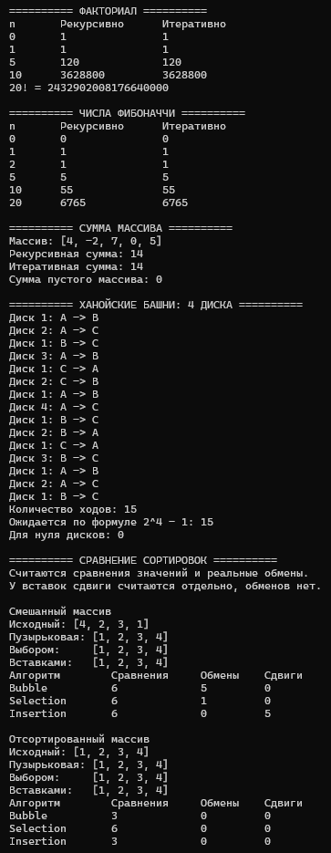
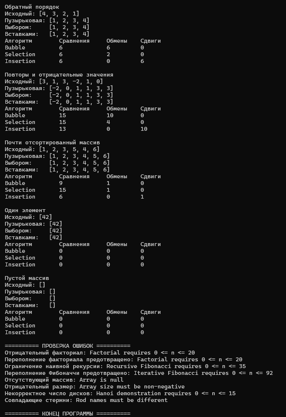

# Лабораторная работа №6

## Титульный лист

**Дисциплина:** Алгоритмы и структуры данных  
**Тема:** Рекурсивные алгоритмы. Простые сортировки  
**Вариант:** 5  
**Студент:** Власенко Александр Андреевич  
**Группа:** ПИЖ-б-о-25-1  
**Год:** 2026

---

## 1. Цель работы

Изучить принципы рекурсии, базовый случай, шаг рекурсии и работу стека вызовов. Реализовать рекурсивное вычисление факториала, чисел Фибоначчи, суммы элементов массива и решение задачи о Ханойских башнях для четырёх дисков. Сравнить рекурсивные и итеративные реализации. Реализовать простые сортировки и исследовать их работу на разных входных данных с подсчётом сравнений, обменов и сдвигов. Проанализировать временную и пространственную сложность алгоритмов.

## 2. Теоретическая часть

### 2.1. Рекурсия и стек вызовов

**Рекурсия** – способ решения задачи, при котором функция вызывает саму себя непосредственно или через другие функции. Исходная задача сводится к более простым подзадачам того же вида. Рекурсивная функция должна содержать базовый случай и шаг, приближающий вычисление к этому случаю.

**Базовый случай** возвращает готовый ответ без нового вызова. **Шаг рекурсии** уменьшает размер подзадачи или иным образом приближает её к завершению. Отсутствие остановки либо неверное изменение параметра может привести к бесконечной рекурсии и переполнению стека.

При вызове функции сохраняются необходимые данные её выполнения и адрес возврата. Незавершённые вызовы образуют стек. При спуске создаются новые вызовы, при возврате их результаты используются для завершения предыдущих. Поэтому глубина рекурсии влияет на дополнительную память.

### 2.2. Виды рекурсии

| Вид | Описание | Пример |
|---|---|---|
| Прямая | Функция непосредственно вызывает себя | `factorialRecursive(n - 1)` |
| Косвенная | Несколько функций вызывают друг друга | `isEven` вызывает `isOdd`, а та снова `isEven` |
| Хвостовая | Рекурсивный вызов является последним действием | Передача накопленного результата следующему вызову |

В обычной записи факториала после рекурсивного вызова ещё выполняется умножение, поэтому такая рекурсия не хвостовая. При использовании аккумулятора промежуточный результат можно передать параметром. Компилятор иногда преобразует хвостовую рекурсию в цикл, но C++ не гарантирует такую оптимизацию.

### 2.3. Факториал

Для неотрицательного целого числа `n` факториал определяется как произведение чисел от 1 до `n`, причём `0! = 1`. Рекуррентное правило: `n! = n * (n - 1)!` при `n > 0`.

```text
factorial(4)
  → 4 * factorial(3)
    → 3 * factorial(2)
      → 2 * factorial(1)
        → 1 * factorial(0)
          → 1
Возврат: 1 → 1 → 2 → 6 → 24
```

Рекурсивная версия выполняет линейное число вызовов и использует стек глубины `O(n)`. Итеративная перемножает числа в цикле за `O(n)` времени и использует `O(1)` дополнительной памяти. В программе обе версии принимают аргументы от 0 до 20: `20!` помещается в 64-битный знаковый `long long`, а `21!` уже не помещается.

### 2.4. Числа Фибоначчи

Числа Фибоначчи задаются условиями `F(0) = 0`, `F(1) = 1` и правилом `F(n) = F(n - 1) + F(n - 2)`. Начало последовательности: `0, 1, 1, 2, 3, 5, 8, 13`.

Наивная рекурсивная реализация непосредственно повторяет формулу. При этом одни и те же подзадачи вычисляются много раз: например, `F(3)` требуется и внутри `F(4)`, и как отдельная ветвь при вычислении `F(5)`. Время экспоненциальное; обычная верхняя оценка – `O(2^n)`. Глубина стека остаётся `O(n)`, поскольку ветви выполняются последовательно.

Итеративная версия хранит два предыдущих числа и вычисляет следующее за один шаг. Её время – `O(n)`, дополнительная память – `O(1)`. Мемоизация также позволяет получить линейное время, сохраняя результаты подзадач, но в данной программе для сравнения оставлена наивная рекурсия.

Рекурсивная функция ограничена диапазоном 0–35 из-за длительности вычислений. Итеративная принимает 0–92: `F(92)` помещается в `long long`, а `F(93)` превышает его диапазон.

### 2.5. Сумма элементов массива

Сумма первых `n` элементов представляется как последний элемент рассматриваемой части и сумма предыдущих: `sum(arr, n) = arr[n - 1] + sum(arr, n - 1)`. Базовый случай – `n == 0`, ответ равен нулю.

Для массива `[4, -2, 7, 0, 5]` вычисление сводится к выражению `5 + 0 + 7 - 2 + 4 + 0 = 14`. Между вызовами передаётся адрес того же массива, а не его копия. Параметр `const int arr[]` запрещает изменение элементов через этот указатель.

Рекурсивная и итеративная версии имеют время `O(n)`, но первая использует `O(n)` памяти стека, а вторая – `O(1)`. Сумма накапливается в `long long`. Отрицательный размер и `nullptr` при положительном размере отклоняются. Пара `nullptr, 0` допускается для пустого массива. Переданный размер должен соответствовать реально доступным элементам.

### 2.6. Ханойские башни

Задача состоит в переносе башни дисков с исходного стержня на конечный при помощи вспомогательного. За один ход разрешается переносить один верхний диск; больший нельзя класть на меньший.

Для переноса `n` дисков нужно:

1. Перенести `n - 1` дисков на вспомогательный стержень.
2. Перенести самый большой диск на конечный стержень.
3. Перенести `n - 1` дисков со вспомогательного на конечный.

Роли стержней в рекурсивных вызовах меняются. Вызов `hanoi(4, 'A', 'C', 'B')` использует A как исходный, C как конечный и B как вспомогательный. Базовый случай `n == 0` не выполняет перемещений и возвращает 0.

Минимальное число ходов удовлетворяет `T(n) = 2 * T(n - 1) + 1`, `T(0) = 0`, откуда `T(n) = 2^n - 1`. Для четырёх дисков требуется 15 ходов: 7 для верхних трёх дисков, один для диска №4 и ещё 7 для завершения переноса. Время – `O(2^n)`, дополнительная память – `O(n)` для стека. Ходы сразу выводятся и не накапливаются в отдельном массиве.

В демонстрации допускается от 0 до 15 дисков, чтобы ограничить объём вывода. Имена трёх стержней должны различаться.

### 2.7. Пузырьковая сортировка

Алгоритм сравнивает соседние элементы и обменивает их, если левый больше правого. После каждого прохода очередной максимум оказывается в конце неотсортированной части. Поэтому правая граница внутреннего цикла уменьшается.

```text
Начало:        [4, 2, 3, 1]
После прохода 1: [2, 3, 1, 4]
После прохода 2: [2, 1, 3, 4]
После прохода 3: [1, 2, 3, 4]
```

Флаг `swapped` отмечает наличие обменов в текущем проходе. Если их не было, массив уже упорядочен и выполнение прекращается. Благодаря этой оптимизации лучший случай имеет `O(n)`, средний и худший – `O(n²)`. Дополнительная память – `O(1)`. При обмене только строго неупорядоченных соседей сортировка устойчива.

### 2.8. Сортировка выбором

На каждом шаге ищется минимум в оставшейся части массива, затем он меняется с первым элементом этой части. Левая отсортированная область увеличивается на одну позицию. Обмен с самим собой не выполняется.

Для `[4, 2, 3, 1]` первый обмен сразу даёт `[1, 2, 3, 4]`, однако последующие поиски минимумов продолжаются. Число сравнений равно `n * (n - 1) / 2` независимо от исходного порядка. Поэтому время во всех случаях – `O(n²)`. Обменов не более `n - 1`, дополнительная память – `O(1)`.

Обычная сортировка выбором неустойчива: дальний обмен может изменить порядок равных значений. Например, `[2a, 2b, 1]` после первого обмена превращается в `[1, 2b, 2a]`, хотя ключи элементов `2a` и `2b` равны.

### 2.9. Сортировка вставками

Левая часть массива поддерживается упорядоченной. Очередное значение сохраняется в `key`, большие элементы слева сдвигаются вправо, после чего `key` записывается на освободившееся место. Равные значения не сдвигаются, поэтому сохраняется устойчивость.

На уже или почти отсортированных данных сдвигов мало. Лучший случай – `O(n)`, средний и худший – `O(n²)`, дополнительная память – `O(1)`. Реализация использует сдвиги и итоговую запись ключа, а не попарные обмены.

### 2.10. Подсчёт операций и условия сравнения

Структура `SortStats` хранит три независимых счётчика. `comparisons` учитывает только сравнения значений, определяющие порядок. Проверки границ и условий циклов в него не входят. `swaps` увеличивается только при фактическом попарном обмене, `shifts` – при переносе большего элемента на соседнюю позицию вправо в сортировке вставками. Итоговая запись `key` сдвигом не считается.

Каждая сортировка создаёт свои нулевые счётчики и возвращает их по завершении. Для корректного сопоставления используются отдельные копии одного исходного массива. `vector<int>` служит только для хранения копий и автоматического освобождения памяти; алгоритмы сортировки реализованы вручную.

## 3. Постановка задачи

**Вариант 5, часть 1:**

1. Рекурсивно вычислить факториал числа.
2. Рекурсивно вычислить число Фибоначчи.
3. Рекурсивно найти сумму элементов массива.
4. Решить задачу о Ханойских башнях для четырёх дисков.

Для факториала, Фибоначчи и суммы массива также реализовать итеративные версии и сопоставить ответы и сложность.

**Вариант 5, часть 2:** реализовать пузырьковую сортировку и сортировку выбором, подсчитать количество сравнений и обменов. Дополнительно реализована сортировка вставками, поскольку она отдельно указана в общей шкале оценивания методички. Её сдвиги учитываются отдельно от обменов.

Проверить алгоритмы на смешанных, отсортированных, обратных, почти отсортированных данных, повторах, отрицательных значениях, пустом массиве и одном элементе. Продемонстрировать ошибки аргументов и защиту от переполнения числовых результатов. Подготовить сравнительные таблицы и анализ сложности.

Вся программа находится в одном файле `main.cpp`. Язык – C++20, среда разработки – Microsoft Visual Studio.

## 4. Листинг программы

Ниже приведён полный согласованный код файла `main.cpp`.

```cpp
#include <iostream>
#include <vector>
#include <stdexcept>
#include <utility>
#include <iomanip>
#include <clocale>

using namespace std;

// ФАКТОРИАЛ
long long factorialRecursive(int n) {
    if (n < 0 || n > 20)
        throw out_of_range("Factorial requires 0 <= n <= 20");

    if (n == 0)
        return 1;

    return n * factorialRecursive(n - 1);
}

long long factorialIterative(int n) {
    if (n < 0 || n > 20)
        throw out_of_range("Factorial requires 0 <= n <= 20");

    long long result = 1;

    for (int i = 2; i <= n; i++)
        result *= i;

    return result;
}

// ЧИСЛА ФИБОНАЧЧИ
long long fibonacciRecursive(int n) {
    // Ограничиваем наивную рекурсию из-за большого числа вызовов
    if (n < 0 || n > 35)
        throw out_of_range("Recursive Fibonacci requires 0 <= n <= 35");

    if (n <= 1)
        return n;

    return fibonacciRecursive(n - 1) + fibonacciRecursive(n - 2);
}

long long fibonacciIterative(int n) {
    if (n < 0 || n > 92)
        throw out_of_range("Iterative Fibonacci requires 0 <= n <= 92");

    if (n <= 1)
        return n;

    long long a = 0;
    long long b = 1;

    for (int i = 2; i <= n; i++) {
        long long next = a + b;
        a = b;
        b = next;
    }

    return b;
}

void checkArray(const int arr[], int n) {
    if (n < 0)
        throw invalid_argument("Array size must be non-negative");

    if (n > 0 && arr == nullptr)
        throw invalid_argument("Array is null");
}

// СУММА ЭЛЕМЕНТОВ МАССИВА
long long sumRecursive(const int arr[], int n) {
    checkArray(arr, n);

    if (n == 0)
        return 0;

    return static_cast<long long>(arr[n - 1]) + sumRecursive(arr, n - 1);
}

long long sumIterative(const int arr[], int n) {
    checkArray(arr, n);
    long long result = 0;

    for (int i = 0; i < n; i++)
        result += arr[i];

    return result;
}

// ХАНОЙСКИЕ БАШНИ
long long hanoi(int n, char from, char to, char aux) {
    if (n < 0 || n > 15)
        throw out_of_range("Hanoi demonstration requires 0 <= n <= 15");

    if (from == to || from == aux || to == aux)
        throw invalid_argument("Rod names must be different");

    if (n == 0)
        return 0;

    long long moves = hanoi(n - 1, from, aux, to);

    cout << "Диск " << n << ": " << from << " -> " << to << "\n";
    moves++;

    moves += hanoi(n - 1, aux, to, from);
    return moves;
}

// СЧЁТЧИКИ ОПЕРАЦИЙ СОРТИРОВОК
struct SortStats {
    long long comparisons = 0;
    long long swaps = 0;
    long long shifts = 0;
};

SortStats bubbleSort(int arr[], int n) {
    checkArray(arr, n);
    SortStats stats;

    for (int i = 0; i < n - 1; i++) {
        bool swapped = false;

        for (int j = 0; j < n - i - 1; j++) {
            stats.comparisons++;

            if (arr[j] > arr[j + 1]) {
                swap(arr[j], arr[j + 1]);
                stats.swaps++;
                swapped = true;
            }
        }

        if (!swapped)
            break;
    }

    return stats;
}

SortStats selectionSort(int arr[], int n) {
    checkArray(arr, n);
    SortStats stats;

    for (int i = 0; i < n - 1; i++) {
        int minIndex = i;

        for (int j = i + 1; j < n; j++) {
            stats.comparisons++;

            if (arr[j] < arr[minIndex])
                minIndex = j;
        }

        if (minIndex != i) {
            swap(arr[i], arr[minIndex]);
            stats.swaps++;
        }
    }

    return stats;
}

// Дополнительная сортировка для общей шкалы оценивания
SortStats insertionSort(int arr[], int n) {
    checkArray(arr, n);
    SortStats stats;

    for (int i = 1; i < n; i++) {
        int key = arr[i];
        int j = i - 1;

        while (j >= 0) {
            stats.comparisons++;

            if (arr[j] <= key)
                break;

            arr[j + 1] = arr[j];
            stats.shifts++;
            j--;
        }

        arr[j + 1] = key;
    }

    return stats;
}

void printArray(const int arr[], int n) {
    checkArray(arr, n);
    cout << "[";

    for (int i = 0; i < n; i++) {
        if (i > 0)
            cout << ", ";

        cout << arr[i];
    }

    cout << "]\n";
}

void printStats(const char* name, const SortStats& stats) {
    cout << left << setw(16) << name
        << setw(14) << stats.comparisons
        << setw(10) << stats.swaps
        << stats.shifts << "\n";
}

void compareSorts(const char* title, const int arr[], int n) {
    checkArray(arr, n);

    // Каждая сортировка получает отдельную копию исходных данных
    vector<int> bubble(n);
    vector<int> selection(n);
    vector<int> insertion(n);

    for (int i = 0; i < n; i++) {
        bubble[i] = arr[i];
        selection[i] = arr[i];
        insertion[i] = arr[i];
    }

    SortStats bubbleStats = bubbleSort(bubble.data(), n);
    SortStats selectionStats = selectionSort(selection.data(), n);
    SortStats insertionStats = insertionSort(insertion.data(), n);

    cout << "\n" << title << "\n";
    cout << "Исходный: ";
    printArray(arr, n);
    cout << "Пузырьковая: ";
    printArray(bubble.data(), n);
    cout << "Выбором:     ";
    printArray(selection.data(), n);
    cout << "Вставками:   ";
    printArray(insertion.data(), n);

    cout << "Алгоритм        Сравнения     Обмены    Сдвиги\n";
    printStats("Bubble", bubbleStats);
    printStats("Selection", selectionStats);
    printStats("Insertion", insertionStats);
}

int main() {
    setlocale(LC_ALL, "");

    cout << "========== ФАКТОРИАЛ ==========\n";
    cout << "n\tРекурсивно\tИтеративно\n";

    for (int n : {0, 1, 5, 10})
        cout << n << "\t" << factorialRecursive(n)
            << "\t\t" << factorialIterative(n) << "\n";

    cout << "20! = " << factorialRecursive(20) << "\n";

    cout << "\n========== ЧИСЛА ФИБОНАЧЧИ ==========\n";
    cout << "n\tРекурсивно\tИтеративно\n";

    for (int n : {0, 1, 2, 5, 10, 20})
        cout << n << "\t" << fibonacciRecursive(n)
            << "\t\t" << fibonacciIterative(n) << "\n";

    cout << "\n========== СУММА МАССИВА ==========\n";

    int values[] = {4, -2, 7, 0, 5};
    int count = sizeof(values) / sizeof(values[0]);

    cout << "Массив: ";
    printArray(values, count);
    cout << "Рекурсивная сумма: " << sumRecursive(values, count) << "\n";
    cout << "Итеративная сумма: " << sumIterative(values, count) << "\n";
    cout << "Сумма пустого массива: " << sumRecursive(nullptr, 0) << "\n";

    cout << "\n========== ХАНОЙСКИЕ БАШНИ: 4 ДИСКА ==========\n";

    long long moves = hanoi(4, 'A', 'C', 'B');
    cout << "Количество ходов: " << moves << "\n";
    cout << "Ожидается по формуле 2^4 - 1: 15\n";
    cout << "Для нуля дисков: " << hanoi(0, 'A', 'C', 'B') << "\n";

    cout << "\n========== СРАВНЕНИЕ СОРТИРОВОК ==========\n";
    cout << "Считаются сравнения значений и реальные обмены.\n";
    cout << "У вставок сдвиги считаются отдельно, обменов нет.\n";

    int mixed[] = {4, 2, 3, 1};
    int sorted[] = {1, 2, 3, 4};
    int reversed[] = {4, 3, 2, 1};
    int repeated[] = {3, 1, 3, -2, 1, 0};
    int almostSorted[] = {1, 2, 3, 5, 4, 6};
    int single[] = {42};

    compareSorts("Смешанный массив", mixed, 4);
    compareSorts("Отсортированный массив", sorted, 4);
    compareSorts("Обратный порядок", reversed, 4);
    compareSorts("Повторы и отрицательные значения", repeated, 6);
    compareSorts("Почти отсортированный массив", almostSorted, 6);
    compareSorts("Один элемент", single, 1);
    compareSorts("Пустой массив", nullptr, 0);

    cout << "\n========== ПРОВЕРКА ОШИБОК ==========\n";

    try {
        factorialRecursive(-1);
    }
    catch (const out_of_range& e) {
        cout << "Отрицательный факториал: " << e.what() << "\n";
    }

    try {
        factorialIterative(21);
    }
    catch (const out_of_range& e) {
        cout << "Переполнение факториала предотвращено: " << e.what() << "\n";
    }

    try {
        fibonacciRecursive(36);
    }
    catch (const out_of_range& e) {
        cout << "Ограничение наивной рекурсии: " << e.what() << "\n";
    }

    try {
        fibonacciIterative(93);
    }
    catch (const out_of_range& e) {
        cout << "Переполнение Фибоначчи предотвращено: " << e.what() << "\n";
    }

    try {
        sumRecursive(nullptr, 3);
    }
    catch (const invalid_argument& e) {
        cout << "Отсутствующий массив: " << e.what() << "\n";
    }

    try {
        bubbleSort(values, -1);
    }
    catch (const invalid_argument& e) {
        cout << "Отрицательный размер: " << e.what() << "\n";
    }

    try {
        hanoi(-1, 'A', 'C', 'B');
    }
    catch (const out_of_range& e) {
        cout << "Некорректное число дисков: " << e.what() << "\n";
    }

    try {
        hanoi(1, 'A', 'A', 'B');
    }
    catch (const invalid_argument& e) {
        cout << "Совпадающие стержни: " << e.what() << "\n";
    }

    cout << "\n========== КОНЕЦ ПРОГРАММЫ ==========\n";
    return 0;
}
```

## 5. Результаты работы

### 5.1. Рекурсивные задачи и начало сравнения сортировок

Первый скриншот содержит результаты факториала, Фибоначчи, суммы массива, 15 ходов Ханойских башен и начало сравнения сортировок.



Рекурсивные и итеративные ответы совпали:

| Задача | Аргумент или данные | Рекурсивно | Итеративно |
|---|---|---:|---:|
| Факториал | `0` | 1 | 1 |
| Факториал | `1` | 1 | 1 |
| Факториал | `5` | 120 | 120 |
| Факториал | `10` | 3628800 | 3628800 |
| Фибоначчи | `0` | 0 | 0 |
| Фибоначчи | `1` | 1 | 1 |
| Фибоначчи | `2` | 1 | 1 |
| Фибоначчи | `5` | 5 | 5 |
| Фибоначчи | `10` | 55 | 55 |
| Фибоначчи | `20` | 6765 | 6765 |
| Сумма массива | `[4, -2, 7, 0, 5]` | 14 | 14 |

Отдельно выведено `20! = 2432902008176640000`. Сумма пустого массива равна нулю.

Для четырёх дисков программа выполнила 15 ходов. Восьмой ход переносит диск №4 с A на C. Полученное число совпадает с формулой `2^4 - 1 = 15`. Для нуля дисков функция возвращает 0 без вывода перемещений.

### 5.2. Сортировки и обработка ошибок

Второй скриншот продолжает вывод сортировок и содержит результаты проверки ошибочных аргументов.



Все три алгоритма сформировали одинаковые отсортированные результаты:

| Исходный массив | Результат |
|---|---|
| `[4, 2, 3, 1]` | `[1, 2, 3, 4]` |
| `[1, 2, 3, 4]` | `[1, 2, 3, 4]` |
| `[4, 3, 2, 1]` | `[1, 2, 3, 4]` |
| `[3, 1, 3, -2, 1, 0]` | `[-2, 0, 1, 1, 3, 3]` |
| `[1, 2, 3, 5, 4, 6]` | `[1, 2, 3, 4, 5, 6]` |
| `[42]` | `[42]` |
| `[]` | `[]` |

Исключения корректно обработаны для отрицательного факториала, факториала 21, рекурсивного Фибоначчи 36, итеративного Фибоначчи 93, отсутствующего массива при положительном размере, отрицательного размера, отрицательного количества дисков и совпадающих имён стержней. Программа вывела сообщения и завершилась штатно.

Ограничение рекурсивного Фибоначчи связано с длительностью наивного алгоритма; ограничения факториала и итеративного Фибоначчи – с диапазоном `long long`. Они проверяются до опасного вычисления.

### 5.3. Сравнительная таблица операций

Таблица составлена по фактическому выводу на двух скриншотах. Обозначения в консоли: Bubble – пузырьковая, Selection – выбором, Insertion – вставками.

| Входные данные | Алгоритм | Сравнения | Обмены | Сдвиги |
|---|---|---:|---:|---:|
| Смешанные `[4, 2, 3, 1]` | Пузырьковая | 6 | 5 | 0 |
| Смешанные `[4, 2, 3, 1]` | Выбором | 6 | 1 | 0 |
| Смешанные `[4, 2, 3, 1]` | Вставками | 6 | 0 | 5 |
| Отсортированные `[1, 2, 3, 4]` | Пузырьковая | 3 | 0 | 0 |
| Отсортированные `[1, 2, 3, 4]` | Выбором | 6 | 0 | 0 |
| Отсортированные `[1, 2, 3, 4]` | Вставками | 3 | 0 | 0 |
| Обратные `[4, 3, 2, 1]` | Пузырьковая | 6 | 6 | 0 |
| Обратные `[4, 3, 2, 1]` | Выбором | 6 | 2 | 0 |
| Обратные `[4, 3, 2, 1]` | Вставками | 6 | 0 | 6 |
| Повторы `[3, 1, 3, -2, 1, 0]` | Пузырьковая | 15 | 10 | 0 |
| Повторы `[3, 1, 3, -2, 1, 0]` | Выбором | 15 | 4 | 0 |
| Повторы `[3, 1, 3, -2, 1, 0]` | Вставками | 13 | 0 | 10 |
| Почти отсортированные `[1, 2, 3, 5, 4, 6]` | Пузырьковая | 9 | 1 | 0 |
| Почти отсортированные `[1, 2, 3, 5, 4, 6]` | Выбором | 15 | 1 | 0 |
| Почти отсортированные `[1, 2, 3, 5, 4, 6]` | Вставками | 6 | 0 | 1 |
| Один элемент `[42]` | Пузырьковая | 0 | 0 | 0 |
| Один элемент `[42]` | Выбором | 0 | 0 | 0 |
| Один элемент `[42]` | Вставками | 0 | 0 | 0 |
| Пустой массив `[]` | Пузырьковая | 0 | 0 | 0 |
| Пустой массив `[]` | Выбором | 0 | 0 | 0 |
| Пустой массив `[]` | Вставками | 0 | 0 | 0 |

**Анализ результатов:**

1. На отсортированных данных пузырьковая сортировка завершилась после первого прохода: 3 сравнения вместо максимальных 6. Вставки также выполнили 3 сравнения без сдвигов.
2. Сортировка выбором для четырёх элементов во всех трёх порядках выполнила 6 сравнений, что соответствует `4 * 3 / 2`. Для шести элементов она выполнила 15 сравнений.
3. Выбором выполнено меньше обменов на смешанном и обратном массивах, чем пузырьковой. Это не означает меньшую асимптотическую сложность: число сравнений остаётся квадратичным.
4. На почти отсортированном массиве вставкам потребовались 6 сравнений и один сдвиг, пузырьковой – 9 сравнений и один обмен, выбором – 15 сравнений и один обмен.
5. Ноль обменов у вставок объясняется выбранной реализацией через сдвиги. Это не отсутствие перемещений: они отражены в отдельном столбце. Итоговая запись сохранённого ключа в этот счётчик не входит.
6. Пустой массив и один элемент не требуют сравнений значений или перестановок.

Сравнение проведено по количеству операций. Измерения времени не выполнялись, поэтому результаты не выдаются за экспериментальные времена работы. Счётчики позволяют сопоставить действия алгоритмов, но сравнение только одного их вида не заменяет измерение полной стоимости выполнения.

### 5.4. Проверка программы

Исходник собран и запущен компилятором MSVC Visual Studio 2022 в режиме C++20 с `/utf-8` и `/W4`, без предупреждений. Дополнительно проверены все массивы длины 0–7 из значений -1, 0, 1, обратный массив на 1000 элементов, граничные значения числовых функций, суммы с предельными `int` и ошибочные аргументы.

Результаты сортировок сопоставлялись с эталонным порядком, а счётчики – с известными свойствами алгоритмов. Для Ханойских башен от 0 до 8 дисков проверены число ходов, перенос только верхнего диска, запрет большего диска на меньшем и конечное положение башни. При проверке Debug CRT не обнаружено разницы выделенной памяти до и после тестовых сценариев.

Изображения в отчёте являются реальными скриншотами запуска в Visual Studio. Итоговый листинг соответствует файлу `main.cpp`.

## 6. Анализ сложности алгоритмов

### 6.1. Рекурсивные и итеративные задачи

Для факториала и Фибоначчи `n` обозначает аргумент, для суммы – длину массива, для Ханойских башен – число дисков. Анализ описывает рост работы алгоритмов; в программе дополнительно установлены практические границы аргументов. Арифметика над `long long` считается операцией постоянной стоимости.

| Алгоритм | Временная сложность | Дополнительная память | Обоснование |
|---|---|---|---|
| `factorialRecursive()` | `O(n)` | `O(n)` | Один вызов для каждого меньшего аргумента |
| `factorialIterative()` | `O(n)` | `O(1)` | Один цикл и накопитель |
| `fibonacciRecursive()` | Экспоненциальная, верхняя оценка `O(2^n)` | `O(n)` | Повторное решение одинаковых подзадач; глубина ветви линейна |
| `fibonacciIterative()` | `O(n)` | `O(1)` | Последовательное вычисление с двумя предыдущими значениями |
| `sumRecursive()` | `O(n)` | `O(n)` | Обработка одного элемента на вызов |
| `sumIterative()` | `O(n)` | `O(1)` | Один проход по массиву |
| `hanoi()` | `O(2^n)` | `O(n)` | Два вызова для `n - 1` и один перенос |

Для Ханойских башен точное число перемещений – `2^n - 1`; для четырёх дисков – 15. В данной реализации с базой `n == 0` число вызовов, включая пустые, равно `2^(n + 1) - 1`. Оно отличается от числа перемещений, но имеет тот же экспоненциальный порядок.

Экспоненциальное число вызовов Фибоначчи не означает экспоненциальную память: одновременно активна только цепочка вызовов глубины `O(n)`. Факториал и сумма через цикл сохраняют линейное время, но устраняют линейную память стека. Для больших массивов рекурсивная сумма ограничена доступным стеком выполнения.

### 6.2. Сортировки

| Алгоритм | Лучший случай | Средний случай | Худший случай | Дополнительная память | Устойчивость |
|---|---|---|---|---|---|
| Пузырьковая с `swapped` | `O(n)` | `O(n²)` | `O(n²)` | `O(1)` | Да |
| Выбором | `O(n²)` | `O(n²)` | `O(n²)` | `O(1)` | Нет |
| Вставками | `O(n)` | `O(n²)` | `O(n²)` | `O(1)` | Да |

Для выбора число сравнений значений всегда равно `n * (n - 1) / 2`, а число обменов не превышает `n - 1` при непустом массиве. У пузырьковой в худшем случае выполняется столько же сравнений и до стольких же соседних обменов. На упорядоченном массиве оптимизированная пузырьковая выполняет `n - 1` сравнений при `n >= 1`.

Вставки на упорядоченном массиве выполняют `n - 1` сравнение без сдвигов. В обратном порядке число сдвигов достигает `n * (n - 1) / 2`. На почти отсортированных данных работа часто близка к линейной, поскольку элементы мало удалены от своих мест.

Вспомогательные функции `checkArray()` и `printStats()` имеют `O(1)`, `printArray()` – `O(n)`. Функция `compareSorts()` создаёт три копии за `O(n)` времени и памяти, затем выполняет сортировки. Её общее время – `O(n²)` из-за обязательной сортировки выбором. Постоянная дополнительная память в таблице относится к самим сортировкам и не включает эти копии.

## 7. Ответы на контрольные вопросы

**1. Что такое рекурсия? Из каких компонентов состоит рекурсивная функция? –** Рекурсия – организация вычисления, при которой функция вызывает себя прямо или через другие функции. Задача сводится к более простым подзадачам того же вида. Основные компоненты – базовый случай, возвращающий ответ без нового вызова, и шаг рекурсии, приближающий вычисление к этому случаю. Например, факториал использует `0! = 1` и правило `n! = n * (n - 1)!`. Каждый незавершённый вызов хранит своё состояние, поэтому необходимо учитывать глубину стека.

**2. Что такое базовый случай рекурсии? Почему он важен? –** Это условие, при котором функция решает задачу непосредственно и не создаёт следующий рекурсивный вызов. Он останавливает цепочку вычислений и задаёт исходный ответ для возврата. Например, сумма пустого массива равна 0, а факториал нуля – 1. Без базы рекурсия может продолжаться до переполнения стека. Одного наличия проверки недостаточно: параметры должны изменяться так, чтобы допустимый вызов обязательно достиг её.

**3. Чем отличается прямая рекурсия от косвенной? –** При прямой рекурсии функция вызывает непосредственно саму себя, как `factorialRecursive`. При косвенной вызовы образуют цепочку из нескольких функций: A вызывает B, а B прямо или через другие функции снова вызывает A. Пример – взаимные проверки чётности и нечётности с уменьшением аргумента. Оба вида требуют условий остановки и движения к ним; различается структура цепочки вызовов.

**4. Что такое хвостовая рекурсия? В чём её преимущество? –** Хвостовая рекурсия означает, что рекурсивный вызов является последним действием функции: после его возврата не нужно выполнять умножение, сложение или другую обработку результата. Промежуточное состояние обычно передают аккумулятором. Такая форма может быть преобразована компилятором в цикл и выполняться без роста стека. Однако стандарт C++ не гарантирует эту оптимизацию. Обычное выражение `n * factorial(n - 1)` не является хвостовой рекурсией, поскольку после возврата ещё требуется умножение.

**5. Какова временная сложность рекурсивного вычисления чисел Фибоначчи? Почему? –** Наивная версия, вычисляющая отдельно `F(n - 1)` и `F(n - 2)` без запоминания, имеет экспоненциальное время. В методичке используется верхняя оценка `O(2^n)`; более точный порядок – `Θ(φ^n)`, где `φ` примерно равно 1,618. Причина – многократное вычисление одинаковых значений в разных ветвях. Например, `F(3)` повторяется внутри вычисления `F(5)`. Глубина активной цепочки при этом равна `O(n)`, поэтому память стека линейна.

**6. Как можно оптимизировать рекурсивное вычисление Фибоначчи? –** Можно применить мемоизацию: сохранять вычисленное `F(n)` в массиве и при повторном запросе возвращать готовое значение. Тогда каждая из `n + 1` подзадач вычисляется не более одного раза, время становится `O(n)`, память – `O(n)` для результатов и стека. Альтернатива – итеративно строить последовательность, храня только два предыдущих числа; это даёт `O(n)` времени и `O(1)` дополнительной памяти. В данной работе наивная рекурсия оставлена для сопоставления с итеративной версией.

**7. В чём отличие рекурсивной реализации от итеративной? –** Рекурсивная версия передаёт решение меньшим вызовам функции, а промежуточные состояния хранятся в стеке. Итеративная организует повторение циклом и явно обновляет переменные. Для факториала и суммы обе формы линейны по времени, но рекурсия требует `O(n)` дополнительной памяти, цикл – `O(1)`. Наивный рекурсивный Фибоначчи также выполняет повторную работу и потому значительно хуже итеративного по порядку времени. Рекурсия удобна, когда задача естественно распадается на однотипные подзадачи, как Ханойские башни или обход дерева.

**8. Какова сложность пузырьковой сортировки? Когда она становится O(n)? –** Средний и худший случаи имеют `O(n²)`, так как выполняются повторные проходы со сравнением соседних элементов. Лучший случай становится `O(n)`, если реализован досрочный выход по отсутствию обменов и массив уже упорядочен. Один проход делает `n - 1` сравнение и подтверждает, что менять элементы не требуется. Без такой оптимизации обычная версия продолжает вложенные циклы даже на отсортированном массиве и имеет квадратичное время. Дополнительная память алгоритма – `O(1)`.

**9. Чем сортировка вставками отличается от сортировки выбором? –** Вставки берут очередной элемент и помещают его в подходящее место уже отсортированной левой части, сдвигая большие значения вправо. Выбор на каждом шаге просматривает всю оставшуюся часть, находит минимум и меняет его с первым неотсортированным элементом. Вставки приспосабливаются к исходному порядку и могут работать за `O(n)` на упорядоченных данных. Выбор всегда выполняет квадратичное число сравнений, но делает мало обменов. Обычные вставки устойчивы, обычный выбор с дальними обменами – нет.

**10. Какая из простых сортировок является устойчивой? Что это значит? –** В рассматриваемых реализациях устойчивы пузырьковая сортировка и вставки: равные по ключу элементы сохраняют исходный относительный порядок. Для этого пузырьковая обменивает соседей только при строгом `>`, а вставки сдвигают только строго большие значения. Например, элементы с равным ключом и метками `2a`, `2b` должны остаться в этом порядке. Обычный выбор неустойчив: `[2a, 2b, 1]` после обмена минимума с первым элементом превращается в `[1, 2b, 2a]`. Устойчивость важна при сортировке записей по нескольким полям.

**11. Какая из простых сортировок работает лучше на почти отсортированных данных? –** Обычно удобна сортировка вставками: если значения близки к своим итоговым позициям, требуется мало сдвигов, и работа приближается к линейной. Пузырьковая с досрочным выходом также использует частичную упорядоченность, но её соседние обмены могут потребовать дополнительных проходов. Выбор всё равно просматривает оставшиеся элементы. В проведённом примере `[1, 2, 3, 5, 4, 6]` вставки выполнили 6 сравнений и один сдвиг, пузырьковая – 9 сравнений и один обмен, выбор – 15 сравнений и один обмен. Это сравнение числа операций, а не измерение времени.

**12. Как реализовать пузырьковую сортировку с оптимизацией? –** После каждого прохода нужно сокращать правую границу, поскольку очередной максимум уже занимает окончательное место. Дополнительно перед проходом устанавливают `swapped = false`, а при обмене меняют его на `true`. Если после прохода флаг остался ложным, массив упорядочен и внешний цикл можно завершить:

```cpp
bool swapped = false;

for (int j = 0; j < n - i - 1; j++) {
    if (arr[j] > arr[j + 1]) {
        swap(arr[j], arr[j + 1]);
        swapped = true;
    }
}

if (!swapped)
    break;
```

Этот фрагмент находится внутри внешнего цикла по `i`. Оптимизация обеспечивает линейный лучший случай, но средняя и худшая сложности остаются квадратичными.

**13. Что такое рекурсивный поиск с возвратом (backtracking)? –** Это способ перебора решений, при котором выбирают очередное допустимое действие, рекурсивно продолжают поиск, а при тупике возвращаются к предыдущему состоянию и пробуют другую возможность. Если действие меняло общее состояние, при возврате его при необходимости отменяют. Подход используется в лабиринтах, размещении ферзей, генерации перестановок и других задачах с выбором. Его сложность зависит от числа рассматриваемых состояний и не является одинаковой для всех задач.

**14. Как рекурсивно обойти лабиринт? –** Функция получает координаты текущей клетки, проверяет границы поля, стену и отметку посещения. Недопустимая клетка возвращает неуспех, финиш – успех. Доступную клетку отмечают посещённой, затем рекурсивно пробуют соседей в четырёх направлениях. Если найден путь, успех передаётся назад по вызовам; иначе функция возвращает неуспех и родитель пробует другой вариант. Отметки предотвращают зацикливание. Для поиска любого пути с постоянным `visited` в поле `R × C` время и память не превосходят `O(R * C)`. Для перечисления всех путей правила снятия отметок и сложность могут отличаться.

**15. Какова сложность Ханойских башен? Сколько ходов нужно для перемещения n дисков? –** Для переноса `n` дисков сначала переносят `n - 1` на вспомогательный стержень, затем самый большой диск на целевой и ещё раз `n - 1` на целевой. Поэтому `T(n) = 2 * T(n - 1) + 1`, `T(0) = 0`. Минимальное число перемещений равно `2^n - 1`, время – `O(2^n)`. Глубина рекурсии равна `O(n)`, поэтому при непосредственном выводе ходов дополнительная память линейна. Для четырёх дисков требуется 15 ходов, что подтверждено запуском программы.

## 8. Выводы

В ходе лабораторной работы реализованы четыре рекурсивные задачи варианта 5: факториал, Фибоначчи, сумма элементов массива и Ханойские башни для четырёх дисков. Для первых трёх подготовлены итеративные версии; их ответы совпали с рекурсивными. Полученные 15 перемещений Ханойских башен соответствуют теоретической формуле.

Реализованы пузырьковая сортировка, выбором и дополнительно вставками. Все алгоритмы правильно обработали разные порядки, повторы, отрицательные значения, пустой массив и один элемент. Счётчики показали влияние исходной упорядоченности: пузырьковая с досрочным выходом и вставки сокращают работу на упорядоченных данных, тогда как выбор сохраняет фиксированное квадратичное число сравнений. Обмены и сдвиги учитывались раздельно.

Изучены базовый случай, шаг рекурсии и расход стека. Установлено, что рекурсивный факториал и сумма имеют линейное время, наивный Фибоначчи и Ханойские башни – экспоненциальное. Итеративные версии факториала и суммы уменьшают дополнительную память, а итеративный Фибоначчи также устраняет повторные вычисления. Закреплены навыки анализа алгоритмов, проверки границ, предотвращения переполнения и обработки исключений.

## 9. Ссылка на Git-репозиторий

https://github.com/lostmoth/student-dsa-course
