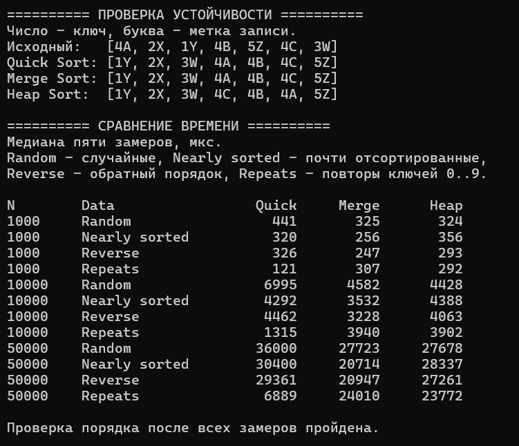

# Лабораторная работа №7

## Титульный лист

**Дисциплина** – Алгоритмы и структуры данных  
**Тема** – Быстрая сортировка, сортировка слиянием, пирамидальная сортировка  
**Уровень** – продвинутый  
**Вариант** – 5  
**Студент** – Власенко Александр Андреевич  
**Группа** – ПИЖ-б-о-25-1  
**Год** – 2026

---

## 1. Цель работы

Изучить быструю сортировку, сортировку слиянием и пирамидальную сортировку. Применить принцип «разделяй и властвуй» к разбиению и слиянию диапазонов, использовать двоичную кучу для сортировки на месте. Реализовать устойчивый Quick Sort, проверить порядок записей с одинаковыми ключами, оценить сложность алгоритмов и сравнить время работы на массивах разного размера и порядка.

## 2. Теоретическая часть

### 2.1. Устойчивость и принцип «разделяй и властвуй»

Устойчивая сортировка сохраняет исходный относительный порядок элементов с одинаковыми ключами. Если записи `4A`, `4B` и `4C` имеют одинаковый ключ `4`, после устойчивой сортировки они останутся в порядке `A`, `B`, `C`. В программе `Item::operator<` сравнивает ключи, а буквы служат метками записей.

Принцип «разделяй и властвуй» состоит в разбиении задачи на меньшие задачи того же вида и использовании их решений для получения общего результата. Quick Sort распределяет элементы по ключам до сортировки частей. Merge Sort делит массив по индексам и объединяет уже отсортированные части после возврата из рекурсии. Диапазон `[first, last)` включает `first`, а `last` обозначает границу за последним элементом. Диапазоны длины 0 и 1 уже упорядочены.

### 2.2. Быстрая сортировка

Quick Sort выбирает опорный элемент и распределяет остальные элементы по отношению к нему. При сбалансированном разбиении на каждом уровне обрабатывается до `n` элементов, а уровней порядка `log n`. Если опорное значение каждый раз оказывается крайним, размеры подзадач убывают на единицу и число операций может вырасти до `O(n²)`.

Обычное разбиение с обменами может нарушать устойчивость. Например, при выборе последнего элемента как опорного обмен в массиве `[2A, 2B, 1]` даёт `[1, 2B, 2A]`. Для варианта 5 используется устойчивое разбиение с вспомогательным буфером.

### 2.3. Устойчивый Quick Sort для варианта 5

Опорное значение выбирается как медиана первого, среднего и последнего элементов диапазона. Для этого упорядочиваются три локальные копии. Порядок исходных записей на этапе выбора опорного сохраняется.

Первый проход считает количество ключей меньше опорного и равных ему. Эти количества определяют начальные индексы трёх групп в буфере. Во втором проходе элементы записываются в свои группы слева направо. Для каждой группы хранится позиция следующей свободной ячейки. После копирования диапазона из буфера в массив группа равных ключей готова, а крайние группы обрабатываются дальше.

```text
Исходный диапазон   [4A, 2X, 1Y, 4B, 5Z, 4C, 3W]
Опорный ключ        4
Меньше 4            [2X, 1Y, 3W]
Равно 4             [4A, 4B, 4C]
Больше 4            [5Z]
```

Записи с одинаковым ключом на каждом шаге попадают в одну группу и записываются туда в порядке обхода. Это сохраняет их относительный порядок при всех последующих разбиениях. Для массива из одинаковых ключей достаточно одного разбиения.

Вспомогательный вектор создаётся один раз на сортировку. Меньшая крайняя группа обрабатывается рекурсивно, большая – следующей итерацией цикла. Поэтому вложенный вызов получает не больше половины текущего диапазона и глубина стека ограничена `O(log n)`. Худшее время остаётся `O(n²)` при сильно неравных разбиениях.

### 2.4. Сортировка слиянием

Merge Sort делит диапазон пополам, сортирует обе половины и сливает их. При слиянии сравниваются первые ещё не использованные элементы каждой половины. Меньший записывается в буфер, а индекс его половины сдвигается на одну позицию. При равных ключах берётся элемент слева, который раньше встречался в исходном массиве. После исчерпания одной половины остаток другой копируется целиком. Затем готовый диапазон переносится из буфера обратно.

Например, слияние `[2A, 6]` и `[2B, 5]` последовательно выбирает `2A`, `2B`, `5`, `6`. Метки равных ключей сохраняют порядок. В реализации один вектор для слияний используется повторно на всех уровнях. Суммарный объём слияний на каждом уровне равен `O(n)`, а сбалансированное деление даёт `O(log n)` уровней.

### 2.5. Пирамидальная сортировка

Max-heap представляет двоичную кучу в массиве. Ключ родителя не меньше ключей его детей, поэтому максимум находится в корне по индексу 0. Для индекса `i` левый ребёнок имеет индекс `2 * i + 1`, правый – `2 * i + 2`, если соответствующий индекс входит в активную часть кучи.

`heapify()` просеивает элемент вниз. Сначала выбирается больший ребёнок, затем при нарушении свойства кучи он меняется с родителем. Просеивание продолжается с новой позиции. Куча строится снизу вверх, начиная с последнего внутреннего узла. Листья уже удовлетворяют свойству кучи, а обработанные поддеревья позволяют просеивать очередного родителя.

После построения корень меняется с последним элементом активной части. Максимум остаётся на своей итоговой позиции, размер кучи уменьшается, новый корень просеивается вниз. Итеративный `heapify()` использует только индексы и обмены. Дальние обмены могут менять порядок записей с одинаковыми ключами.

## 3. Постановка задачи

Для продвинутого уровня, варианта 5, реализовать Quick Sort, Merge Sort и Heap Sort. Дополнительное требование варианта – устойчивая версия быстрой сортировки.

1. Реализовать устойчивый Quick Sort с выбором опорного по медиане трёх и разбиением на три группы.
2. Реализовать Merge Sort с общим вспомогательным буфером и сохранением порядка равных ключей при слиянии.
3. Реализовать Heap Sort на основе max-heap с итеративным просеиванием.
4. Продемонстрировать работу на записях с ключами и метками, затем измерить время сортировок на одинаковых наборах целых чисел.
5. Сопоставить результаты замеров, устойчивость и затраты памяти.

Программа написана на C++20 в одном файле `main.cpp`. Шаблонные функции применяются к целым числам и к записям `Item`.

## 4. Листинг программы

Полный согласованный исходник приведён ниже.

```cpp
#include <algorithm>
#include <chrono>
#include <clocale>
#include <iomanip>
#include <iostream>
#include <random>
#include <stdexcept>
#include <utility>
#include <vector>

using namespace std;

struct Item {
    int key;
    char label;

    bool operator<(const Item& other) const {
        return key < other.key;
    }
};

// Медиана первого, среднего и последнего элементов
template <typename T>
T choosePivot(const vector<T>& arr, size_t first, size_t last) {
    T a = arr[first];
    T b = arr[first + (last - first) / 2];
    T c = arr[last - 1];

    if (b < a)
        swap(a, b);
    if (c < b)
        swap(b, c);
    if (b < a)
        swap(a, b);

    return b;
}

// Устойчивая быстрая сортировка диапазона [first, last)
template <typename T>
void quickSortRange(vector<T>& arr, vector<T>& buffer, size_t first, size_t last) {
    while (last - first > 1) {
        const T pivot = choosePivot(arr, first, last);
        size_t lessCount = 0;
        size_t equalCount = 0;

        for (size_t i = first; i < last; i++) {
            if (arr[i] < pivot)
                lessCount++;
            else if (!(pivot < arr[i]))
                equalCount++;
        }

        const size_t equalBegin = first + lessCount;
        const size_t greaterBegin = equalBegin + equalCount;
        size_t lessPos = first;
        size_t equalPos = equalBegin;
        size_t greaterPos = greaterBegin;

        // В каждой группе сохраняем порядок обхода
        for (size_t i = first; i < last; i++) {
            if (arr[i] < pivot)
                buffer[lessPos++] = arr[i];
            else if (pivot < arr[i])
                buffer[greaterPos++] = arr[i];
            else
                buffer[equalPos++] = arr[i];
        }

        for (size_t i = first; i < last; i++)
            arr[i] = buffer[i];

        // Меньшая часть обрабатывается рекурсией, большая – циклом
        if (equalBegin - first < last - greaterBegin) {
            quickSortRange(arr, buffer, first, equalBegin);
            first = greaterBegin;
        }
        else {
            quickSortRange(arr, buffer, greaterBegin, last);
            last = equalBegin;
        }
    }
}

template <typename T>
void quickSort(vector<T>& arr) {
    if (arr.size() < 2)
        return;

    vector<T> buffer(arr.size());
    quickSortRange(arr, buffer, 0, arr.size());
}

// Слияние соседних отсортированных частей
template <typename T>
void mergeRanges(vector<T>& arr, vector<T>& buffer, size_t first, size_t middle, size_t last) {
    size_t left = first;
    size_t right = middle;
    size_t pos = first;

    while (left < middle && right < last) {
        if (arr[right] < arr[left])
            buffer[pos++] = arr[right++];
        else
            buffer[pos++] = arr[left++]; // При равенстве берём слева
    }

    while (left < middle)
        buffer[pos++] = arr[left++];

    while (right < last)
        buffer[pos++] = arr[right++];

    for (size_t i = first; i < last; i++)
        arr[i] = buffer[i];
}

template <typename T>
void mergeSortRange(vector<T>& arr, vector<T>& buffer, size_t first, size_t last) {
    if (last - first < 2)
        return;

    const size_t middle = first + (last - first) / 2;
    mergeSortRange(arr, buffer, first, middle);
    mergeSortRange(arr, buffer, middle, last);
    mergeRanges(arr, buffer, first, middle, last);
}

template <typename T>
void mergeSort(vector<T>& arr) {
    if (arr.size() < 2)
        return;

    vector<T> buffer(arr.size());
    mergeSortRange(arr, buffer, 0, arr.size());
}

// Просеивание вниз в пределах активной кучи
template <typename T>
void heapify(vector<T>& arr, size_t root, size_t heapSize) {
    while (root < heapSize / 2) {
        size_t child = 2 * root + 1;

        if (child + 1 < heapSize && arr[child] < arr[child + 1])
            child++;

        if (!(arr[root] < arr[child]))
            return;

        swap(arr[root], arr[child]);
        root = child;
    }
}

template <typename T>
void heapSort(vector<T>& arr) {
    // Начинаем с последнего узла, у которого есть дети
    for (size_t i = arr.size() / 2; i > 0; i--)
        heapify(arr, i - 1, arr.size());

    for (size_t end = arr.size(); end > 1; end--) {
        swap(arr[0], arr[end - 1]);
        heapify(arr, 0, end - 1);
    }
}

void printItems(const vector<Item>& arr) {
    cout << "[";

    for (size_t i = 0; i < arr.size(); i++) {
        if (i > 0)
            cout << ", ";

        cout << arr[i].key << arr[i].label;
    }

    cout << "]\n";
}

using SortFunction = void (*)(vector<int>&);

long long measureTime(const vector<int>& source, SortFunction sortFunction) {
    constexpr int repeats = 5;
    long long times[repeats];

    for (int i = 0; i < repeats; i++) {
        vector<int> copy = source;

        const auto start = chrono::steady_clock::now();
        sortFunction(copy);
        const auto finish = chrono::steady_clock::now();

        times[i] = chrono::duration_cast<chrono::microseconds>(finish - start).count();

        if (!is_sorted(copy.begin(), copy.end()))
            throw logic_error("Array is not sorted");
    }

    // Упорядочиваем только пять измерений, чтобы взять медиану
    sort(times, times + repeats);
    return times[repeats / 2];
}

void printBenchmark(const char* name, const vector<int>& source) {
    const long long quickTime = measureTime(source, quickSort<int>);
    const long long mergeTime = measureTime(source, mergeSort<int>);
    const long long heapTime = measureTime(source, heapSort<int>);

    cout << left << setw(9) << source.size() << setw(16) << name
        << right << setw(10) << quickTime << setw(10) << mergeTime
        << setw(10) << heapTime << "\n";
}

int main() {
    setlocale(LC_ALL, "");

    cout << "========== ПРОВЕРКА УСТОЙЧИВОСТИ ==========\n";
    cout << "Число – ключ, буква – метка записи.\n";

    const vector<Item> items = {
        {4, 'A'}, {2, 'X'}, {1, 'Y'}, {4, 'B'}, {5, 'Z'}, {4, 'C'}, {3, 'W'}
    };
    vector<Item> quickItems = items;
    vector<Item> mergeItems = items;
    vector<Item> heapItems = items;

    quickSort(quickItems);
    mergeSort(mergeItems);
    heapSort(heapItems);

    cout << "Исходный:   ";
    printItems(items);
    cout << "Quick Sort: ";
    printItems(quickItems);
    cout << "Merge Sort: ";
    printItems(mergeItems);
    cout << "Heap Sort:  ";
    printItems(heapItems);

    cout << "\n========== СРАВНЕНИЕ ВРЕМЕНИ ==========\n";
    cout << "Медиана пяти замеров, мкс.\n";
    cout << "Random – случайные, Nearly sorted – почти отсортированные,\n";
    cout << "Reverse – обратный порядок, Repeats – повторы ключей 0..9.\n\n";
    cout << left << setw(9) << "N" << setw(16) << "Data"
        << right << setw(10) << "Quick" << setw(10) << "Merge"
        << setw(10) << "Heap" << "\n";

    mt19937 generator(42);
    uniform_int_distribution<int> randomValue(-1000000, 1000000);
    uniform_int_distribution<int> repeatedValue(0, 9);

    for (int n : {1000, 10000, 50000}) {
        vector<int> random(n);
        vector<int> nearly(n);
        vector<int> reverse(n);
        vector<int> repeats(n);

        for (int i = 0; i < n; i++) {
            random[i] = randomValue(generator);
            nearly[i] = i;
            reverse[i] = n - i;
            repeats[i] = repeatedValue(generator);
        }

        for (int i = 0; i + 1 < n; i += 100)
            swap(nearly[i], nearly[i + 1]);

        printBenchmark("Random", random);
        printBenchmark("Nearly sorted", nearly);
        printBenchmark("Reverse", reverse);
        printBenchmark("Repeats", repeats);
    }

    cout << "\nПроверка порядка после всех замеров пройдена.\n";
    return 0;
}
```

## 5. Результаты работы

### 5.1. Проверка устойчивости

На скриншоте показаны порядок записей после сортировки и фактические времена выполнения.



| Алгоритм | Результат | Метки при ключе 4 |
|---|---|---|
| Исходные данные | `[4A, 2X, 1Y, 4B, 5Z, 4C, 3W]` | `A, B, C` |
| Quick Sort | `[1Y, 2X, 3W, 4A, 4B, 4C, 5Z]` | `A, B, C` |
| Merge Sort | `[1Y, 2X, 3W, 4A, 4B, 4C, 5Z]` | `A, B, C` |
| Heap Sort | `[1Y, 2X, 3W, 4C, 4B, 4A, 5Z]` | `C, B, A` |

Во всех трёх результатах ключи расположены по возрастанию. Quick Sort и Merge Sort сохранили последовательность меток равных записей. Результат Heap Sort демонстрирует возможное изменение этой последовательности.

### 5.2. Условия измерений

Для каждого размера `1 000`, `10 000` и `50 000` созданы четыре массива.

| Метка в выводе | Построение массива |
|---|---|
| Random | Случайные целые от `-1000000` до `1000000` |
| Nearly sorted | Возрастающие значения с обменом одной соседней пары через каждые 100 позиций |
| Reverse | Убывающие значения от `n` до `1` |
| Repeats | Случайные ключи из диапазона `0–9` |

Генератор `mt19937` инициализируется числом 42. Для каждого алгоритма и повтора создаётся свежая копия одного исходного массива. `chrono::steady_clock` измеряет вызов сортировки, включая работу её внутренних буферов. Создание копии, проверка отсортированности и вывод выполняются вне измеряемого участка. Из пяти длительностей берётся медиана в микросекундах. Режим сборки пользовательского запуска на снимке не указан.

### 5.3. Сравнительная таблица производительности

Все времена в таблице переписаны со скриншота. В каждой ячейке указана медиана пяти измерений, мкс.

| N | Данные | Quick Sort, мкс | Merge Sort, мкс | Heap Sort, мкс |
|---:|---|---:|---:|---:|
| 1000 | Random | 441 | 325 | 324 |
| 1000 | Nearly sorted | 320 | 256 | 356 |
| 1000 | Reverse | 326 | 247 | 293 |
| 1000 | Repeats | 121 | 307 | 292 |
| 10000 | Random | 6995 | 4582 | 4428 |
| 10000 | Nearly sorted | 4292 | 3532 | 4388 |
| 10000 | Reverse | 4462 | 3228 | 4063 |
| 10000 | Repeats | 1315 | 3940 | 3902 |
| 50000 | Random | 36000 | 27723 | 27678 |
| 50000 | Nearly sorted | 30400 | 20714 | 28337 |
| 50000 | Reverse | 29361 | 20947 | 27261 |
| 50000 | Repeats | 6889 | 24010 | 23772 |

На случайных массивах в этом запуске наименьшее время показал Heap Sort. При `n = 50000` разница с Merge Sort составила 45 мкс, поэтому оба результата близки. Устойчивый Quick Sort занял больше времени на каждом из трёх размеров. Его разбиение включает два прохода и копирование через буфер.

На почти отсортированных и обратных массивах Merge Sort показал наименьшее время при всех трёх размерах. Для `n = 50000` получено 20 714 мкс на почти отсортированных данных и 20 947 мкс при обратном порядке.

На данных с ключами `0–9` наименьшее время показал Quick Sort. Для `n = 50000` он занял 6 889 мкс. Этот результат согласуется с трёхчастным разбиением: каждая группа равных ключей после своего разбиения исключается из дальнейшей сортировки. Merge Sort выполняет предусмотренные слияния и на данных с повторами, а Heap Sort по-прежнему переносит корень на итоговую позицию на каждом шаге. Абсолютные времена зависят от оборудования, режима сборки и нагрузки системы.

### 5.4. Проверка реализации

Код собран компилятором MSVC Visual Studio 2022 x64 с `/std:c++20`, `/utf-8` и `/W4 /WX`. Дополнительная проверка охватила 9 849 массивов. Среди них все массивы длины от 0 до 8 из значений `-1`, `0`, `1`, предельные значения `int`, крупные массивы до 50 000 элементов, одинаковые ключи и разные порядки данных.

Результаты сортировки целых чисел сопоставлены с эталоном. Для записей проверено сохранение исходного порядка равных ключей в Quick Sort и Merge Sort. У Heap Sort проверены порядок ключей и сохранность всех записей. Debug CRT не обнаружил разницы выделенной памяти до и после тестовых сценариев.

## 6. Анализ сложности

| Алгоритм | Лучший случай | Средний случай | Худший случай | Дополнительная память | Устойчивость |
|---|---|---|---|---|---|
| Quick Sort с устойчивым трёхчастным разбиением | `O(n)` при одинаковых ключах | `O(n log n)` при типичных разбиениях случайных данных | `O(n²)` | `O(n)` буфер, `O(log n)` стек | Да |
| Merge Sort | `Θ(n log n)` | `Θ(n log n)` | `Θ(n log n)` | `O(n)` буфер, `O(log n)` стек | Да |
| Heap Sort с итеративным `heapify()` | `O(n)` при одинаковых ключах | `O(n log n)` | `O(n log n)` | `O(1)` | Нет |

У Quick Sort разбиение диапазона требует линейного времени. При делении на части сопоставимого размера получается `O(log n)` уровней работы, а при повторяющихся крайне неравных разбиениях – до `O(n)` уровней. Реализация обрабатывает меньший диапазон рекурсивно, поэтому число одновременно активных вызовов ограничено логарифмом. Общая дополнительная память определяется буфером `O(n)`.

Merge Sort сливает диапазоны на каждом уровне. Суммарный размер обрабатываемых диапазонов на одном уровне равен `O(n)`, а число уровней составляет `O(log n)`. Копирование в буфер и обратно выполняется и для заранее упорядоченных данных, поэтому для этой реализации оценка `Θ(n log n)` сохраняется.

У Heap Sort построение кучи снизу вверх занимает `O(n)`, поскольку большинство узлов близко к листьям и требует мало шагов просеивания. Затем выполняется `n - 1` извлечений с восстановлением кучи до `O(log n)` на шаг. Общая гарантия составляет `O(n log n)`. На массиве одинаковых ключей просеивание сразу останавливается, и время линейно. Дополнительная память постоянна благодаря циклу в `heapify()`.

Копии входных данных нужны для сравнения производительности. Они создаются функцией измерений и не входят в оценку дополнительной памяти отдельной сортировки.

## 7. Ответы на контрольные вопросы

**1. Какова сложность быстрой сортировки в лучшем, среднем и худшем случае? –** Для обычного Quick Sort лучший случай при сбалансированных разбиениях и средний случай на случайных данных имеют порядок `O(n log n)`. Разбиение линейно, а число уровней при удачных опорных значениях логарифмическое. Худший случай имеет `O(n²)`, когда при каждом разбиении одна часть почти так же велика, как исходная. В реализованной трёхчастной версии одинаковые ключи объединяются за одно разбиение, поэтому для массива из равных значений время составляет `O(n)`.

**2. Когда возникает худший случай для быстрой сортировки? –** Худший случай возникает при последовательности сильно неравных разбиений. Например, выбор последнего элемента как опорного на возрастающем массиве каждый раз выделяет максимум и оставляет участок длины `n - 1`. Тогда суммируются затраты на участки длин `n`, `n - 1` и так далее, что даёт квадратичное время. Двухчастное разбиение также может вырождаться на равных ключах в зависимости от условия сравнения.

**3. Как можно улучшить быструю сортировку для защиты от худшего случая? –** Выбор случайного опорного снижает зависимость от исходного порядка. Медиана трёх помогает получать сбалансированные части на многих типичных входах. Трёхчастное разбиение сразу выделяет группу одинаковых ключей. Для гарантии `O(n log n)` по времени вводят ограничение глубины разбиений и переходят на алгоритм с такой гарантией. Например, интроспективная сортировка использует Heap Sort, а для сохранения устойчивости резервным алгоритмом может быть Merge Sort. Обработка меньшей части рекурсией ограничивает стек, а на число операций разбиения влияет выбор опорного.

**4. Какова сложность сортировки слиянием? Почему она всегда O(n log n)? –** В обычной сортировке слиянием деление пополам образует `O(log n)` уровней, а все слияния одного уровня обрабатывают суммарно `O(n)` элементов. В этой реализации слияние и копирование выполняются для каждого диапазона, поэтому временная сложность составляет `Θ(n log n)` при любом исходном порядке. Для массивов выделяется буфер `O(n)`, дополнительно используется `O(log n)` стека.

**5. Какие преимущества и недостатки имеет сортировка слиянием перед быстрой? –** Merge Sort гарантирует `O(n log n)` в худшем случае и сохраняет порядок равных ключей при выборе из левой половины на равенстве. Его последовательное слияние подходит для массивов, списков и объединения отсортированных частей данных. Для массива обычно нужен линейный буфер, а копирование добавляет операции. Обычный Quick Sort может работать на месте с затратами только на стек, но зависит от качества разбиений. Устойчивый Quick Sort в этой работе тоже использует линейный буфер.

**6. Как работает пирамидальная сортировка? Какова её сложность? –** Сначала из массива строится max-heap. Корень с максимальным ключом меняется с последним элементом активной части, после чего эта часть уменьшается и свойство кучи восстанавливается просеиванием. Повторение ставит максимумы справа налево. Построение снизу вверх занимает `O(n)`, а сортировка имеет гарантию `O(n log n)`. Итеративное просеивание позволяет использовать `O(1)` дополнительной памяти.

**7. Какая из трёх сортировок устойчивая? Почему? –** В классическом сравнении устойчива сортировка слиянием, если при равенстве она выбирает элемент левой половины. В данной работе устойчив и Quick Sort, потому что элементы каждой группы при разбиении записываются в исходном порядке. Равные ключи всегда попадают в одну группу. Heap Sort может менять порядок равных записей дальними обменами. Это видно по меткам `C, B, A` при ключе `4` на скриншоте.

**8. Какая из трёх сортировок требует дополнительной памяти? Сколько? –** Для Merge Sort на массиве требуется буфер `O(n)` и стек `O(log n)`. Реализованный устойчивый Quick Sort тоже выделяет `O(n)` для разбиения и использует `O(log n)` стека благодаря рекурсии по меньшей части. Обычная версия Quick Sort с обменами может обходиться стеком, глубина которого зависит от разбиений. В этой программе Heap Sort с итеративным просеиванием использует `O(1)` дополнительной памяти.

**9. Какая из трёх сортировок лучше работает на почти отсортированных данных? –** Результат зависит от выбора опорного элемента, реализации и размера. Quick Sort с первым или последним опорным на почти упорядоченном массиве может делить данные неудачно. Медиана трёх помогает для таких входов. Merge Sort сохраняет сбалансированное деление, а Heap Sort гарантирует `O(n log n)` независимо от порядка. В приведённых замерах на почти отсортированных массивах Merge Sort показал наименьшее время при всех трёх размерах.

**10. Зачем в пирамидальной сортировке сначала строится куча? –** Свойство max-heap гарантирует, что максимум активной части находится в корне. Тогда для переноса следующего максимума на итоговую позицию достаточно обменять корень с концом кучи и восстановить свойство просеиванием. Поиск максимума по всему остаточному массиву после каждого шага потребовал бы линейного обхода вместо просеивания по высоте дерева.

**11. Что такое «разделяй и властвуй»? Как он применяется в быстрой сортировке и сортировке слиянием? –** Задачу делят на подзадачи того же вида, решают их и получают общий результат. Quick Sort сначала распределяет значения относительно опорного, затем сортирует полученные части. Merge Sort сначала делит диапазон пополам, сортирует обе половины и сливает их. Поэтому у Quick Sort основная работа выполняется при разбиении, а у Merge Sort – при объединении.

**12. Можно ли реализовать быструю сортировку итеративно (без рекурсии)? –** Да. Диапазоны, которые ещё надо отсортировать, сохраняют в явном стеке. Цикл извлекает диапазон, разбивает его и помещает обратно непустые подзадачи. Если большую часть откладывать, а меньшую обрабатывать сразу, размер стека можно ограничить `O(log n)`. В данной программе используется близкая идея с рекурсией по меньшему диапазону и циклом по большему.

**13. Почему быстрая сортировка обычно быстрее сортировки слиянием на практике? –** Обычный Quick Sort на массиве может разбивать данные на месте, последовательно читать элементы и обходиться без копирования каждого уровня во вспомогательный массив. Это может уменьшить постоянные затраты на перемещение данных. Эффект зависит от выбора опорного и конкретной реализации. Устойчивый Quick Sort данной работы делает два прохода разбиения и копирует данные через буфер. На случайном массиве из 50 000 элементов его время в приведённом запуске выше времени Merge Sort.

**14. Когда выгодно использовать пирамидальную сортировку? –** Heap Sort подходит, когда важны гарантия `O(n log n)` и малый расход дополнительной памяти, а устойчивость не требуется. Например, его можно использовать для сортировки массива на месте при ограниченной доступной памяти. На практике обход кучи может иметь менее удобный порядок обращений к памяти, поэтому скорость определяется конкретными данными и реализацией.

**15. Какой алгоритм сортировки вы бы выбрали для встроенных систем с ограниченной памятью? –** При отсутствии требования устойчивости я бы выбрал Heap Sort с итеративным просеиванием. Он использует `O(1)` дополнительной памяти, обходится без рекурсивного стека и гарантирует `O(n log n)` по времени. Если сохранение порядка равных записей обязательно, придётся учитывать доступную память и выбирать подходящую устойчивую реализацию.

## 8. Выводы

Реализованы три алгоритма сортировки продвинутого уровня, варианта 5. Быстрая сортировка сохраняет порядок равных записей благодаря трёхчастному разбиению с последовательной записью в буфер. Merge Sort сохраняет этот порядок при выборе слева на равенстве. Heap Sort сортирует массив на месте с постоянной дополнительной памятью.

Замеры на одинаковых копиях входных массивов показали зависимость результата от структуры данных. В данном запуске Heap Sort показал наименьшее время на случайных массивах, Merge Sort – на почти отсортированных и обратных, устойчивый Quick Sort – на массивах с множеством повторов. Полученные результаты сопоставлены со сложностью алгоритмов, способом разбиения и затратами на временные буферы.

## 9. Ссылка на Git-репозиторий

https://github.com/lostmoth/student-dsa-course
