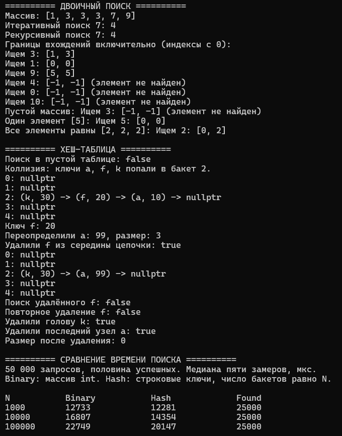

# Лабораторная работа №8

## Титульный лист

**Дисциплина** – Алгоритмы и структуры данных  
**Тема** – Двоичный поиск. Хеш-таблицы  
**Вариант** – 5  
**Студент** – Власенко Александр Андреевич  
**Группа** – ПИЖ-б-о-25-1  
**Год** – 2026

---

## 1. Цель работы

Освоить итеративную и рекурсивную формы двоичного поиска, научиться находить границы группы равных элементов. Изучить хеширование строк и методы разрешения коллизий. Реализовать хеш-таблицу с цепочками, проверить её основные операции и сравнить время двух способов поиска на наборах разного размера.

## 2. Теоретическая часть

### 2.1. Двоичный поиск

Двоичный поиск использует порядок элементов в отсортированном массиве. Если средний элемент меньше искомого, то все элементы слева от него тоже меньше. Продолжать поиск достаточно в правой половине. Если средний элемент больше искомого, проверяется левая половина. При совпадении обычный поиск возвращает индекс среднего элемента.

При каждой проверке размер диапазона уменьшается примерно вдвое. После $k$ шагов остаётся порядка $n / 2^k$ элементов, поэтому число шагов растёт логарифмически. В итеративной реализации границы меняются в цикле. Рекурсивная реализация передаёт уменьшенный диапазон следующему вызову. Базовый случай – пустой диапазон, в котором искать больше негде.

В программе используется полуоткрытый диапазон `[left, right)`. Индекс `left` входит в диапазон, а `right` обозначает позицию сразу после его конца. Изначально правая граница равна размеру массива. Середина вычисляется через разность границ, чтобы избежать переполнения при их сложении.

### 2.2. Границы группы равных элементов

В отсортированном массиве одинаковые элементы образуют непрерывную группу. Чтобы получить её границы, выполняются два поиска. Первый возвращает позицию первого элемента, который больше или равен искомому значению. Если эта позиция указывает на искомый элемент, второй поиск находит первую позицию со строго большим значением. Чтобы получить индекс последнего вхождения, из второй позиции вычитается единица.

В массиве `[1, 3, 3, 3, 7, 9]` первым элементом, который больше или равен `3`, будет тройка по индексу `1`. Первый элемент строго больше `3` – семёрка по индексу `4`. Значит, группа троек занимает индексы от `1` до `3` включительно. Если искомого числа нет, программа возвращает пару `[-1, -1]`.

### 2.3. Хеш-таблица и хеш-функция

Хеш-таблица хранит пары «ключ – значение». Хеш-функция преобразует ключ в число, а остаток от деления этого числа на количество бакетов задаёт индекс в массиве. Бакетом называется ячейка, с которой начинается поиск записей с таким индексом. Для одинаковых ключей результат вычисления должен совпадать. Хорошая хеш-функция быстро вычисляется и достаточно равномерно распределяет типичные ключи по бакетам.

В строковой хеш-функции программы начальное значение равно нулю. При обработке следующего байта накопленное значение умножается на `31`, затем добавляется числовое значение байта. Такой порядок учитывает расположение байтов в строке. Преобразование к `unsigned char` даёт неотрицательное значение байта, а накопитель типа `size_t` использует определённую в C++ беззнаковую арифметику.

Разные ключи могут попадать в один бакет. Такая ситуация называется коллизией. Например, при пяти бакетах ключи `"a"`, `"f"` и `"k"` дают хеши `97`, `102` и `107`. Остаток от деления каждого из них на пять равен двум. Поэтому после вычисления бакета программа проверяет равенство полных ключей.

### 2.4. Метод цепочек

При разрешении коллизий методом цепочек каждый бакет хранит указатель на начало односвязного списка. Узел содержит ключ, значение и указатель на следующий узел. Пустой бакет содержит `nullptr`. Для поиска достаточно пройти цепочку выбранного бакета. Вставка существующего ключа меняет его значение, новый ключ добавляется в начало цепочки.

При удалении сохраняется адрес предыдущего узла. Если удаляемый узел находится внутри цепочки или в конце, указатель предыдущего узла перенаправляется на следующий. При удалении головы изменяется указатель в самом бакете. После перенастройки связи узел освобождается. Деструктор последовательно освобождает все узлы, сохраняя адрес следующего узла перед каждым удалением.

### 2.5. Открытая адресация, загрузка и рехеширование

При открытой адресации записи хранятся непосредственно в ячейках массива. При коллизии проверяется последовательность позиций. Пусть `m` – число ячеек, `h` – начальная позиция, а `i` – номер попытки с нуля.

| Метод | Индекс | Особенность |
|---|---|---|
| Линейное пробирование | `(h + i) % m` | Проверяются соседние ячейки. Непрерывные занятые участки могут сливаться, образуя первичную кластеризацию. |
| Квадратичное пробирование | `(h + i * i) % m` | Смещение растёт по квадратам. Ключи с одной начальной позицией проходят одинаковую последовательность, образуя вторичную кластеризацию. |
| Двойное хеширование | `(h1 + i * h2) % m` | Шаг задаёт второй хеш. Ненулевой шаг, взаимно простой с размером массива, позволяет обойти все ячейки. |

При удалении в открытой адресации ячейку обычно помечают как удалённую. Поиск продолжает проходить через неё, поскольку нужная запись могла попасть дальше по той же последовательности пробирования. Никогда не занятая ячейка позволяет завершить поиск.

Коэффициент загрузки $\alpha = n / m$ равен отношению числа записей к числу бакетов. В методе цепочек он может превышать единицу. Чем выше загрузка, тем больше узлов в средней цепочке. Для открытой адресации рост загрузки особенно заметен около единицы, когда свободных позиций мало.

При рехешировании создаётся массив нового размера. Индекс каждой записи вычисляется заново, поскольку остаток от деления зависит от числа бакетов. Например, хеш `97` даёт индекс `2` при пяти бакетах и `9` при одиннадцати. В данной реализации размер выбирается при создании таблицы и используется в течение её жизни.

## 3. Постановка задачи

1. Реализовать двоичный поиск левой и правой границ группы одинаковых значений в отсортированном массиве целых чисел. Проверить обычные и граничные случаи.
2. Разработать класс хеш-таблицы со строковым ключом и целочисленным значением. Реализовать метод цепочек и операции `insert`, `find` и `remove`. Продемонстрировать обработку коллизии.
3. Для `N = 1 000`, `10 000` и `100 000` сравнить время итеративного двоичного поиска в массиве и поиска в собственной хеш-таблице. Представить результаты в таблице и проанализировать их.

Программа написана на C++20 и запускается в Visual Studio.

## 4. Листинг программы

```cpp
#include <algorithm>
#include <array>
#include <chrono>
#include <clocale>
#include <cstddef>
#include <iomanip>
#include <iostream>
#include <random>
#include <stdexcept>
#include <string>
#include <utility>
#include <vector>

using namespace std;

ptrdiff_t binarySearch(const vector<int>& arr, int target) {
    size_t left = 0;
    size_t right = arr.size();

    while (left < right) {
        size_t mid = left + (right - left) / 2;
        if (arr[mid] == target)
            return static_cast<ptrdiff_t>(mid);
        if (arr[mid] < target)
            left = mid + 1;
        else
            right = mid;
    }

    return -1;
}

ptrdiff_t binarySearchRecursive(const vector<int>& arr, int target, size_t left, size_t right) {
    if (left == right)
        return -1;

    size_t mid = left + (right - left) / 2;
    if (arr[mid] == target)
        return static_cast<ptrdiff_t>(mid);
    if (arr[mid] < target)
        return binarySearchRecursive(arr, target, mid + 1, right);
    return binarySearchRecursive(arr, target, left, mid);
}

// Первая позиция с элементом >= target или > target
size_t findBound(const vector<int>& arr, int target, bool upper) {
    size_t left = 0;
    size_t right = arr.size();

    while (left < right) {
        size_t mid = left + (right - left) / 2;
        if (arr[mid] < target || (upper && arr[mid] == target))
            left = mid + 1;
        else
            right = mid;
    }

    return left;
}

pair<ptrdiff_t, ptrdiff_t> findBounds(const vector<int>& arr, int target) {
    size_t first = findBound(arr, target, false);
    if (first == arr.size() || arr[first] != target)
        return {-1, -1};

    size_t afterLast = findBound(arr, target, true);
    return {static_cast<ptrdiff_t>(first), static_cast<ptrdiff_t>(afterLast - 1)};
}

class HashTable {
private:
    struct Node {
        string key;
        int value;
        Node* next;
    };

    vector<Node*> buckets;
    size_t count = 0;

    size_t hash(const string& key) const {
        size_t code = 0;
        for (char ch : key)
            code = code * 31 + static_cast<unsigned char>(ch);
        return code % buckets.size();
    }

public:
    explicit HashTable(size_t bucketCount) : buckets(bucketCount, nullptr) {
        if (bucketCount == 0)
            throw invalid_argument("Bucket count must be positive");
    }

    HashTable(const HashTable&) = delete;
    HashTable& operator=(const HashTable&) = delete;

    ~HashTable() {
        for (Node* current : buckets) {
            while (current != nullptr) {
                Node* next = current->next;
                delete current;
                current = next;
            }
        }
    }

    void insert(const string& key, int value) {
        size_t index = hash(key);
        Node* current = buckets[index];

        while (current != nullptr) {
            if (current->key == key) {
                current->value = value;
                return;
            }
            current = current->next;
        }

        // Новый узел становится головой цепочки
        buckets[index] = new Node{key, value, buckets[index]};
        count++;
    }

    bool find(const string& key, int& result) const {
        const Node* current = buckets[hash(key)];
        while (current != nullptr) {
            if (current->key == key) {
                result = current->value;
                return true;
            }
            current = current->next;
        }
        return false;
    }

    bool remove(const string& key) {
        size_t index = hash(key);
        Node* current = buckets[index];
        Node* prev = nullptr;

        while (current != nullptr) {
            if (current->key == key) {
                // Перенастраиваем связь до освобождения узла
                if (prev == nullptr)
                    buckets[index] = current->next;
                else
                    prev->next = current->next;

                delete current;
                count--;
                return true;
            }

            prev = current;
            current = current->next;
        }
        return false;
    }

    size_t size() const {
        return count;
    }

    void print() const {
        for (size_t i = 0; i < buckets.size(); i++) {
            cout << i << ": ";
            const Node* current = buckets[i];
            while (current != nullptr) {
                cout << '(' << current->key << ", " << current->value << ") -> ";
                current = current->next;
            }
            cout << "nullptr\n";
        }
    }
};

void printBounds(const vector<int>& arr, int target) {
    auto [first, last] = findBounds(arr, target);
    cout << "Ищем " << target << ": [" << first << ", " << last << ']';
    if (first == -1)
        cout << " (элемент не найден)";
    cout << '\n';
}

void showBinarySearch() {
    cout << "========== ДВОИЧНЫЙ ПОИСК ==========\n";
    const vector<int> arr{1, 3, 3, 3, 7, 9};
    cout << "Массив: [1, 3, 3, 3, 7, 9]\n";
    cout << "Итеративный поиск 7: " << binarySearch(arr, 7) << '\n';
    cout << "Рекурсивный поиск 7: " << binarySearchRecursive(arr, 7, 0, arr.size()) << '\n';

    cout << "Границы вхождений включительно (индексы с 0):\n";
    for (int target : {3, 1, 9, 4, 0, 10})
        printBounds(arr, target);
    cout << "Пустой массив: ";
    printBounds({}, 3);
    cout << "Один элемент [5]: ";
    printBounds({5}, 5);
    cout << "Все элементы равны [2, 2, 2]: ";
    printBounds({2, 2, 2}, 2);
}

void showHashTable() {
    cout << "\n========== ХЕШ-ТАБЛИЦА ==========\n";
    HashTable table(5);
    int value = 0;

    cout << "Поиск в пустой таблице: " << table.find("a", value) << '\n';
    table.insert("a", 10);
    table.insert("f", 20);
    table.insert("k", 30);
    cout << "Коллизия: ключи a, f, k попали в бакет 2.\n";
    table.print();

    if (table.find("f", value))
        cout << "Ключ f: " << value << '\n';
    table.insert("a", 99);
    if (table.find("a", value))
        cout << "Переопределили a: " << value << ", размер: " << table.size() << '\n';

    cout << "Удалили f из середины цепочки: " << table.remove("f") << '\n';
    table.print();
    cout << "Поиск удалённого f: " << table.find("f", value) << '\n';
    cout << "Повторное удаление f: " << table.remove("f") << '\n';
    cout << "Удалили голову k: " << table.remove("k") << '\n';
    cout << "Удалили последний узел a: " << table.remove("a") << '\n';
    cout << "Размер после удаления: " << table.size() << '\n';
}

struct SearchResult {
    long long microseconds;
    int found;
};

template <typename Key, typename Search>
SearchResult measureSearch(const vector<Key>& queries, Search search) {
    int found = 0;
    const auto start = chrono::steady_clock::now();
    for (const Key& key : queries) {
        if (search(key))
            found++;
    }
    const auto finish = chrono::steady_clock::now();
    return {chrono::duration_cast<chrono::microseconds>(finish - start).count(), found};
}

void compareSearch(int n) {
    const int queryCount = 50000;
    const int repeats = 5;
    vector<int> arr;
    arr.reserve(n);
    HashTable table(n);

    // Чётные ID есть в обеих структурах, нечётных нет
    for (int i = 0; i < n; i++) {
        int id = 2 * i;
        arr.push_back(id);
        table.insert("key_" + to_string(id), id);
    }

    mt19937 generator(42);
    uniform_int_distribution<int> pick(0, n - 1);
    vector<int> numbers;
    numbers.reserve(queryCount);
    for (int i = 0; i < queryCount; i++)
        numbers.push_back(2 * pick(generator) + i % 2);
    shuffle(numbers.begin(), numbers.end(), generator);

    vector<string> keys;
    keys.reserve(queryCount);
    for (int id : numbers)
        keys.push_back("key_" + to_string(id));

    auto searchArray = [&arr](int id) {
        return binarySearch(arr, id) != -1;
    };
    auto searchTable = [&table](const string& key) {
        int value = 0;
        return table.find(key, value);
    };

    array<long long, repeats> binaryTimes{};
    array<long long, repeats> hashTimes{};
    int found = 0;
    for (int i = 0; i < repeats; i++) {
        SearchResult binary{};
        SearchResult hashed{};
        // Чередуем порядок замеров двух способов
        if (i % 2 == 0) {
            binary = measureSearch(numbers, searchArray);
            hashed = measureSearch(keys, searchTable);
        }
        else {
            hashed = measureSearch(keys, searchTable);
            binary = measureSearch(numbers, searchArray);
        }

        if (binary.found != queryCount / 2 || hashed.found != binary.found)
            throw logic_error("Search results do not match");

        binaryTimes[i] = binary.microseconds;
        hashTimes[i] = hashed.microseconds;
        found = binary.found;
    }

    sort(binaryTimes.begin(), binaryTimes.end());
    sort(hashTimes.begin(), hashTimes.end());
    cout << left << setw(12) << n << setw(17) << binaryTimes[repeats / 2]
        << setw(17) << hashTimes[repeats / 2] << found << '\n';
}

int main() {
    setlocale(LC_ALL, "");
    cout << boolalpha;

    showBinarySearch();
    showHashTable();

    cout << "\n========== СРАВНЕНИЕ ВРЕМЕНИ ПОИСКА ==========\n";
    cout << "50 000 запросов, половина успешных. Медиана пяти замеров, мкс.\n";
    cout << "Binary: массив int. Hash: строковые ключи, число бакетов равно N.\n\n";
    cout << left << setw(12) << "N" << setw(17) << "Binary" << setw(17) << "Hash" << "Found\n";

    for (int n : {1000, 10000, 100000})
        compareSearch(n);

    return 0;
}
```

## 5. Результаты работы

### 5.1. Демонстрация программы

На рисунке показан запуск в Visual Studio. Итеративная и рекурсивная версии нашли число `7` по индексу `4`. Поиск границ вернул `[1, 3]` для числа `3`, `[0, 0]` для первого элемента и `[5, 5]` для последнего. Для отсутствующих чисел и пустого массива программа вернула `[-1, -1]`. Также проверены массив из одного элемента и массив из одинаковых элементов.



Ключи `a`, `f` и `k` образовали цепочку в бакете `2`. Поиск `f` вернул значение `20`. После обновления `a` его значение стало равно `99`, а размер таблицы остался равен трём записям. Удаление `f` из середины связало узел `k` с узлом `a`. Поиск и повторное удаление `f` вернули `false`. После удаления головы и последнего узла размер стал равен нулю.

### 5.2. Условия измерений

- В массив заносились чётные идентификаторы от `0` до `2 * (N - 1)`. В хеш-таблице им соответствовали строки с префиксом `key_`, например `key_42`. Число бакетов равно `N`, поэтому коэффициент загрузки заполненной таблицы равен единице.
- Для каждого размера выполнялись 50 000 запросов. Ровно 25 000 задавали присутствующие чётные идентификаторы, остальные – отсутствующие нечётные. Порядок запросов перемешивался, начальное состояние генератора задавалось числом `42`.
- Оба способа проверяли наличие одного и того же идентификатора. Массив получал целое число, а таблица – заранее подготовленную строку. Построение структур, генерация запросов и подготовка строк выполнялись до запуска таймера.
- Время измерялось через `std::chrono::steady_clock` в микросекундах. Для каждого способа бралась медиана пяти замеров полного набора запросов. Порядок запуска двух способов чередовался.

### 5.3. Сравнительная таблица производительности

| Количество элементов N | Двоичный поиск, мкс | Поиск в хеш-таблице, мкс | Найдено каждым способом |
|---:|---:|---:|---:|
| 1 000 | 12 733 | 12 281 | 25 000 |
| 10 000 | 16 807 | 14 354 | 25 000 |
| 100 000 | 22 749 | 20 147 | 25 000 |

В этом запуске хеш-таблица показала меньшее время при всех трёх размерах. Разница составила 452, 2 453 и 2 602 мкс соответственно. При росте `N` время обоих способов увеличилось. Двоичный поиск выполняет больше шагов на больших массивах. На время хеш-поиска влияют длина строк, распределение по цепочкам и обращения к памяти. Таблица показывает результат для конкретных типов ключей, набора запросов и настроек запуска.

### 5.4. Проверка реализации

Дополнительные проверки сравнили индексы с линейным обходом отсортированных массивов, включая повторы и предельные значения `int`. Операции хеш-таблицы проверены на специально подобранных коллизиях и на случайных последовательностях вставки, поиска и удаления с эталоном `std::unordered_map`. Также проверены пустые строки, удаление начала, середины и конца цепочки, повторное использование бакетов и отклонение нулевого числа бакетов. Всего прошло 187 893 проверки. В этих сценариях Debug CRT не обнаружил разницы в выделенной памяти после завершения тестов.

## 6. Анализ сложности

Пусть `n` – число элементов или записей, `m` – число бакетов, `L` – длина строкового ключа. Обработка одного байта занимает постоянное время. Худшая оценка сравнения строк достигается при длинных совпадающих префиксах.

| Операция | Время | Дополнительная память операции |
|---|---|---|
| Обычный двоичный поиск в цикле | `O(1)` при совпадении в середине, `O(log n)` в худшем случае | `O(1)` |
| Обычный рекурсивный поиск | `O(1)` в лучшем случае, `O(log n)` в худшем | `O(log n)` на стек в худшем случае |
| Поиск обеих границ | `O(log n)` | `O(1)` |
| Вставка, поиск и удаление в таблице с цепочками | В среднем `O(L)` при хорошем распределении и ограниченной загрузке. В худшем случае до `O(nL)`. | `O(1)` рабочих указателей. Для вставки нового ключа создаётся узел с копией строки. |

Хеш-таблица хранит `m` указателей и `n` узлов. Их структурные затраты составляют `O(m + n)` памяти. Дополнительно требуется память для самих строковых ключей. При записи оценки `O(1)` в среднем и `O(n)` в худшем случае стоимость обработки одного ключа считается постоянной.

## 7. Ответы на контрольные вопросы

**1. Какое условие необходимо для применения двоичного поиска? –** Диапазон должен быть отсортирован по тому же правилу сравнения, которое использует поиск. В этой работе целые числа упорядочены по неубыванию. Поэтому сравнение со средним элементом позволяет исключить целую часть диапазона.

**2. Какова сложность двоичного поиска? Почему она логарифмическая? –** В худшем и среднем случаях обычный двоичный поиск выполняет порядка `log n` шагов. После очередного сравнения остаётся не более половины текущего диапазона. Число таких делений до диапазона из одного элемента равно примерно `log₂ n`. Когда искомое значение сразу находится в середине, обычный поиск завершается за `O(1)`.

**3. В чём разница между итеративной и рекурсивной реализацией двоичного поиска? –** Итеративная версия сужает границы в цикле и использует постоянное количество рабочих переменных. Рекурсивная версия передаёт новые границы следующему вызову и завершает поиск на совпадении или пустом диапазоне. Число сравнений в худшем случае имеет одинаковый порядок. В обычной рекурсивной версии стек занимает до `O(log n)`, а цикл использует `O(1)` дополнительной памяти.

**4. Чем опасен вариант mid = (left + right) / 2? Как правильно вычислять середину? –** Для больших индексов промежуточная сумма может переполнить целочисленный тип до деления. При корректных границах можно вычислить половину расстояния и прибавить её к левой границе.

```cpp
size_t mid = left + (right - left) / 2;
```

**5. Что такое хеш-таблица? Из каких компонентов она состоит? –** Это структура для хранения и поиска пар «ключ – значение». В неё входят массив бакетов, хеш-функция для вычисления позиции по ключу и механизм разрешения коллизий. В методе цепочек бакет хранит указатель на первый узел списка, а узел содержит ключ, значение и адрес следующего узла.

**6. Какие требования предъявляются к хеш-функции? –** Она должна быть детерминированной, достаточно быстрой и распределять типичные входные ключи по бакетам достаточно равномерно. Равные ключи должны давать одинаковый хеш. Хорошее распределение сокращает среднюю длину цепочек.

**7. Что такое коллизия в хеш-таблице? Как с ней бороться? –** Коллизия происходит, когда разные ключи получают один индекс бакета. В методе цепочек записи размещаются в списке и различаются сравнением полных ключей. При открытой адресации для записи подбирается другая ячейка по последовательности пробирования. На частоту коллизий влияют распределение хешей и число бакетов.

**8. В чём отличие метода цепочек от открытой адресации? –** Метод цепочек хранит несколько записей с общим индексом в отдельной структуре, например связном списке. Открытая адресация размещает по одной записи в ячейке основного массива и разрешает коллизию пробированием. В цепочках удаление перенастраивает ссылки, а при открытой адресации часто нужна пометка удалённой ячейки, чтобы сохранить путь поиска.

**9. Что такое первичная и вторичная кластеризация? –** Первичная кластеризация характерна для линейного пробирования. Последовательные занятые ячейки образуют участки, которые удлиняются при вставках и могут объединяться. Вторичная кластеризация возникает, когда ключи с одной начальной позицией проходят одинаковую последовательность проб. Например, при квадратичном пробировании смещения зависят от номера попытки, поэтому у таких ключей совпадает весь маршрут.

**10. Какова средняя и худшая сложность операций в хеш-таблице? –** При хорошем распределении, ограниченной загрузке и постоянной стоимости обработки ключа вставка, поиск и удаление в среднем занимают `O(1)`. Если все записи оказались в одной цепочке, приходится проверять до `n` узлов, что даёт `O(n)). Для строк длины `L` нужно учесть `O(L)` на вычисление хеша и возможные сравнения до `L` байтов на каждом узле.

**11. Когда эффективнее использовать двоичный поиск, а когда – хеш-таблицу? –** Двоичный поиск удобен, когда данные уже отсортированы, нужен порядок, границы диапазона или небольшой расход дополнительной памяти. Хеш-таблица удобна для частых запросов по точному ключу, вставок и удалений, если подходит дополнительная память под бакеты и узлы. Практическая скорость зависит от размера данных, представления ключей и распределения по бакетам.

**12. Что такое коэффициент загрузки хеш-таблицы? Почему он важен? –** Это отношение числа записей к числу бакетов. Для метода цепочек оно характеризует среднюю длину цепочки с учётом пустых бакетов. Для открытой адресации коэффициент показывает долю занятых ячеек. При росте загрузки увеличивается число сравнений или проб, необходимых для поиска.

**13. Как работает рехеширование (динамическое расширение хеш-таблицы)? –** Обычно при достижении порога загрузки создают массив большего размера. Для каждого существующего ключа рассчитывают индекс по новому размеру и переносят запись в соответствующий бакет. Для цепочек можно переиспользовать узлы и изменить связи. Одно рехеширование включает обработку всех записей и инициализацию нового массива бакетов.

**14. Как выбрать размер хеш-таблицы? Почему часто выбирают простое число? –** Размер выбирают с учётом ожидаемого числа записей, допустимой загрузки и свойств хеш-функции. Простое число помогает уменьшить совпадения, вызванные общими делителями, если ключи и хеши образуют периодический набор. Для двойного хеширования любой шаг от `1` до `m - 1` взаимно прост с простым `m`, поэтому последовательность проб может посетить все ячейки. Равномерность всё равно зависит от распределения хешей.

**15. Как реализовать хеш-функцию для строк? –** Можно последовательно учитывать байты строки. На каждом шаге накопитель умножается на константу, после чего прибавляется значение текущего байта. Это учитывает порядок байтов. Для получения индекса хеш берётся по модулю положительного числа бакетов. Обработка строки длины `L` занимает `O(L)`.

```cpp
size_t code = 0;
for (char ch : key)
    code = code * 31 + static_cast<unsigned char>(ch);
size_t index = code % bucketCount;
```

## 8. Выводы

Реализованы итеративный и рекурсивный двоичный поиск, поиск границ группы одинаковых элементов и хеш-таблица со строковыми ключами. Проверены граничные случаи, обновление значения, поиск при коллизии и корректность связей после удаления узлов. Поиск границ использует порядок в массиве, а хеш-таблица вычисляет индекс бакета и проверяет ключи внутри цепочки.

В измеренном запуске при 50 000 запросов хеш-таблица оказалась быстрее на всех трёх размерах. Оба способа дали одинаковое число успешных поисков. Полученное соотношение времён относится к поиску целых чисел в отсортированном массиве и строковых ключей в таблице с коэффициентом загрузки, равным единице.

## 9. Ссылка на Git-репозиторий

[Репозиторий student-dsa-course](https://github.com/lostmoth/student-dsa-course)
