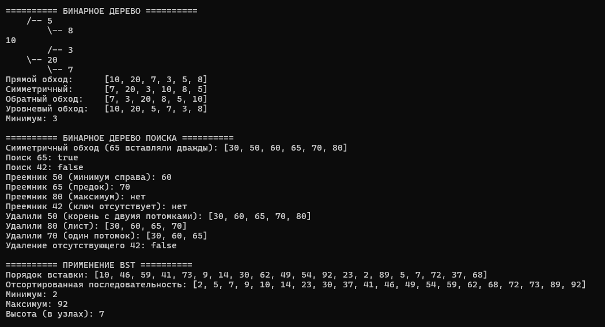
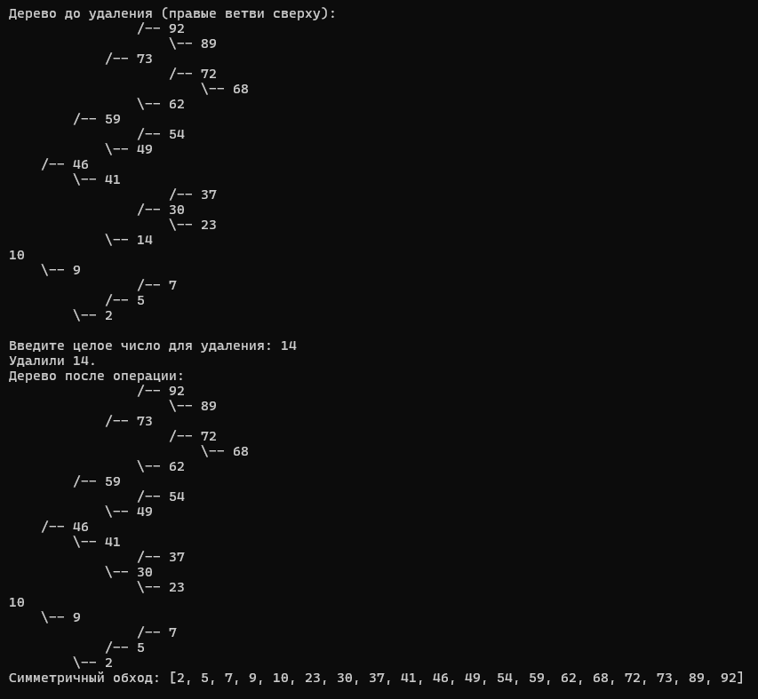

# Лабораторная работа №9

## Титульный лист

**Дисциплина** – Алгоритмы и структуры данных  
**Тема** – Бинарное дерево. Обходы. BST  
**Вариант** – 5  
**Студент** – Власенко Александр Андреевич  
**Группа** – ПИЖ-б-о-25-1  
**Год** – 2026

---

## 1. Цель работы

Изучить устройство бинарных деревьев, реализовать обходы в глубину и в ширину и найти минимум в обычном бинарном дереве. Освоить вставку, поиск, нахождение преемника и удаление в бинарном дереве поиска. На примере случайных данных показать работу BST и определить, как форма дерева влияет на сложность операций.

## 2. Теоретическая часть

### 2.1. Устройство бинарного дерева

Бинарное дерево – иерархическая структура, в которой у каждого узла может быть левый и правый ребёнок. Узел `Node` хранит целое число `data` и два указателя `left` и `right`. Дерево начинается с указателя `root`. Если `root == nullptr`, дерево пусто. Узел с двумя нулевыми указателями на потомков называется листом.

Уровень узла равен числу рёбер от корня до него. Корень находится на уровне 0. В программе высота считается в узлах на самом длинном пути от корня до листа. Высота пустого дерева равна 0, а высота листа – 1. Для каждого внутреннего узла берётся большая из высот дочерних поддеревьев и прибавляется 1.

### 2.2. Обходы и поиск минимума

Рекурсивный обход начинает работу с проверки на `nullptr`. Каждый вызов обрабатывает текущий узел и вызывает ту же функцию для его левого и правого поддеревьев. Вид обхода определяется местом, в котором обрабатывается текущий узел.

| Обход | Порядок обработки |
|---|---|
| Прямой, `preOrder` | Текущий узел → левое поддерево → правое поддерево |
| Симметричный, `inOrder` | Левое поддерево → текущий узел → правое поддерево |
| Обратный, `postOrder` | Левое поддерево → правое поддерево → текущий узел |
| Уровневый, `levelOrder` | По уровням от корня вниз, внутри каждого уровня слева направо |

Для уровневого обхода в очередь сначала добавляется корень. Затем из начала очереди извлекается очередной узел, а его дети помещаются в конец. Левый ребёнок добавляется первым, поэтому узлы одного уровня обрабатываются слева направо.

Минимум обычного бинарного дерева может находиться в любой ветви. В программе начальное значение минимума берётся из корня, затем обновляется при посещении каждого узла. Для пустого дерева функция возвращает пустой `std::optional<int>`. При уничтожении дерева используется обратный обход, чтобы освободить оба поддерева до удаления родительского узла.

### 2.3. Бинарное дерево поиска

Для каждого узла BST все ключи левого поддерева строго меньше его ключа, а все ключи правого – строго больше. Ограничение распространяется на всех потомков. В данной программе повторная вставка ключа сохраняет одну запись с этим ключом.

Поиск выбирает одно поддерево по результату сравнения и заканчивается при совпадении или достижении `nullptr`. Вставка следует по тому же пути до свободной позиции. Рекурсивная функция возвращает указатель на корень поддерева, а внешний вызов сохраняет его в `root`. Поэтому первая вставка создаёт корень, а последующие связывают новый узел с его родителем.

Симметричный обход BST выводит ключи по возрастанию. Минимум находится спуском по левым указателям от корня, а максимум – спуском по правым.

### 2.4. Преемник и удаление

Преемник существующего ключа – ближайший больший ключ в симметричном обходе. Если у узла есть правое поддерево, его преемник – минимум этого поддерева. Если правого поддерева нет, преемник – ближайший предок, в левом поддереве которого находится узел. При поиске от корня такого предка можно запоминать при каждом повороте влево. У максимального ключа преемника нет. В программе для максимального и отсутствующего ключей возвращается пустой результат.

При удалении BST рассматриваются три случая.

1. **Лист.** Узел освобождается. Указатель на него заменяется на `nullptr`.
2. **Один потомок.** Адрес потомка сохраняется перед `delete` и возвращается как новый корень поддерева. Таким образом, ветка сохраняет связь с родителем.
3. **Два потомка.** В текущий узел копируется ключ преемника, затем прежний узел преемника удаляется из правого поддерева. У него нет левого ребёнка, поскольку он был минимумом правого поддерева. Если есть правый ребёнок, он занимает освободившееся место.

Возвращаемый функцией удаления адрес записывается обратно в соответствующий указатель `left`, `right` или `root`. Это позволяет тем же алгоритмом удалять узлы внутри дерева и на его вершине.

## 3. Постановка задачи

1. Реализовать обычное бинарное дерево. Для варианта 5 выполнить прямой, симметричный и обратный обходы и найти минимальное значение. Уровневый обход включён для проверки четырёх видов обхода по общим критериям работы.
2. Реализовать в BST операции `insert`, `search` и `inOrder`. Найти преемника заданного ключа. Реализовать удаление и продемонстрировать все три случая.
3. Построить BST из 20 случайных чисел, вывести их в отсортированном порядке, найти минимум, максимум и высоту. Прочитать целое число с клавиатуры, удалить соответствующий узел и визуализировать результат.

Программа написана на C++20 и запускается в Visual Studio.

## 4. Листинг программы

```cpp
#include <algorithm>
#include <clocale>
#include <iostream>
#include <numeric>
#include <optional>
#include <queue>
#include <random>
#include <sstream>
#include <string>
#include <vector>

using namespace std;

struct Node {
    int data;
    Node* left = nullptr;
    Node* right = nullptr;

    explicit Node(int value) : data(value) {}
};

void collectInOrder(const Node* node, vector<int>& values) {
    if (node == nullptr)
        return;

    collectInOrder(node->left, values);
    values.push_back(node->data);
    collectInOrder(node->right, values);
}

void destroyTree(Node* node) {
    if (node == nullptr)
        return;

    destroyTree(node->left);
    destroyTree(node->right);
    delete node;
}

void printSideways(const Node* node, size_t depth, const char* branch) {
    if (node == nullptr)
        return;

    printSideways(node->right, depth + 1, "/-- ");
    cout << string(depth * 4, ' ') << branch << node->data << '\n';
    printSideways(node->left, depth + 1, "\\-- ");
}

class BinaryTree {
private:
    Node* root = nullptr;

    static void collectPreOrder(const Node* node, vector<int>& values) {
        if (node == nullptr)
            return;

        values.push_back(node->data);
        collectPreOrder(node->left, values);
        collectPreOrder(node->right, values);
    }

    static void collectPostOrder(const Node* node, vector<int>& values) {
        if (node == nullptr)
            return;

        collectPostOrder(node->left, values);
        collectPostOrder(node->right, values);
        values.push_back(node->data);
    }

    static void updateMin(const Node* node, int& result) {
        if (node == nullptr)
            return;

        result = min(result, node->data);
        updateMin(node->left, result);
        updateMin(node->right, result);
    }

public:
    BinaryTree() = default;
    BinaryTree(const BinaryTree&) = delete;
    BinaryTree& operator=(const BinaryTree&) = delete;

    ~BinaryTree() {
        destroyTree(root);
    }

    void buildSample() {
        destroyTree(root);
        root = nullptr;

        // В обычном дереве значения не обязаны быть упорядочены
        root = new Node(10);
        root->left = new Node(20);
        root->right = new Node(5);
        root->left->left = new Node(7);
        root->left->right = new Node(3);
        root->right->left = new Node(8);
    }

    vector<int> preOrder() const {
        vector<int> values;
        collectPreOrder(root, values);
        return values;
    }

    vector<int> inOrder() const {
        vector<int> values;
        collectInOrder(root, values);
        return values;
    }

    vector<int> postOrder() const {
        vector<int> values;
        collectPostOrder(root, values);
        return values;
    }

    vector<int> levelOrder() const {
        vector<int> values;
        if (root == nullptr)
            return values;

        queue<const Node*> pending;
        pending.push(root);
        while (!pending.empty()) {
            const Node* current = pending.front();
            pending.pop();
            values.push_back(current->data);

            if (current->left != nullptr)
                pending.push(current->left);
            if (current->right != nullptr)
                pending.push(current->right);
        }

        return values;
    }

    optional<int> minValue() const {
        if (root == nullptr)
            return nullopt;

        int result = root->data;
        updateMin(root, result);
        return result;
    }

    void printTree() const {
        if (root == nullptr)
            cout << "(пусто)\n";
        else
            printSideways(root, 0, "");
    }
};

class BST {
private:
    Node* root = nullptr;

    static Node* insert(Node* node, int key) {
        if (node == nullptr)
            return new Node(key);

        if (key < node->data)
            node->left = insert(node->left, key);
        else if (key > node->data)
            node->right = insert(node->right, key);

        return node;
    }

    static const Node* leftmost(const Node* node) {
        while (node->left != nullptr)
            node = node->left;
        return node;
    }

    static Node* remove(Node* node, int key, bool& removed) {
        if (node == nullptr)
            return nullptr;

        if (key < node->data)
            node->left = remove(node->left, key, removed);
        else if (key > node->data)
            node->right = remove(node->right, key, removed);
        else {
            removed = true;

            // Для листа вместо узла возвращается nullptr
            if (node->left == nullptr) {
                Node* child = node->right;
                delete node;
                return child;
            }
            if (node->right == nullptr) {
                Node* child = node->left;
                delete node;
                return child;
            }

            // Копируем ключ преемника и удаляем его старый узел
            int nextKey = leftmost(node->right)->data;
            node->data = nextKey;
            node->right = remove(node->right, nextKey, removed);
        }

        return node;
    }

    static int height(const Node* node) {
        if (node == nullptr)
            return 0;
        return 1 + max(height(node->left), height(node->right));
    }

public:
    BST() = default;
    BST(const BST&) = delete;
    BST& operator=(const BST&) = delete;

    ~BST() {
        destroyTree(root);
    }

    void insert(int key) {
        root = insert(root, key);
    }

    bool search(int key) const {
        const Node* current = root;
        while (current != nullptr) {
            if (key == current->data)
                return true;

            if (key < current->data)
                current = current->left;
            else
                current = current->right;
        }
        return false;
    }

    optional<int> successor(int key) const {
        const Node* current = root;
        const Node* candidate = nullptr;

        while (current != nullptr && current->data != key) {
            if (key < current->data) {
                candidate = current;
                current = current->left;
            }
            else
                current = current->right;
        }

        if (current == nullptr)
            return nullopt;
        if (current->right != nullptr)
            return leftmost(current->right)->data;
        if (candidate != nullptr)
            return candidate->data;
        return nullopt;
    }

    bool remove(int key) {
        bool removed = false;
        root = remove(root, key, removed);
        return removed;
    }

    vector<int> inOrder() const {
        vector<int> values;
        collectInOrder(root, values);
        return values;
    }

    optional<int> minValue() const {
        if (root == nullptr)
            return nullopt;
        return leftmost(root)->data;
    }

    optional<int> maxValue() const {
        if (root == nullptr)
            return nullopt;

        const Node* current = root;
        while (current->right != nullptr)
            current = current->right;
        return current->data;
    }

    int height() const {
        return height(root);
    }

    void printTree() const {
        if (root == nullptr)
            cout << "(пусто)\n";
        else
            printSideways(root, 0, "");
    }
};

void printValues(const vector<int>& values) {
    cout << '[';
    for (size_t i = 0; i < values.size(); i++) {
        if (i != 0)
            cout << ", ";
        cout << values[i];
    }
    cout << "]\n";
}

void printValue(optional<int> value) {
    if (value.has_value())
        cout << *value << '\n';
    else
        cout << "нет\n";
}

void showBinaryTree() {
    cout << "========== БИНАРНОЕ ДЕРЕВО ==========\n";
    BinaryTree tree;
    tree.buildSample();
    tree.printTree();

    cout << "Прямой обход:      ";
    printValues(tree.preOrder());
    cout << "Симметричный:      ";
    printValues(tree.inOrder());
    cout << "Обратный обход:    ";
    printValues(tree.postOrder());
    cout << "Уровневый обход:   ";
    printValues(tree.levelOrder());
    cout << "Минимум: ";
    printValue(tree.minValue());
}

void showBST() {
    cout << "\n========== БИНАРНОЕ ДЕРЕВО ПОИСКА ==========\n";
    BST tree;
    for (int key : {50, 30, 70, 60, 80, 65, 65})
        tree.insert(key);

    cout << "Симметричный обход (65 вставляли дважды): ";
    printValues(tree.inOrder());
    cout << "Поиск 65: " << tree.search(65) << '\n';
    cout << "Поиск 42: " << tree.search(42) << '\n';
    cout << "Преемник 50 (минимум справа): ";
    printValue(tree.successor(50));
    cout << "Преемник 65 (предок): ";
    printValue(tree.successor(65));
    cout << "Преемник 80 (максимум): ";
    printValue(tree.successor(80));
    cout << "Преемник 42 (ключ отсутствует): ";
    printValue(tree.successor(42));

    tree.remove(50);
    cout << "Удалили 50 (корень с двумя потомками): ";
    printValues(tree.inOrder());
    tree.remove(80);
    cout << "Удалили 80 (лист): ";
    printValues(tree.inOrder());
    tree.remove(70);
    cout << "Удалили 70 (один потомок): ";
    printValues(tree.inOrder());
    cout << "Удаление отсутствующего 42: " << tree.remove(42) << '\n';
}

void showRandomBST() {
    cout << "\n========== ПРИМЕНЕНИЕ BST ==========\n";
    const int count = 20;
    vector<int> numbers(99);
    iota(numbers.begin(), numbers.end(), 1);
    mt19937 generator(42);
    shuffle(numbers.begin(), numbers.end(), generator);
    numbers.resize(count);

    BST tree;
    for (int key : numbers)
        tree.insert(key);

    cout << "Порядок вставки: ";
    printValues(numbers);
    cout << "Отсортированная последовательность: ";
    printValues(tree.inOrder());
    cout << "Минимум: ";
    printValue(tree.minValue());
    cout << "Максимум: ";
    printValue(tree.maxValue());
    cout << "Высота (в узлах): " << tree.height() << '\n';
    cout << "\nДерево до удаления (правые ветви сверху):\n";
    tree.printTree();

    cout << "\nВведите целое число для удаления: ";
    string line;
    if (!getline(cin, line)) {
        cout << "\nВвод завершён.\n";
        return;
    }

    istringstream input(line);
    int key;
    char extra;
    if (!(input >> key) || (input >> extra)) {
        cout << "Ожидалось одно целое число.\n";
        return;
    }

    if (tree.remove(key))
        cout << "Удалили " << key << ".\n";
    else
        cout << "Ключ " << key << " не найден.\n";

    cout << "Дерево после операции:\n";
    tree.printTree();
    cout << "Симметричный обход: ";
    printValues(tree.inOrder());
}

int main() {
    setlocale(LC_ALL, "");
    cout << boolalpha;

    showBinaryTree();
    showBST();
    showRandomBST();

    return 0;
}
```

## 5. Результаты работы

### 5.1. Обходы и операции BST



| Обход обычного дерева | Полученный порядок |
|---|---|
| Прямой | `[10, 20, 7, 3, 5, 8]` |
| Симметричный | `[7, 20, 3, 10, 8, 5]` |
| Обратный | `[7, 3, 20, 8, 5, 10]` |
| Уровневый | `[10, 20, 5, 7, 3, 8]` |

Минимум обычного дерева равен 3. После вставки в BST получена последовательность `[30, 50, 60, 65, 70, 80]`. Ключ 65 был передан на вставку дважды и присутствует в дереве один раз. Поиск 65 завершился успешно, а поиск 42 вернул `false`. Преемником 50 стал минимум его правого поддерева 60, а преемником 65 – предок 70. Для максимума 80 и отсутствующего ключа 42 программа вывела «нет».

| Операция | Симметричный обход после удаления |
|---|---|
| Удаление корня 50 с двумя потомками | `[30, 60, 65, 70, 80]` |
| Удаление листа 80 | `[30, 60, 65, 70]` |
| Удаление узла 70 с одним потомком | `[30, 60, 65]` |

Попытка удалить отсутствующий ключ 42 вернула `false`.

### 5.2. Применение BST и визуализация

Программа перемешивает числа от 1 до 99 генератором `mt19937` с начальным значением 42 и выбирает первые 20. Так в демонстрации используются 20 различных ключей. На первом снимке корень построенного дерева – 10, минимум – 2, максимум – 92, высота – 7 узлов.



Дерево выведено боком. Корень расположен у левого края, правые ветви печатаются выше родителя и помечаются `/--`, левые печатаются ниже и помечаются `\--`. Отступ увеличивается с глубиной узла.

Пользователь ввёл 14. Этот узел был левым ребёнком 41 и имел одного правого ребёнка 30. После удаления указатель `left` узла 41 указывает на 30. Оба поддерева узла 30, с ключами 23 и 37, входят в итоговое дерево. Симметричный обход выводит 19 ключей по возрастанию:

```text
[2, 5, 7, 9, 10, 23, 30, 37, 41, 46, 49, 54, 59, 62, 68, 72, 73, 89, 92]
```

### 5.3. Проверка программы

Программа собрана и запущена в Visual Studio 2022, C++20, Debug x64, с параметрами `/utf-8` и `/W4 /WX`. В дополнительных тестах проверены пустые деревья, один узел, дубликаты, предельные значения `int`, оба способа нахождения преемника и все случаи удаления. Случайные последовательности операций сверены с `std::set`. Всего прошло 67 670 проверок. В проверенных сценариях Debug CRT не обнаружил оставшихся выделений памяти. Ввод проверен для существующего и отсутствующего ключей, некорректной строки и конца потока.

## 6. Анализ сложности

Пусть `n` – число узлов, `h` – высота дерева, `w` – число узлов на самом широком уровне. В таблице рабочая память указана без учёта хранения дерева и возвращаемой последовательности обхода.

| Операция | Время | Рабочая память |
|---|---|---|
| Прямой, симметричный и обратный обходы | `O(n)` | `O(h)` на стек |
| Уровневый обход | `O(n)` | `O(w)` на очередь |
| Минимум обычного дерева, высота, освобождение узлов | `O(n)` | `O(h)` на стек |
| Поиск, преемник, минимум и максимум в BST | `O(h)` | `O(1)`, обход ветвей выполняется циклом |
| Вставка и удаление в BST | `O(h)` | `O(h)` на стек |

Хранение узлов требует `O(n)` памяти. Возвращаемый вектор обхода также занимает `O(n)`. При удалении узла с двумя детьми переход к минимуму правого поддерева и удаление старого узла преемника дают суммарно `O(h)` времени. Консольная визуализация посещает каждый узел один раз, а число печатаемых пробелов зависит от суммарной глубины узлов.

На сбалансированном BST высота порядка `log n`. Операции по одной ветви в таком дереве имеют сложность `O(log n)`. При последовательной вставке возрастающих ключей обычное BST превращается в цепочку высоты `n`, и те же операции могут занимать `O(n)`. Для дерева из 20 ключей в демонстрации высота равна 7, а при вставке тех же ключей в возрастающем порядке она составила бы 20.

## 7. Ответы на контрольные вопросы

**1. Что такое бинарное дерево? Из каких элементов оно состоит? –** Бинарное дерево состоит из узлов, у каждого из которых может быть левый и правый ребёнок. Доступ начинается с корня. Внутренний узел имеет хотя бы одного ребёнка, а лист не имеет детей. Дочерний узел вместе со своими потомками образует поддерево.

**2. В чём отличие бинарного дерева от бинарного дерева поиска (BST)? –** Бинарное дерево задаёт структуру связей, где у узла не больше двух детей. BST дополнительно упорядочивает ключи. Для любого узла все значения слева меньше его ключа, а все значения справа больше. Это правило позволяет при поиске выбирать одну ветвь.

**3. Какие существуют виды обхода бинарного дерева? В чём их особенности? –** При прямом обходе сначала посещают узел, затем левое и правое поддеревья. При симметричном – левое поддерево, узел и правое поддерево. При обратном узел обрабатывается после обоих поддеревьев. Эти три обхода идут в глубину. Уровневый обход идёт в ширину и посещает узлы каждого уровня слева направо.

**4. Какой обход даёт отсортированную последовательность для BST? –** Симметричный `inOrder`. Он сначала посещает все меньшие ключи из левого поддерева, затем текущий ключ, затем все большие из правого. То же правило применяется рекурсивно к каждому поддереву.

**5. Какова сложность операций поиска, вставки и удаления в BST? От чего она зависит? –** Все три операции занимают `O(h)` времени, где `h` – высота дерева. Даже при удалении с двумя потомками поиск и перенос преемника выполняются вдоль ветвей. При высоте порядка `log n` операции имеют сложность `O(log n)`. Для вырожденного дерева с высотой `n` худший случай – `O(n)`.

**6. Что происходит с BST, если вставлять элементы в отсортированном порядке? –** При вставке различных ключей по возрастанию каждый следующий ключ становится правым ребёнком предыдущего. При вставке по убыванию образуется цепочка левых детей. Высота в обоих случаях становится равной числу узлов, и поиск крайнего ключа требует линейного числа шагов.

**7. Какие три случая нужно рассмотреть при удалении узла из BST? –** Лист освобождается, а ведущая к нему ссылка получает `nullptr`. При одном потомке ведущая ссылка переключается на него. При двух потомках можно скопировать ключ преемника из правого поддерева в удаляемый узел, а затем удалить прежний узел преемника. У него может быть только правый ребёнок, который при удалении занимает его позицию.

**8. Как найти наименьший элемент в BST? Наибольший? –** Для минимума нужно идти от корня по указателям `left` до первого узла без левого ребёнка. Для максимума аналогично выполняется спуск по `right`. Если корень пуст, ни один результат не существует. Время каждого спуска – `O(h)`.

**9. Как вычислить высоту бинарного дерева рекурсивно? –** Для пустого узла вернуть 0. Для остальных узлов рекурсивно найти высоты обоих поддеревьев, выбрать большую и прибавить 1 за сам узел. При таком определении высота листа равна 1. Функция посещает каждый узел один раз.

**10. Что такое наименьший общий предок (LCA) двух узлов в дереве? –** Это самый глубокий узел, в поддереве которого находятся оба заданных узла. Один из заданных узлов может сам быть их общим предком. В BST для существующих ключей можно спускаться влево, пока оба ключа меньше текущего, и вправо, пока оба больше. Первый узел, на котором пути расходятся или один из ключей совпадает с текущим, будет ответом.

**11. Как проверить, является ли бинарное дерево BST? –** При обходе нужно передавать допустимый диапазон ключей. Для левого поддерева верхней границей становится текущий ключ, для правого он становится нижней границей. В каждом узле проверяется строгое попадание в диапазон, полученный от предков. Так проверяются и связи между соседними узлами, и ограничения на более глубоких потомков.

**12. Что такое сбалансированное дерево? Почему это важно для производительности? –** В дереве, сбалансированном по высоте, высоты левого и правого поддеревьев каждого узла отличаются не более чем на единицу. Это удерживает общую высоту порядка `log n`. Поскольку поиск, вставка и удаление идут вдоль ветвей, малая высота ограничивает число шагов.

**13. Как преобразовать несбалансированное BST в сбалансированное? –** Выполнить симметричный обход и записать ключи в отсортированный массив. Средний элемент назначить корнем нового дерева. Из левой половины тем же способом построить левое поддерево, из правой – правое. Если узлы связываются непосредственно во время рекурсии, обход и построение вместе требуют `O(n)` времени.

**14. Как восстановить дерево по массиву обхода (in-order + pre-order)? –** При различных ключах первый элемент прямого обхода задаёт корень. Его позиция в симметричном обходе делит последовательность на левое и правое поддеревья. По длине левой части можно отделить соответствующие элементы прямого обхода. Для обеих частей повторяется та же процедура. Пустая часть означает отсутствие потомка.

**15. Как реализовать итеративный (не рекурсивный) обход бинарного дерева? –** Для симметричного обхода можно хранить явно в стеке узлы, к которым надо вернуться после левого поддерева. Сначала выполняется спуск влево с добавлением узлов в стек. Когда спуск заканчивается, последний узел извлекается, обрабатывается и начинается обход его правой ветви.

```cpp
std::stack<const Node*> pending;
const Node* current = root;

while (current != nullptr || !pending.empty()) {
    while (current != nullptr) {
        pending.push(current);
        current = current->left;
    }

    current = pending.top();
    pending.pop();
    std::cout << current->data << ' ';
    current = current->right;
}
```

## 8. Выводы

Реализованы четыре обхода обычного бинарного дерева и поиск его минимума. В BST проверены вставка, поиск, симметричный обход, нахождение преемника и все три случая удаления. Пример с ключом 14 показал, как при удалении узла с одним потомком указатель родителя переключается на дочерний узел. Итоговый симметричный обход подтвердил сохранение порядка ключей.

Сложность операций BST определяется высотой дерева. В демонстрации дерево из 20 случайно выбранных ключей имело высоту 7 узлов. Последовательная вставка тех же ключей по возрастанию образовала бы цепочку из 20 узлов. Поэтому порядок вставки влияет на длину пути при поиске, вставке и удалении.

## 9. Ссылка на Git-репозиторий

[Репозиторий student-dsa-course](https://github.com/lostmoth/student-dsa-course)
